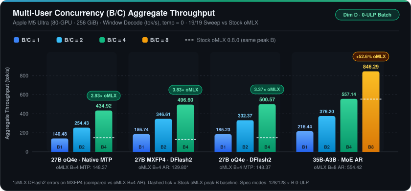

<p align="center"></p>

<h1 align="center">ninfer-metal</h1>

<p align="center">
  <strong>Native Metal 4 NAX &amp; Compute ICB LLM inference engine for Apple M5+ (v1 core codename <code>miv</code>)</strong>
</p>

<!-- Replace scoltzero/ninfer-metal with final GitHub slug if changed -->
<p align="center">
  <a href="https://github.com/scoltzero/ninfer-metal/stargazers"></a>
  <a href="https://github.com/scoltzero/ninfer-metal/releases"></a>
  <a href="docs/releases/miv-v0.01-changelog.md"></a>
  
  
  <a href="LICENSE"></a>
</p>

<div align="center">

**English** | [简体中文](docs/i18n/zh-CN/README.md) | [繁體中文](docs/i18n/zh-TW/README.md) | [日本語](docs/i18n/ja/README.md) | [한국어](docs/i18n/ko/README.md) | [Español](docs/i18n/es/README.md) | [Français](docs/i18n/fr/README.md) | [Deutsch](docs/i18n/de/README.md)

</div>

---

**`ninfer-metal`** is a pure C++20 / Objective-C++ / Metal 4 inference engine targeting Apple Silicon with hardware **Neural Accelerators (NAX)** and **Compute ICB** (`M5 / M5 Pro / M5 Max / M5 Ultra`, `MTLGPUFamilyApple10+`, `macOS 27+`).

- **Zero Python, zero MLX**: Ships 16 Mach-O binaries (including native `ninfer-metal-serve` and `mseries_backendd`) and 38 precompiled `.metallib` shaders linked solely against macOS system frameworks — runs on clean Macs without Xcode, Python, or Homebrew dylibs.
- **Standalone OpenAI server (`ninfer-metal-serve`)**: Single C++20 binary hosting in-process `miv` and parallel Path B SPI v2 microkernels on one HTTP/SSE port (`/v1/chat/completions`, `/v1/completions`, `/v1/models`, `/health`, `/metrics`), with C++ BPE tokenizer, Jinja chat templates, `<think>` `reasoning_content` split, and Qwen XML/JSON `<tool_call>` parsing — ready for Open WebUI, Cursor, Cline, NewAPI, and OpenAI SDKs.
- **Single-copy NAX weights & `0-ULP` parity**: Offline NAX pre-tiling (`.omlxm5`) feeds Prefill, `T=1` AR decode, and speculative verify from one resident weight copy (`1.0×` artifact size). Baseline **`miv-v0.01`** runs Qwen3.5 / Qwen3.6 / Qwen3.8 hybrid models (Dense 27B & 35B-A3B MoE) across `MXFP4` and `oQ` Affine (`q3–q8`) with `affine4_g128` KV cache, Native MTP / DFlash2, multi-user batching (`B/C = 1..8`), and rolling UMA prefix reuse.
- **Drop-in `oMLX-extend` coexistence**: Bundles `oMLX-extend` (`omlx-extend-v0.8.3` over `jundot/omlx`) exposing **`miv Core Backend`** via an AF_UNIX Provider SPI v2 sidecar — adapted `.omlxm5` models route automatically in O(1), unadapted models stay on Stock MLX untouched, and sidecar + MLX models share UMA under one memory cap.

---

## Performance at a Glance




Measured on physical Apple M5 Ultra (`80-GPU / 256 GiB` and `64-GPU / 96 GiB`) against stock `oMLX 0.8.0` (`mlx 0.32.4`, NAX enabled) in clean subprocesses with `0-ULP` greedy parity. All four charts and Dim A–F figures are in **[`miv-v0.01` Release Notes](docs/releases/miv-v0.01-changelog.md)**.

---

## Supported Models & Microkernels

| Model Family | Quantization | Microkernel | Mode | Credit / Source |
|---|---|---|---|---|
| **Qwen3.5 / 3.6 / 3.8 Dense** (0.8B – 27B, 3:1 GDN+GQA) | `MXFP4`, `oQ4e` | `miv-v0.01` | Path A (Mainline) | `ninfer-metal` core |
| **Qwen3.5 / 3.6 Hybrid MoE** (256×8 + shared, e.g. 35B-A3B) | `MXFP4`, `oQ4e` | `miv-v0.01` | Path A (Mainline) | `ninfer-metal` core |
| *Llama, Qwen3 (Pure-Attn), DeepSeek MLA, Gemma, GLM, MiniMax, ...* | *Open* | *Call for PRs* | Path A / Path B | **[Join Microkernel Foundry →](docs/microkernel-foundry.md)** |

Contributors and coding agents can expand this roster through **[Microkernel Foundry](docs/microkernel-foundry.md)**:

- **Path A (Mainline PR)**: Merge directly into `ninfer-metal`'s shared Metal 4 NAX substrate — listed here with **contributor credit**.
- **Path B (Parallel Sidecar)**: Open a PR or Issue once ready — we add it to [`omlx-extend/registry/microkernels.json`](omlx-extend/registry/microkernels.json) (`sync_microkernels.sh`) and list it here with a **link to your original repository**. Both `oMLX-extend` and standalone `ninfer-metal-serve --providers-dir` natively discover `Providers/*/current/provider.json` and run Path B microkernels in parallel alongside `miv` (and stock MLX in `oMLX-extend`).

---

## Quick Start

Build the zero-MLX `miv/` core (`macOS 27+`, `Xcode 27+`):

```bash
export DEVELOPER_DIR=/Applications/Xcode.app/Contents/Developer
cmake -S . -B build/miv-v001 -G Ninja -DCMAKE_BUILD_TYPE=Release -DOMLX_M5_BUILD_NAX_METALLIB=ON -DOMLX_M5_BUILD_MLX_LEGACY_SMOKE=OFF -DOMLX_M5_BUILD_PYTHON=OFF
cmake --build build/miv-v001
```

Launch the standalone C++ OpenAI server in one command (auto-loads shared defaults from [`omlx-extend/config/ninfer-metal.toml`](omlx-extend/config/ninfer-metal.toml), reused by `oMLX-extend`) or verify the `oMLX-extend` sidecar layer:

```bash
./omlx-extend/scripts/start_ninfer_serve.sh /path/to/Qwen3.8-27B
./omlx-extend/scripts/apply_spi_patch.sh --omlx-dir ./omlx --test
```

Full build flags, `.omlxm5` weight conversion, multi-microkernel `ninfer-metal-serve --providers-dir` / `[[models]]` configs, and `oMLX-extend` hot-update instructions are in **[Getting Started & Config](docs/getting-started.md)**; for a screenshot walkthrough of the macOS app, see **[`oMLX-extend` Visual Guide](docs/omlx-extend-guide.md)**.

---

## Explore Further

| Guide | What You Will Find |
|---|---|
| **[`oMLX-extend` Visual Guide](docs/omlx-extend-guide.md)** | 5-step screenshot walkthrough of `oMLX` on macOS: microkernel cards, active engine badges, auto-routing / Stock MLX toggle, MTP / DFlash2 & 4-bit KVQuant, and 1-click shared config |
| **[Getting Started & Config](docs/getting-started.md)** | Prerequisites, zero-MLX CMake build, 1-click `start_ninfer_serve.sh`, `ninfer-metal-serve` standalone server, `oMLX-extend` sidecar setup, `ninfer-metal.toml`, and low-level CLI/daemon usage |
| **[Architecture & Coexistence](docs/architecture.md)** | Dual-mode `miv/` core (`ninfer-metal-serve` + `mseries_backendd`), Provider SPI v2, O(1) auto-routing, UMA memory coordination, and atomic symlink hot-update |
| **[Microkernel Foundry](docs/microkernel-foundry.md)** | Open call for new M5+ model-family microkernels (Llama, DeepSeek, Gemma, GLM, MiniMax) using the Silicon-Squeeze Skill |
| **[Release Notes (`miv-v0.01`)](docs/releases/miv-v0.01-changelog.md)** | Visual Dim A–F benchmark charts, `ninfer-metal-serve` & `oMLX-extend` changes, test & `otool -L` audit results, and supported scope |
| **[Roadmap](docs/roadmap/README.md)** | Planned milestones beyond `miv-v0.01` |
| **[Documentation Index](docs/README.md)** | Full 8-language doc mirror, hardware guides, SKU calibrations (`64-GPU` / `80-GPU`), backend specs, and certification standards |

---

## Acknowledgments

- **[`jundot/omlx`](https://github.com/jundot/omlx)** — Upstream oMLX inference server and macOS app extended via `oMLX-extend`.
- **[`Neroued/ninfer`](https://github.com/Neroued/ninfer)** — Reference native inference engine for explicit memory ownership and deterministic scheduling.
- **[`z-lab/dflash`](https://github.com/z-lab/dflash)** & **[`bstnxbt/dflash-mlx`](https://github.com/bstnxbt/dflash-mlx)** — DFlash / DFlash2 block-diffusion speculative decoding architecture and Apple Silicon draft model ecosystem.
- **[`SqueezeAILab/KVQuant`](https://github.com/SqueezeAILab/KVQuant)** & **[`FutureMLS-Lab/FOSCAR`](https://github.com/FutureMLS-Lab/FOSCAR)** — Low-bit KV cache quantization research and affine-folding decode attention behind `miv`'s `affine4_g128` Metal 4 NAX kernels.
- **[`p-e-w/heretic`](https://github.com/p-e-w/heretic)** & **[`scoltzero/heretic-mlx`](https://github.com/scoltzero/heretic-mlx)** — Upstream Heretic training-free language model modification framework and its native Apple Silicon MLX port and community quantized weights.
