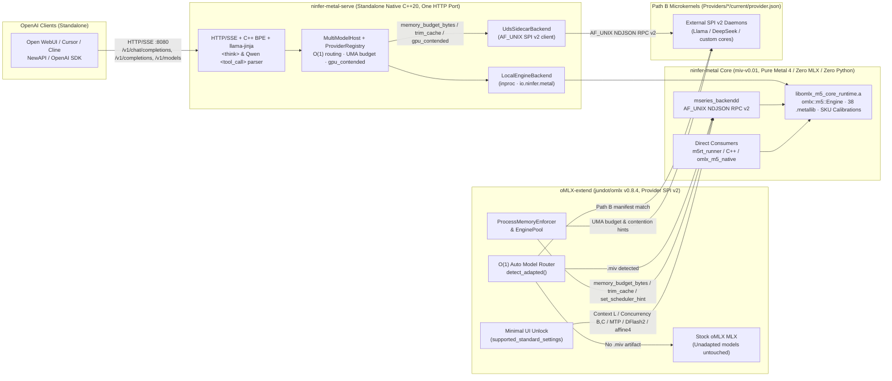

**English** | [简体中文](i18n/zh-CN/architecture.md) | [繁體中文](i18n/zh-TW/architecture.md) | [日本語](i18n/ja/architecture.md) | [한국어](i18n/ko/architecture.md) | [Español](i18n/es/architecture.md) | [Français](i18n/fr/architecture.md) | [Deutsch](i18n/de/architecture.md)

# Architecture & Multi-Model Coexistence

`ninfer-metal` runs in two deployment modes over one pure C++20 / Objective-C++ / Metal 4 core (`miv/`, static runtime `libomlx_m5_core_runtime.a`): a standalone native C++ OpenAI server (`ninfer-metal-serve`) that hosts both in-process `miv` and parallel Path B SPI v2 microkernels on one HTTP port, and an `oMLX-extend` Provider SPI v2 sidecar (`mseries_backendd`).

---

## Dual-Mode System Topology

---

## 1. Standalone Native C++ Server (`ninfer-metal-serve`)

`ninfer-metal-serve` ships as a single Mach-O binary with zero Python and zero MLX runtime dependencies. On one HTTP port, it hosts both in-process `miv` models (`LocalEngineBackend`) and parallel Path B SPI v2 sidecar microkernels (`UdsSidecarBackend`):

- **Multi-microkernel hosting & UMA coordination**: `ProviderRegistry` scans `--providers-dir`, TOML `[server].providers_dir`, `$OMLX_PROVIDERS_DIR`, and `~/Library/Application Support/oMLX/Providers` for `<dir>/*/current/provider.json` and resolves each model in O(1) without hijacking other providers. `MultiModelHost` tracks resident footprints against a unified UMA cap (`--memory-budget-gb` or 81% of `sysctl hw.memsize`), trims idle caches (`trim_cache`) under pressure, and sends `set_scheduler_hint(gpu_contended=true/false)` as concurrent inference across models starts and ends.
- **HTTP/SSE transport & config**: POSIX `cpp-httplib` server (`GET /health` with `models[]`, `gpu_contended`, `memory_budget_bytes`; `GET /metrics` with aggregate + per-model `model`/`provider`/`backend_mode` series; `GET /v1/models` and `GET /v1/models/:id` exposing `provider_id`/`backend_mode`; `POST /v1/chat/completions` and `POST /v1/completions` routed by JSON `"model"`, optional Bearer auth, CORS) configured by `ninfer-metal.toml` (`tomlplusplus`, including `[[models]]`) with CLI flag overrides.
- **Native tokenization & templates**: Pure C++ BPE tokenizer (`utf8proc`, loading HuggingFace `tokenizer.json` directly including `LetterDigit1` for Qwen3.8) paired with `llama-jinja` chat template rendering (`--chat-template` -> `model_dir/chat_template.jinja` -> `tokenizer_config.json` -> ChatML fallback).
- **Streaming reasoning & tool parsing**: Incremental UTF-8 holdback parser splits `<think>...</think>` into `reasoning_content` and extracts both Qwen3.5/3.8 XML (`<tool_call><function=...><parameter=...>`) and Qwen3 JSON (`<tool_call>{...}`) calls in sync and SSE streaming responses.
- **Coexistence by default**: Listens on port `8080` by default (disjoint from oMLX's port `8000`) and auto-loads the same zero-edit default [`omlx-extend/config/ninfer-metal.toml`](../omlx-extend/config/ninfer-metal.toml) reused by `oMLX-extend`.

---

## 2. O(1) Auto Model Routing (`oMLX-extend`)

`oMLX-extend` inspects each model directory with `detect_adapted(model_dir)` in `< 1 ms` using filesystem checks (`model.miv`, legacy `model.omlxm5`, `model_pack.json`, `omlxm5-manifest.json`) with zero subprocess spawn:

- **Adapted models**: Route lazily to **`miv Core Backend`** (`mseries_backendd`) on first request (or when pinned), showing **`miv Core Backend (Auto)`** in `Model Settings → Advanced Settings`. Flipping **`Use External Engine`** off writes `external_engine: "stock"` and opts the model back into Stock MLX.
- **Unadapted models**: Run unmodified through Stock MLX (`BatchedEngine` / `VLMBatchedEngine`) with zero sidecar processes, zero extra memory, and zero performance change.

---

## 3. Provider SPI v2 & UMA Coexistence

When multiple engines run on the same Apple Silicon machine — either sidecar microkernels alongside stock MLX under `oMLX-extend`, or in-process `miv` alongside Path B sidecars under `ninfer-metal-serve` — they share one Unified Memory (UMA) pool and one GPU queue. Protocol v2 coordinates both hosts explicitly:

- **Hard memory cap (`memory_budget_bytes`)**: `ProcessMemoryEnforcer` computes each model's remaining ceiling inside the host budget and sends `memory_budget_bytes` in the `load` RPC. `native_backend.cpp` clamps weight pools, `KvPagePool`, and prefix caches to `min(W_ws - cur_alloc, memory_budget_bytes - cur_alloc)`.
- **Soft-pressure cache trim (`trim_cache`)**: Before evicting a resident model, `oMLX-extend` calls `trim_cache(target_free_bytes)`. `miv/` evicts unpinned prefix entries and `UmaCheckpointPool` slabs within `<= 100 ms` and detaches freed `MTLBuffer` objects from `MTLResidencySet` so macOS reclaims wired pages immediately.
- **GPU contention hints (`set_scheduler_hint`)**: When both an in-process MLX model and a sidecar model execute concurrently, `EnginePool` sends `gpu_contended: true`. Long prefills drop into bounded `64`-token page-aligned chunks so co-running decode streams hold steady inter-token latency.
- **Clean process teardown**: Every loaded model runs in an isolated child process with its own `MTLDevice`, `MTL4CommandQueue`, and per-instance `AF_UNIX` socket (`/tmp/omlx-<provider>-<uid>/...`, zero TCP ports). On `stop()`, the host drains the process group and verifies `process_memory_bytes() == 0` before loading another model.

### Minimal UI & Config Split

`oMLX-extend` adds zero custom settings forms to the oMLX dashboard or macOS app (`omlx-mac`). Instead, **`Integrations → External Engines`** displays installed **`miv Core Backend (ninfer-metal)`** and Path B microkernel cards above Splash, **`Models`** shows active engine badges beside `Loaded` and on library rows, and `provider.json` + the `hello` handshake publish `supported_standard_settings` to unlock stock controls per capability (`max_context_window`, `mtp_*`, `dflash_*`, `turboquant_kv_enabled` + `affine4 -> affine4_g128`). Other providers such as `Splash` keep exact upstream lock behavior. Core-specific knobs (`rolling_prefix_cache`, `prefix_cache_gb`, per-model `max_concurrency` overrides, `sampling_contract`) live in the shared zero-edit [`omlx-extend/config/ninfer-metal.toml`](../omlx-extend/config/ninfer-metal.toml). See **[`oMLX-extend` Visual Guide](omlx-extend-guide.md)** for screenshots of every screen.

---

## 4. Metal 4 Engine Design (`miv/`)

- **Single pre-tiled weight copy**: Offline `.miv` conversion (`mx_nax_tiled_bk128_v1` / `oq_nax_tiled_g64_v1`) serves wide `64×64` Prefill NAX, `T=1` QMV decode, and `BM=8/16/32` speculative verify from one resident allocation (`1.0×` artifact footprint vs `~1.92×` for online re-tiling).
- **Safe Compute ICB recording**: All indirect buffer segments stay strictly below `2 GiB` (`< 1 GiB` for auxiliary compact caches) to prevent 32-bit hardware offset wraparound. Double-buffered `ar_pipe_[2]` command allocators overlap host encoding with GPU execution.
- **Paged CoW KV & UMA continuation**: `KvPagePool` manages `64`-token reference-counted pages (`bf16` and `0-ULP` `affine4_g128` at `0.5625 B/val`). `QwenUmaContinuation` snapshots and restores 48-layer GDN state (`146.81 MiB`) in a single GPU command buffer (`0.22–1.62 ms`, zero CPU `memcpy`), and `rolling_prefix_cache` supersedes unpinned ancestors in place (`1×` slab reuse).
- **Strict SKU calibration isolation**: `silicon_tuning.h` loads per-SKU profiles (`apple-m5-ultra-64gpu.json`, `apple-m5-ultra-80gpu.json`) keyed by exact `profile_id` and falls back to parameterized priors on unmeasured chips — never applying one SKU's measured constants to another.

---

## 5. Monorepo Dual-Track CI & Atomic Hot-Update

Both tracks live in one repository with independent release tags and workflows:

| Track | Path | Tag Pattern | Workflow |
|---|---|---|---|
| **Inference Core** | `miv/` | `miv-v0.01` (`<codename>-vX.YZ`) | [`.github/workflows/release-ninfer-metal.yml`](../.github/workflows/release-ninfer-metal.yml) |
| **Host Extension** | `omlx/` + `omlx-extend/` | `omlx-extend-vX.Y.Z` / `omlx-extend-vX.Y.Z-mixN` | [`.github/workflows/sync-omlx-extend.yml`](../.github/workflows/sync-omlx-extend.yml) |

Core tarballs install side-by-side under `~/Library/Application Support/oMLX/Providers/io.ninfer.metal/versions/<tag>/` and activate by atomically flipping the `current` symlink — allowing upgrades and single-command rollbacks without modifying oMLX's Python environment.

---

## Deep-Dive References

- [Porting Architecture v2](backend/ninfer-m5-porting-architecture-v2.md)
- [`.miv` Artifact Format v1](backend/artifact-format-v1.md) & [Dispatch Contract v1](backend/dispatch-contract-v1.md)
- [Hardware & Software Boundaries v1](foundations/hardware-software-boundaries-v1.md)
- [Core Certification Standard](standards/core-certification-standard.md)
