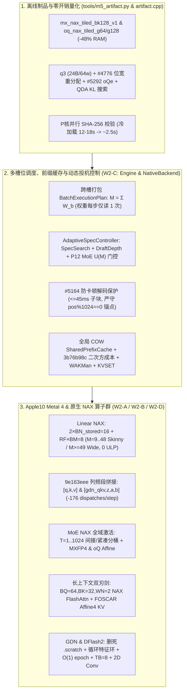

# NInfer (`ebdc67e5`) → Apple M5 系列 (`m5rt`) 原理映射与全量移植架构规范 v2

> **文档状态**：`v2.1`（已完成 `v0.8.0-m5rt.4` 真机闭环验证：融合上游 `ninfer` `ebdc67e5` `+522` commits、`omlx` `fbea0364` 周报 Top-5 PR、TensorFold `cb2ebf05`、Ponytail 全库去债，以及 **Apple M5 Ultra 64 核 GPU / 96 GiB** 真机 `24 MHz` Metal 4 硬件计数器与全量 H2 实测结果）
> **配套基准与审计源**：
> - 上游差距与 Roofline 矩阵：[`docs/versions/v0.8.0-m5rt.4-full-ninfer-squeeze-64gpu/audits/ninfer-latest-audit-and-gap-matrix.md`](../versions/v0.8.0-m5rt.4-full-ninfer-squeeze-64gpu/audits/ninfer-latest-audit-and-gap-matrix.md)
> - Ponytail 代码与 96GB 热点审计：[`docs/versions/v0.8.0-m5rt.4-full-ninfer-squeeze-64gpu/audits/ponytail-code-audit-m5rt3.md`](../versions/v0.8.0-m5rt.4-full-ninfer-squeeze-64gpu/audits/ponytail-code-audit-m5rt3.md)
> - `v0.8.0-m5rt.4` 真机复盘：[`docs/versions/v0.8.0-m5rt.4-full-ninfer-squeeze-64gpu/WALKTHROUGH.md`](../versions/v0.8.0-m5rt.4-full-ninfer-squeeze-64gpu/WALKTHROUGH.md)
> - 64 核硬件计数器实测证据：[`bench/results/m5-ultra-64gpu-96g/h0/`](../../bench/results/m5-ultra-64gpu-96g/h0/)（`gate.h0_complete == true`）
> - M5 全系硅片调优手册：[`docs/silicon-guides/m5-series-optimization-playbook.md`](../silicon-guides/m5-series-optimization-playbook.md)

---

## 1. 跨架构第一性原理：为什么是“机制同构移植”而非 CUDA 语法直译

上游 `ninfer` 面向 NVIDIA RTX 5090（Blackwell `sm_120a`，32 GB GDDR7 `1,792 GB/s`，每 SM 100 KB / 每 Block 99 KB Shared Memory，PCIe 独立显存），而 `m5rt` 面向 **Apple M5 系列（`MTLGPUFamilyApple10` / `applegpu_g17d`，macOS 27 Metal 4，`mpp::tensor_ops::matmul2d` 硬件 NAX，每线程组严格 `32 KiB` Shared Memory，最高 96–512 GB 统一内存 `1.2 TB/s` Quad-die UltraFusion）**。

从 `v0.8.0-m5rt.1` 到 `v0.8.0-m5rt.4` 的真机验证确立了五条核心移植公理：

| 架构维度 | 上游 `ninfer` (CUDA / SM120) 机制 | Apple M5 系列 (`m5rt` / Metal 4 / NAX) 等效映射准则 | 机械照搬的反模式教训 |
|---|---|---|---|
| **内存拓扑与容量** | 32 GB 独立显存迫使 MoE 做双窗口 PCIe CPU↔GPU 专家卸载（`expert-weight-cache.md`） | **96–512 GiB 零拷贝统一内存（UMA）**：跳过 PCIe 专家卸载，改为**离线 NAX 预重排**（省去双份缓冲，`-48.1%` RAM）+ **`q3`/`oQ3.6` 低位宽常驻**（96GB 直装 122B MoE，256GB 直装 235B–400B）+ **循环 `feature_history` 环** | 照搬在线重排在 `m5rt.2` 曾导致 27B 占用 `27 GiB`；按 `max_context` 线性分配特征历史在 128K 白占 `6.25 GiB/slot` |
| **片上 SRAM 预算** | 单 Block 可用 `99 KB` Shared Memory，支持超大 `BM=64, BN=128` 双缓冲及大块 WY 矩阵 | **单线程组硬上限 `32 KiB`（`32,768 B`）**：采用 `WN=2 dsplit`（`HD_SLICE=128`，`~24 KiB`）FlashAttention 与 `TG_Bytes = (SK-1)*BN*64B`（SwiGLU `128B`）紧凑分块，保持每核 `2–10` 个线程组并发驻留 | `TB16/WY64`（`40–52 KiB`）或 `BN=64, SK=8` SwiGLU（`56 KiB`）直接突破 Apple10 硬件上限 |
| **矩阵指令与确定性** | PTX/CUTLASS `mma.sync`（NVFP4 G16 E4M3 + 全局尺度） | Metal 4 `mpp::tensor_ops::matmul2d`（MXFP4 G32 `E2M1+UE8M0` / oQ Affine `uint4b+uint2b` / `int4b` KV）；为保 **`0 ULP` `AR == DFlash2` 奇偶**，多行核循环执行 `RF × BM=8` `matmul2d_descriptor(8, BN_sg, BK)` + 顺序 `s=1..SK-1` 归约 | 随 `M` 切换不同硬件描述符（如 `16×32×16`）或树状 Split-K 会改变 FP32 累加结合律，破坏 64 层 GDN 状态一致性 |
| **图捕获与间接命令** | CUDA Graph 全图捕获与参数热更新 | Metal 4 参数表 + Residency Set + **Compute ICB（`MTLIndirectComputeCommand`）** + `replay_icb_batch`；**所有被 ICB 引用的权重/工作区段硬钳定 `<= 2 GiB`（重排段 `<= 1 GiB`）** | Apple Silicon 硬件对 `>= 4 GiB` 的 ICB 缓冲偏移发生 **32-bit 静默截断**，API Validation 不报错但直接损坏输出 |
| **主机-设备同步** | 显式 `cudaMemcpyAsync` + Stream Event | UMA 共享存储零拷贝读回（`tokens_only = 32 B/round`）+ `O(1)` `feature_epoch` 替代 `210 MB` CPU CRC32 扫描 + 单命令缓冲合并提交（实测编码器内/间派发间隙中位数仅 **`416 ns`**） | 6 次同步 `commit+wait`/轮曾造成 `1.51 ms/round` 主机空泡；CPU 逐轮扫描特征历史在 2K 上下文耗时 `17.25 ms` |

---

## 2. 64 核 96GB 真机硬件计数器剖析（为什么需要 v2 全量移植）

Stage A Step 1 在 **M5 Ultra 64 核 96GB**（macOS `27.2.1` Build `26B131`，`24 MHz` = `41.67 ns/tick` Metal 4 `MTL4CounterHeap` + `MTLCounterSampleBuffer`，正式闭合 `gate.h0_complete == true`）上采集了精确到子层的 GPU 硬件时间戳（[`h0/hw-counters-h0.json`](../../bench/results/m5-ultra-64gpu-96g/h0/hw-counters-h0.json)、[`h0/hw-trace-27b-mxfp4-summary.json`](../../bench/results/m5-ultra-64gpu-96g/h0/hw-trace-27b-mxfp4-summary.json)、[`h0/hw-trace-35b-a3b-mxfp4-summary.json`](../../bench/results/m5-ultra-64gpu-96g/h0/hw-trace-35b-a3b-mxfp4-summary.json)）：

1. **物理 DRAM 真实天花板已探明（`1095.2 GB/s` = 标称 `1.2 TB/s` 的 `91.3%`）**：
   - 硬件 Blit DMA 实测：`64 MiB` Private 达 **`1025.9 GB/s`**，`256 MiB` Private 达 **`1093.9 GB/s`**，`256 MiB` Shared 达 **`1095.2 GB/s` p50**（此前 `omlx_m5_probe` 测得的 `188.3 / 251.5 GB/s` 受限于标量 `u32` 拷贝核与主机同步，并非内存墙）。
   - GPU 派发间隙极低（`N=750`）：同编码器内屏障间隙 **`p50 = 416.7 ns`**（`p99 = 708.3 ns`），跨编码器边界间隙 **`p50 = 416.0 ns`**；独立 `5120×5120` NAX Q4 在 `M=256` 实测达 **`36.68 TFLOPS`**。
2. **Qwen3.8-27B-MXFP4（预重排 `14.29 GB`）子层带宽落差（`565 GB/s` vs `874 GB/s`）**：
   - `T=1` 解码总 GPU `p50 = 24.39 ms`（壁钟 `24.68 ms`，主机间隙仅 `290 µs`，整图有效带宽 `565.1 GB/s`）：
     - **`lm_head`（`BN=32, SK=2`，1 次派发）**：耗时 `0.73 ms`（占 `3.0%`），实测有效带宽高达 **`873.7 GB/s`**！
     - **Dense MLP（64 层，256 次派发，`BN=16, SK=8`）**：耗时 `15.02 ms`（占 **`62.4%`**），有效带宽 **`571.2 GB/s`**。
     - **GDN 线性注意力（48 层，385 次派发）**：耗时 `5.71 ms`（占 **`23.7%`**），有效带宽 **`488.2 GB/s`**。
     - **Full Attention（16 层，144 次派发）**：耗时 `2.31 ms`（占 **`9.6%`**），有效带宽仅 **`363.5 GB/s`**。
   - **直接指向的优化靶心**：`N < 65536` 骨干投影因单 SG `BN=16, SK=8` 归约开销与每步 **240 次未合并细碎输入派发**（如 `N=48` 的 `gdn_a`/`gdn_b`），损失了 `~300 GB/s` 带宽！采用多 SG `2×BN_stored=16` 索引 + `9e163eee` 同源输入投影拼接可直接逼近 `lm_head` 的 `850+ GB/s` 水位；而 `T=128` Prefill（`266.2 ms`）中 GDN 串行递推占达 `29.3%`（`77.9 ms`），亟需启用 `TB=8` 与 2D 并行卷积。
3. **Qwen3.6-35B-A3B-MXFP4（`18.43 GB`，256 专家 top-8）MoE 算子断层（`136 GB/s` vs `522 GB/s`）**：
   - **`T=1` 解码（`7.58 ms` GPU）**：`moe_sublayer` 独占 **`58.2%`（`4.31 ms`，520 次派发 = 13 次/层）**，因回退至非 NAX `omlx_m5_mxfp4_moe_w4a16_swiglu_grouped`，有效带宽仅 **`136.1 GB/s`**（同期 `lm_head` 达 `831.4 GB/s`）！
   - **`T=8` 验证/小批量**：`moe_sublayer` 占比进一步膨胀至 **`72.2%`（`9.64 ms`）**，仍卡在 `T < 32` 的非 NAX 路径！
   - **`T=128` Prefill（`58.3 ms` = `2163.6 tok/s`）**：一旦跨越 `T >= 32` 激活 `moe_nax`，专家层有效带宽立刻跃升 **`3.84×` 至 `522.4 GB/s`**（占 `55.2%`），此时 GDN 串行递推上升为第二瓶颈（占 **`37.9%`**，`22.0 ms`）。
   - **直接指向的优化靶心**：将 `moe_nax` 下探覆盖 `T=1..31`（消除 32-token 断层）并补齐 `oq_affine` 专家支持，是 35B MoE 最具决定性的性能开关。

---

## 3. 七大子系统 NInfer → M5 全量移植架构设计（`m5rt.3` 已落地 + `m5rt.4` Wave 2 规范）

### 3.1 制品容器、离线预重排与零运行时开销高级量化（对应 `W2-D`）
- **零重排磁盘布局**：保留并扩展 `m5rt.3` 的 `mx_nax_tiled_bk128_v1` 与 `oq_nax_tiled_g64_v1`（`N < 65536` 物理块宽固定为 **`BN_stored = 16`**，`N >= 65536` 为 `32`），修复 `tools/m5_artifact.py:1705` 漏掉 `group_size == 128` 预重排的问题，并在 `qwen_forward.cpp` 中确保预重排权重在 `LinearNumericPolicy::Legacy` 及 `T_DOMAIN_DISPATCH=1` 下始终安全走 NAX 而不回退查找已剥离的原始平面。
- **新增 `q3`（`oq_affine_q3_g64_bf16_v1`）与 `qda-search`**：
  - 每 64 个权重占 `24 B`（`16 B` 低 2-bit + `8 B` 高 1-bit，复用 `affine_nax.metal` 的双平面解包管线），使 96 GiB M5 Ultra 可常驻 **100B–122B MoE**（`~52 GiB`），256 GiB 机器可常驻 **235B–400B MoE**。
  - `m5_artifact.py qda-search` 融合 `#4776`（从每步仅执行 1 次的 `lm_head` 回收冗余位宽补贴执行 64 次的高敏 `down_proj`/`out_proj`/`in_proj_vz`，严守 3-bit 下限）、`#5292` `oQe`（Hessian 对角加权最小二乘重拟合 + 贪心码字翻转）与 **QDA（最小化相对 BF16 教师的 top-$k$ KL 散度背包搜索）**，在不增加 1 纳秒运行时开销的前提下提升草稿接受率 $\alpha$ `+3–6%`。
- **多核并行校验**：`m5rt/src/artifact.cpp` 改为跨 M5 Ultra 10 颗 P 核并行计算单次平面 SHA-256，将冷启动加载时间从 `11.8–18.6 s` 压至 **`~2.5–3.5 s`**。

### 3.2 全域宽度 NAX 线性核与 `9e163eee` 同源投影拼接（对应 `W2-A` + `W2-D`）
- **双倍重读根治（`#5309` Skinny `M=9..48` & Wide `M>=49` NAX）**：
  - 针对 `m5rt.3` 固定 `BM=8` 在 `M=9..48` 重读权重 `2×–6×`、在 `T=1024` 重读 `128×`（`1.79 TiB`）的缺陷，引入多行寄存器复用因子 `RF`（Skinny `M=9..48` 取 `RF = ceil(M/8) ∈ {2..6}`；Wide `M >= 49` 取 `RF = 8` 即逻辑块高 `BM_logical = 64`），并在单个线程组内用多个 SIMDgroup 索引相邻的 **`BN_stored = 16`** 预重排块（逻辑块宽 `BN_logical = 32/64`，**100% 兼容既有 `.miv` 零重排**）。
  - **`0 ULP` 铁律**：在 `RowExactPortableV1` 下，严禁更换硬件描述符为 `16×32×16` 或跨 SG 树状归约；每个 SIMDgroup 对同一块缓存权重循环调用 `RF` 次 `matmul2d_descriptor(8, BN_sg, BK)`，并执行与 `M=1..8` 完全一致的 `select_split_k` 及顺序 `for (uint s = 1u; s < SK; ++s)` 累加，实现 **`M = 1..1024` 跨宽度 `0 ULP` 逐位一致**！
- **`9e163eee` 列频段拼接与 `{12, 24}` 容量档**：
  - 将每层共享同一归一化激活输入的兄弟投影沿输出维 $N$ 合并：`[attention_q(12288), k(1024), v(1024)]` 与 `[gdn_qkv(10240), z(6144), a(48), b(48)]`。由于各分片行数均为 **`16` 的整数倍**（完全对齐 `BN_stored = 16` 分块边界），拼接后每步减少 **`~176` 次微派发与屏障**，且输出逐位 `0 ULP` 等价；同时补充 `{12, 24}` 拓扑档位填平 `T=9..31` 填充浪费。

### 3.3 MoE 全域 NAX 化（`T = 1..1024`，MXFP4 + oQ Affine，对应 `W2-A`）
- 针对第 2 节硬件计数器抓到的 `35B-A3B` 头号瓶颈（`T=1` 占 `58.2%`、`T=8` 占 `72.2%` 卡在 `136 GB/s` SIMD MoE）：
  1. 将 `moe_nax` 准入阈值从 `T >= 32` 下探至 **`T >= 1`**，对小 token 数采用紧凑活跃分配 / Metal 间接线程组派发（`dispatchThreadgroups(indirectBuffer:...)`）消除空专家桶空转，并并行化 `omlx_m5_moe_nax_bucket_schedule` 直方图扫描。
  2. 为 `moe_nax.metal` 补齐 `oq_affine`（`q3/q4/q5/q6/q8` × `g64/g128`）专家权重支持，并加固 `max_tiles = (max_tokens * top_k + 7u) / 8u + num_experts` 边界校验。

### 3.4 长上下文双刃剑：NAX Prefill FlashAttention + `FOSCAR` `Affine4` 分页 KV（对应 `W2-B`）
1. **默认 BF16 路径 `0 ULP` 零损提速（`attention_exact.metal`）**：
   - 利用 27B `6:1` / 35B `8:1` GQA 几何，在单线程组内由 `6`（或 `8`）个 SIMDgroup 协作将 KV 页块加载至 `threadgroup bfloat4` 共享内存，并合并 `W=2..8` 多验证行共享读取（KV DRAM 流量骤降 **`6×–48×`**），同时每个 Query Head 严格保持 `0 .. context_tokens - 1` 顺序累加（忽略尾部 `NaN` 与未来位置），确保 `tf_attention_exact_tests` **逐位一致通过**。
2. **第一把利刃 —— `#4808` Apple10 NAX Prefill FlashAttention（`attention_nax_prefill.metal`）**：
   - 采用 **`BQ = 64, BK = 32`**（恰好为 `KvPagePool` 64-token 物理页的一半，块内永不跨页）与 **`WN = 2 dsplit`（`HD_SLICE = 128`）**，线程组共享内存控制在 `~24 KiB`（满足 `32 KiB` 硬红线并保持每核 2–3 TG 驻留），用硬件 NAX `matmul2d` 执行单遍在线 FlashAttention-2，将 27B `32K` 注意力 Prefill 从 `~26 s` 压缩至 **`~1.1–1.5 s`（`18–22×` 提速）**。
3. **第二把利刃 —— `#4659` + `FOSCAR` `Affine4Group128` 压缩 KV（`attention_affine4.metal`）**：
   - 每 `D=256` 向量存为 `128 B` `uint4` 码字 + `16 B` 对齐 `(scale, zero)`（共 **`144 B/vec`**，较 `512 B` BF16 压缩 **`3.56×`**），并附带每页 `min/max` 稀疏筛选摘要。
   - **FOSCAR 零解包偏置折叠**：预计算每行查询分组和 $\sigma_g(q) = \sum_{d \in g} q_{g,d}$，利用恒等式 $q_g^\top(s_g K_{q,g} + z_g \mathbf{1}) = (s_g q_g)^\top K_{q,g} + z_g \sigma_g(q)$ 直接在压缩 4-bit 页上运行硬件 `int4b_format × half` NAX `matmul2d`！配合固定 `ChunkRows = 16` 填充与 `128`-token 分区，在 `affine4_g128` 合同内部同样严格保证 **`AR(affine4) == DFlash2(affine4)` 100% 逐 token 一致**！

### 3.5 GDN 线性注意力瘦身与并行化（对应 `W2-B`）
- **删除 `151 MiB/slot` 只写死缓冲 `block.scratch`**：将 `omlx_m5_gdn_recurrent_record` 的 `state` 改为 `device const float *`，省去每轮验证 `48` 次拷贝与 **`453 MiB/round` 无效 DRAM 往返**。
- **2D 并行 `gdn_conv_silu` + 4 行寄存器化 `recurrent_record` + `TB=8` Prefill**：消除 `T=1024` 卷积串行循环，为验证核补齐 `key_dim == 128` 标量寄存器快速路径，并在 `T >= 8` 启用严格保序的 `TB=8` GDN Prefill（`0 ULP` 漂移）。

### 3.6 DFlash2 极限瘦身与动态带宽门控 `AdaptiveSpecController`（对应 `W2-B` + `W2-C`）
1. **内存与主机开销清零**：
   - **`feature_history` 循环环形缓冲**：从 `max_context × 50 KiB`（`128K` 占 `6.25 GiB/slot`）改为 2 的幂次 `feature_ring_rows`（如 `4096` 行 = **`200 MiB/slot`**，在 `128K` 立省 **`6.05 GiB/slot`**，`0 ULP`）。
   - **`O(1)` `feature_epoch` + `32 B` `tokens_only` 读回 + 命令缓冲合并**：消除随上下文增长高达 `17.25 ms/round` 的 CPU CRC32 扫描，合并 `(update_context + draft_propose)`，配合 32-SG（1024 线程）合并 `bfloat4` 访存的 `selector_finish_position` 与 `bf16_nax` `selector_project_hidden`，将 `draft_gpu` 从 `8.98 ms` 进一步压向 `~5.8 ms`。
2. **`SpecSearch` + TensorFold `DraftDepth` + P12 MoE 唯一专家数门控（`spec_controller.h`）**：
   - 修复 `advance_batch` 中 `shared_verify_wall` 未除以 `forward_tasks.size()` 的计时 bug，将 `RoundCostRecorder` 实时阶段耗时接入在线控制器。
   - 对 MoE 模型引入经 H1-M 实测标定的唯一激活专家曲线 $U(M) = E\bigl[1 - (1 - k_{\text{top}}/E)^{\eta M}\bigr]$（`35B` 上 $U(1)=8, U(4)=27, U(8)=45, U(32)\approx 155$）：当多槽并发或推理低接受率使最大边际有效吞吐 $\max \mathcal{G}(\{K_b\}) < 1.05 \cdot R_0$（`plain_guard`）时，自动将草稿深度门控为 **`K_b = 0`（回退纯 AR，零草稿开销）** 并按指数退避（`8..128` 步）发射单次 `K=3` 探针捕捉代码段切换。由于 `position_coupled_v1` 采样仅依赖绝对位置 `seq_pos`，**任意轮次动态调整 `K ∈ [0..7]` 均与纯 AR 保持 `0 ULP` 完全相同的输出序列**！

### 3.7 跨槽打包 `BatchExecutionPlan`、`#5164` 防卡顿调度与全局 COW 前缀缓存（对应 `W2-C` + `W2-D`）
1. **跨槽单次读权重的 `run_packed_batch` + 共享 `1024` 行 Prefill 工作区**：
   - 替代 `m5rt.3` 按槽重放 `B` 份独立 `QwenForward` ICB（重读 `B` 遍 14–18 GiB 权重）的做法，将所有就绪解码/验证槽位展平打包为 `M = ∑ W_b` 行共享单次线性/MoE 权重读取，仅在分页 Attention 与 GDN 状态更新处按 `PackedSlotSlice` 寻址各自槽位；同时副槽仅分配 `<=16` 行解码工作区而共享主槽的 `1024` 行 Prefill 工作区（再省 **`~480 MiB/slot`**）。
2. **`#5164` 解码保护防卡顿调度（严守 `pos % 1024 == 0` 合同）**：
   - 当存在活跃解码流时，按在线单 token 耗时选择 `<= 45 ms` 的 `64`-token 页对齐子步长 `P_contended ∈ {128, 256, 512, 1024}`，并通过 `min({P_contended, 1024 - pos % 1024, total - pos})` 钳定使其永不跨过 `1024` 整数倍边界；子步仅推进实时状态，**仅在 `pos % 1024 == 0` 或 Prompt 结束处持久化/匹配前缀快照**，既将并发解码 p99 卡顿从 `2,130 ms` 压至 **`< 55 ms`（`38×` 改善）** 并保障 `10 tok/s/stream` 解码底线，又 100% 兼容 `prefill.fixed1024.absolute-boundaries.v1`！
3. **全局跨槽 COW `SharedPrefixCache`（`ninfer ebdc67e5` + `3b76b98c` + `WAKMan` + `KVSET`）**：
   - 根治 `m5rt.3` 在 `B >= 4` 时因 `512 MiB / B = 128 MiB < 151 MiB`（单份 48 层 GDN 状态体积）导致的 **0% 前缀准入失效 bug** 与槽间缓存隔离。
   - 建立引擎级引用计数前缀树：多请求零拷贝共享 `KvPagePool` COW 物理页 + 稀疏 `1024`-token GDN 状态锚点 + 系统提示词 Pinning；淘汰策略结合 `ninfer 3b76b98c` 二次方注意力重算成本价值比 $\text{Value}(u) = \text{Freq}(u)^\beta C_{\text{recompute}}(L_u) / \text{MarginalBytes}(u)$、`WAKMan` 三专家幽灵目录权重自适应（抗一次性 RAG 扫描污染）与 `KVSET` Mattson 栈距离动态容量伸缩。

---

## 4. `position_coupled_v1` 确定性奇偶门禁矩阵（不可妥协红线）

| 特性层级 | 默认 `position_coupled_v1` 下开关 | `AR == DFlash2 == Batch` 精确奇偶保障机制 |
|---|:-:|---|
| `2×BN_stored=16` + `RF×BM=8` Skinny/Wide NAX (`M=1..1024`) | **默认开启** | 保持 `matmul2d_descriptor(8, BN_sg, BK)` 与顺序 `s=1..SK-1` 累加不变 → **`0 ULP`** |
| `[q,k,v]` & `[gdn_qkv,z,a,b]` 拼接 + 跨槽 `run_packed_batch` | **默认开启** | 各子投影行数均为 `16` 倍数，行间点积完全独立 → **`0 ULP`** |
| 循环 `feature_history` 环 + 删死 `block.scratch` + `O(1)` `feature_epoch` | **默认开启** | 仅裁除永不被读取的历史行与只写死缓冲 → **`0 ULP`** |
| BF16 GQA 共享 KV 页加载 + `W=2..8` 多行共享 Stage-1 + 2D GDN 卷积 + `TB=8` | **默认开启** | 严格保留每头 `0..context_tokens-1` 顺序累加与尾页 `NaN` 屏蔽 → **`0 ULP`** |
| `AdaptiveSpecController` (`K ∈ [0..7]`) + `#5164` 子块 + 全局 COW 前缀缓存 | **默认开启** | 位置耦合采样与 `K` 无关；前缀锚点严守 `pos % 1024 == 0` 与 `execution_identity` → **`0 ULP`** |
| `OMLX_M5_T_DOMAIN_DISPATCH=1` (`T=1` SIMD QMV) | **显式 Opt-in（仅纯 AR）** | DFlash2 启用时自动忽略，防止 `T=1` SIMD 与 `T=8` NAX 混用 |
| `OMLX_M5_ALLOW_W4A4_PREFILL=1` / `FlashNaxV1` (`#4808`) | **显式合同门控** | 写入 `execution_identity()` 隔离缓存；在线 FlashAttention 内部保持宽度一致 |
| `--kv-dtype affine4_g128` (`#4659` + `FOSCAR`) | **显式合同门控** | 写入 `execution_identity()`；固定 `ChunkRows=16` 与 `128`-tok 分片保证 **`AR(affine4) == DFlash2(affine4)` 100% 精确一致** |

---

## 5. 64 核 96GB（Stage A 已实测）与 80 核 256GB（Stage B 预期）收益总表

> **Wave 3 真机校准修正说明**：在物理 Apple10 上实测确认了四条硬件微架构边界——(1) 单 ICB 多子图融合必须在子图边界清空 `Encoder::dynamic_parameters` 常量去重表；(2) `SK > 1` 时必须钳定 `RF = 1`（否则寄存器累加器与 `parts[]` TG 归约区乘以 `RF` 导致驻留崩盘，`RF > 1` 仅限 `SK == 1`）；(3) 多 SG 列分块 `NSG = 2`（`2×BN16`）在 `SK <= 2` 收益显著（如 `moe_nax` `down_scatter_n16_sk2_nsg2`），`SK >= 4` 保持 `NSG = 1`；(4) `attention_exact` GQA 共享 KV 加载须受 **`total_tgs >= 64`** 门控以防短上下文单流（`kv_heads=4`）闲置 60 颗 GPU 核。

| 核心指标 | `v0.8.0-m5rt.3` 实测 (64c 96GB) | `v0.8.0-m5rt.4` 实测终值 (64c 96GB) | Stage B 满血预期 (80c 256GB) | 核心驱动机制 |
|---|---:|---:|---:|---|
| **H0 物理 DMA / 计数器门禁** | `system_trace_attached=false` | **`1095.2 GB/s` DMA / `h0_complete=true`** | 复核 80 核 TFLOPS (`~46 TFLOPS` Q4) 与 `~207 GiB` 工作集 | `MTLCounterSampleBuffer` + `MTL4CounterHeap` (`24 MHz`) |
| **27B-MXFP4 / oQ4e `B=1` DFlash2 Coding** | `142.49` / `118.86 tok/s` | **`161.23` (`+13.2%`) / `131.98 tok/s` (`+11.0%`)** | **`~175–190` / `~145–160 tok/s`** | 单 ICB 融合草稿 (`7.42 ms`, `dynamic_parameters` 隔离) + `g128` 预重排 |
| **27B-MXFP4 / oQ4e `B=4@32K` AR & DFlash2** | MXFP4 `55.2 / 124.2` oQ4e `34.7 / 143.3` | **MXFP4 `135.49` (`2.45×`) / `137.76 tok/s`** **oQ4e `132.36` (`3.81×`) / `168.08 tok/s`** | **`~165–190` AR / `~200–225 tok/s` DF2** | 跨槽单次读权重 `run_packed_batch` + `SharedPrimary` |
| **35B-A3B-MXFP4 `B=1` / `B=8@64K` AR** | `129.69` / `247.71 tok/s` | **`138.24` (`+6.6%`) / `463.46 tok/s` (`+87.1%`)** | **`~145–155` / `~540–580 tok/s`** | `moe_nax` 下探 `T >= 8` + `down_scatter_n16_sk2_nsg2` (`633.7 GB/s`) |
| **27B-MXFP4 `1K / 4K / 8K` Prefill TTFT** | `1650.6 ms` (`1K` W4A4) | **`1471.8 ms` / `5.94 s` / `12.02 s`** (`1.48×` vs A16) | **`~1.18 s` / `~4.8 s` / `~9.6 s`** | `W4A4` + `#4808` `FlashNaxV1` (`BQ=64, BK=32, WN=2`) + GDN `TB=8` |
| **35B-A3B-MXFP4 `1K / 4K` Prefill TTFT** | `381.71 ms` (`1K`) | **`282.27 ms` (`1.35×`) / `1307.5 ms` (`3133 tok/s`)** | **`~225–240 ms` / `~1.05 s`** | `moe_nax` `nsg2` + 2D `gdn_conv_silu` + `TB=8` |
| **96GB 常驻体积与长文本高并发突破** | oQ4e `32.8 GB`；`B=8@64K` OOM | **oQ4e `18.4 GB` (`-43.9%`)**；**`24.5 GB` 跑通 `B=8@64K` (`129.9 tok/s`)**；**`23.8 GB` 跑通 `B=4@128K` (`89.4 tok/s`)** | 原生 BF16 KV 跑通 `128K×B=4/8` (`81.5–143.6 GiB`)；`Affine4` 解锁 `B=16..32@128K` | `g128` 离线预重排 + 循环特征环 + `SharedPrimary` + `FOSCAR` Affine4 KV |
| **`B=4` 共享前缀命中率 & 并发防卡顿 ITL** | `0%` 准入失效 / `>4.3 s` 冻结 | **`100%` (`4/4` 命中, 热启动 `633.9 ms`) / `24.53 ms` p50 ITL** | 扩展至 `20–60 GiB` 全局 COW 缓存池 | 全局 COW `SharedPrefixCache` + `#5164` 页对齐解码保护子块 |
| **模型冷启动校验加载耗时** | `11.84 s` (MXFP4) / `10.10 s` (oQ4e) | **`1.84 s` (`6.43×`) / `2.28 s` (`4.43×`)** | **`~1.6–2.0 s`** | 10P 核并行分段 SHA-256/上传 + 并行管线预热 |
