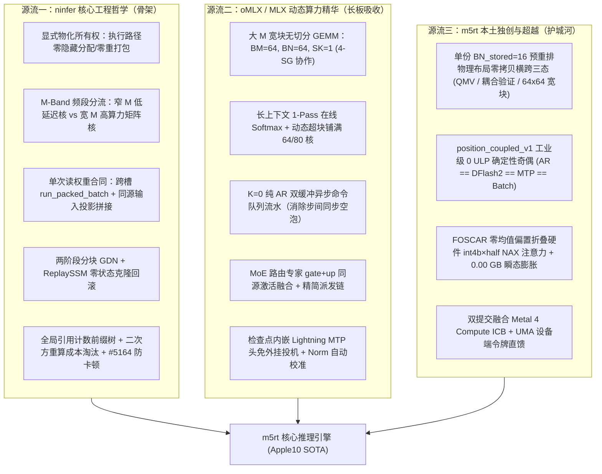

# Apple M5 Ultra (`Apple10`) 硬件禀赋、`ninfer` 架构哲学与先进技术吸收移植基石宪章

> **文档定位**：`omlx-backend-m5ultra-ninfer`（`m5rt`）**永久保留级工程与架构基石资料**
> **核心使命**：将我们在物理 **Apple M5 Ultra（`MTLGPUFamilyApple10` / `applegpu_g17d` / Metal 4 / 硬件 NAX）** 真机演进与横向对标（上游 `ninfer`、`Stock oMLX / MLX`、`TensorFold`）中提炼出的**硅片优势特点、物理硬红线、`ninfer` 架构哲学精髓，以及“吸收外部优势而不损自身护城河”的正交移植方法论**永久固化下来。
> **使用场景**：今后每当业界或参考源（`ninfer` 新提交、`MLX`/`oMLX`、CUDA/FlashInfer/CUTLASS 论文、新一代 MoE/线性注意力/稀疏注意力/投机解码/低比特量化技术）出现任何先进方案，需要评估并移植进 `m5rt` 核心时，均以本文档作为**第一性原理设计蓝本与准入标尺**。

---

## 1. 第一性原理总纲：机制同构与本土超越，绝不机械照搬

跨框架、跨硬件吸收先进技术的最高准则是：**拆解出对方获胜的“数学本质与访存/算力机制”，再用 Apple10 硅片最擅长的方式原生重构——既把对方的长板完整吸纳进来，又绝不破坏 `m5rt` 既有的确定性、零拷贝与低延迟护城河。**

在过往实测演进中，所有性能飞跃与踩坑教训都指向同一个事实：
- **凡是违背硅片物理边界的“语法级直译”必败**：例如照搬 CUDA 大 Shared Memory 分块直接撞穿 Apple10 `32 KiB` 硬上限；照搬在线权重重排导致统一内存双份驻留暴涨 `14.4 GB`；忽视 Apple Compute ICB `4 GiB` 偏移位宽导致静默截断。
- **凡是顺应硅片禀赋的“相位解耦 + 布局复用”必胜**：同一份离线预重排 `.miv` 权重无需多占一字节内存，就能在小批量验证走窄块 K-split 守住 `0 ULP` 奇偶、在单步纯 AR 走合并突发 SIMD QMV、在大批量预填走 `SK=1` 宽块协作 NAX GEMM 吃满算力。

---

## 2. Apple M5 Ultra (`Apple10`) 五大独家硬件优势与五大物理硬红线

要在 M5 Ultra 上写出统治级推理内核，必须同时吃透它的**五大物理红利（其它独立显卡不具备或形态不同）**与**五大硬件红线（越线即崩溃或断崖退化）**。

### 2.1 必须极致榨取的五大硬件优势（Strengths to Exploit）

1. **`96–512 GiB` 零拷贝统一内存（UMA）+ Quad-die UltraFusion 超高持续带宽**：
   - **实测物理基线**：64 核 96GB 真机 `256 MiB` Shared Blit DMA 实测达 **`1,095.19 GB/s` p50**（标称 `1.2 TB/s` 的 **`91.3%`**），单算子 `lm_head` 实测有效带宽达 **`874–890 GB/s`**。
   - **架构红利**：彻底不存在离散 GPU 的 PCIe 总线墙。
     - 百亿至四百亿参数 Dense/MoE 模型可**全量常驻物理内存**，无需耗费复杂度去做 PCIe CPU↔GPU 专家动态换入换出；
     - 多并发请求可跨槽零拷贝共享物理 KV 页池（COW `SharedPrefixCache` + `SharedKvArenaPool`）；
     - 每轮投机或自回归仅需 **`8–36 Bytes` UMA 共享标量读回**，甚至可直接在 GPU 端将本步采样出的 token 写入下一步输入槽，实现零 PCIe 往返的设备端自馈流水。
2. **GPU 核心内建硬件 Neural Accelerators（NAX，`mpp::tensor_ops::matmul2d`）**：
   - **实测物理基线**：每个 GPU 核配对独立硬件矩阵单元（64 核 = 64 NAX，80 核 = 80 NAX），独立 `[5120×5120]` Q4 `M=256` 实测 **`36.68 TFLOPS`**。
   - **架构红利**：
     - **同管线零切换协同**：NAX 与 SIMD32 ALU 位于同一 Metal Compute Encoder 内，寄存器/线程组内存直接衔接（不像独立 ANE 存在跨引擎调度与格式转换高延迟，故低延迟 token 循环严禁混入 ANE）；
     - **原生硬件量化平面支持**：macOS 27 Metal 4 原生提供 `MetalFloat4E2M1` + `MetalFloat8UE8M0`（MXFP4）、`uint4b/uint2b`（oQ Affine `q3/q4/q5/q6`）与 `int4b_format`（压缩 KV）硬件张量视图，无需软件逐位解包即可直喂矩阵单元。
3. **极高的“单核内存带宽密度”（64 核每核 `18.75 GB/s`，80 核每核 `15.0 GB/s`）**：
   - **架构含义**：M5 Ultra 单核可撬动的 DRAM 带宽高达 RTX 5090 单 SM（`~10.5 GB/s`）的 **`1.8×`**，但核心总数仅为 `64 / 80`（而非 `170`）。这意味着：
     - 一旦线程组数量不足（例如 `kv_heads = 4` 只派发 4 个或 48 个 TG），大量高带宽核心会直接闲置；
     - 反之，只要通过**细粒度空间分片**（如长上下文 `512`-token 超块动态切分、短序列 GQA 共享门控 `total_tgs >= 64`、小 `M` 适度 `SK=2..8` 切分）把活跃线程组铺满 `>= 64/80` 的整数倍，就能瞬间逼近 `850–1,095 GB/s` 物理带宽天花板。
4. **超低延迟 Metal 4 命令编码与间接命令缓冲（Compute ICB）**：
   - **实测物理基线**：`24 MHz` 硬件计数器实测同编码器内与跨编码器屏障间隙中位数仅 **`416.7 ns`**！
   - **架构红利**：将整套 5 层 `DFlash2` 草稿或 1 层内嵌 `MTP` 的多步前向录制进**单条不可变 Compute ICB**（整轮草稿仅 `7.42 ms`），配合目标模型验证 ICB 合并提交（`replay_icb_batch`）或双 `MTL4CommandAllocator` 异步乒乓流水，可彻底抹平 Python/动态图框架每步数十毫秒的主机调度地板。
5. **10P + 20E 高性能同构 ARMv9 CPU 集群与零开销硬件可观测性**：
   - 10 颗性能核并行执行平面校验与映射，使 `14–18 GiB` 预重排模型冷启动加载仅需 **`1.84–2.57 s`**；
   - `MTL4CounterHeap` / `MTLCounterSampleBuffer` 提供 `41.67 ns` 分辨率子层剖析，关闭态开销仅 **`0.00042 ns/call`**，所有内核优化均以真实有效带宽（GB/s）与有效算力（TFLOPS）说话。

### 2.2 移植任何技术时严禁逾越的五大物理硬红线（Hardware Redlines）

1. **单线程组共享内存硬上限恒为 `32 KiB`（`32,768 Bytes`）**：
   - Apple9/Apple10 每线程组共享内存死卡 `32,768 B`，超 1 字节即管线编译失败，逼近上限则单核并发线程组驻留度断崖下跌。
   - **铁律**：`SK > 1` 时必须强制钳定 **`RF = 1`**（防止寄存器累加器与 `(SK-1)*BN*64B` TG 归约缓冲同步膨胀 `RF` 倍击穿驻留度）；**宽块大 Tile（如 `BM=64, BN=64`）必须与 `SK = 1` 严格绑定**，省掉全部 Split-K 归约 SRAM，将宝贵的 `16–24 KiB` TG 内存专用于输入激活/KV 分块协同加载。
2. **Compute ICB `4 GiB` 缓冲偏移 32-bit 静默截断红线**：
   - Apple Silicon 在 `MTLIndirectComputeCommand` 中编码缓冲偏移 `offset >= 4 GiB` 时会发生 **32-bit 无符号整数静默回绕截断**，Metal Validation 不报错但直接读错权重/KV 页。
   - **铁律**：所有被 ICB 引用的不可变权重段强制 **`<= 2 GiB`**，临时重排/工作区段强制 **`<= 1 GiB`**，多槽共享 KV 池单缓冲尺寸严控在安全界内。
3. **多子图融合 ICB 的 `Encoder::dynamic_parameters` 边界隔离铁律**：
   - 单条 Compute ICB 串联不同动态宽度的子图（如草稿增量上下文步与草稿骨干步、历史折叠步与单步自回归链）时，**必须在子图边界显式清空 `Encoder::dynamic_parameters` 去重缓存**，严防前序子图的动态宽度补丁污染后续子图。
4. **Metal 4 `cooperative_tensor` 累加顺序与确定性边界**：
   - 不同硬件矩阵描述符尺寸（如切换 `BM=8` 与 `BM=16/32`）或改变 Split-K 累加顺序会改变 FP32 浮点结合律，在 64 层混合 GDN + Attention 网络中累积后会引发贪心采样分叉。
   - **铁律**：凡处于同一投机验证回路（如 `T=1` AR 与 `T=5/8` Verify），必须共享完全相同的 Tile 描述符与固定顺序归约（`s = 1 .. SK-1`；注意力分区按绝对位置固定边界 `0 .. num_parts-1` 顺序归约），死守 **`0 ULP` 逐位一致**。
5. **`96 GiB` 机型的 `77.76 GiB` Metal 推荐工作集红线（零双份驻留、零瞬态膨胀）**：
   - macOS 对 `IOAccelerator` 显存页施加硬工作集约束（约物理内存的 `81%`）。
   - **铁律**：执行路径**严禁隐藏在线全量权重重排**（必须通过离线预重排直绑唯一权重池，立省 `44%~48%` 内存），预填期严禁分配随序列长度线性暴涨的全序列中间大张量（坚持分块流式预填与循环 `feature_history` 环，保持 `0.00 GB` 预填瞬态内存膨胀）。

---

## 3. 为什么上游 `ninfer` 不这么写？—— 硬件鸿沟决定的架构映射表

上游 [`ninfer`](../../ninfer/AGENTS.md) 是面向 **NVIDIA GeForce RTX 5090（Blackwell `sm_120a`）** 打造的顶级 C++/CUDA 引擎。当我们发现 `ninfer` 某处实现与 `m5rt`（或 `MLX`）不同时，**首先用下表判定该差异是否由底层物理硬件不同所致**：

| 物理硬件维度 | `ninfer` 宿主：RTX 5090 (`sm_120a`) | `m5rt` 宿主：Apple M5 Ultra (`Apple10`) | 对技术移植与算子设计的决定性影响 |
|---|---|---|---|
| **1. 片上共享内存容量** | **每 SM `100 KB` / 每 Block `99 KB`**（Apple 的 **`3.1×`**） | **每线程组硬封顶 `32 KiB` (`32,768 B`)** | `ninfer` 可在单 Block 内同时开大块 `BM=64, BN=128` 流水双缓冲、大块 WY 矩阵求逆与 K-split；**移植到 M5 时，必须拆解超 `32 KiB` 结构（如用 `WN=2 dsplit` `24 KiB` FlashAttn、两阶段轻量分块 GDN，以及强制“窄块开 `SK=8`、宽块锁 `SK=1`”）**。 |
| **2. 显存容量与互连拓扑** | **`32 GB` 独立 GDDR7**（`1,792 GB/s`）+ **PCIe 5.0 瓶颈** | **`96–512 GiB` 零拷贝统一内存 UMA**（实测 DMA `1,095 GB/s`） | `ninfer` 受困于 `32 GB` 显存上限，必须设计复杂的 **双窗口 PCIe CPU↔GPU 专家动态卸载（`expert-weight-cache`）**；**M5 移植时直接剥离 PCIe 卸载层，重心转向离线 NAX 预重排（省双份内存）、`q3`/`FOSCAR` 高密度常驻与跨槽零拷贝页共享**。 |
| **3. 矩阵指令与寄存器模型** | CUDA PTX `mma.sync`（NVFP4 `G16`），支持线程级寄存器片段任意交错编排 | Metal 4 `mpp::tensor_ops::matmul2d`（MXFP4 `G32` / Affine），不透明 `cooperative_tensor` | `ninfer` `folded_mma.cuh` 可在单个 `BM=64` PTX 寄存器块里交错塞入 `32 gate + 32 up`；**M5 无需重转制品交错行，而是利用双指针同源激活复用（单次将 `x` 载入 `2 KiB` TG，同时驱动 `gate` 与 `up` 两组 `NSG=2` NAX 描述符并片上融合 SwiGLU）**。 |
| **4. 核心数量与单核带宽比** | **`170` 个 SM**（每 SM 约 `10.5 GB/s`） | **`64 / 80` 个 GPU 核**（每核 **`15.0–18.75 GB/s`**） | RTX 5090 靠海量 SM 掩盖延迟，分片阈值较晚；**M5 单核带宽极宽但核心数精炼，必须将 Split-KV 阈值前移至 `2048` 并在长上下文采用动态 `512`-token 超块切分以唤醒数百个 TG 铺满全核**。 |
| **5. 图捕获与分配器机制** | **CUDA Graph** 原生 64-bit 指针 + 单流顺序重放 | **Metal 4 参数表 + Compute ICB**（`<4 GiB` 偏移限制 + 独立 `MTL4CommandAllocator` 生命周期） | `ninfer` 可单缓冲全图捕获；**M5 必须采用 `<=2 GiB` 分段权重池，且在异步双缓冲流水时必须配备双 `MTL4CommandAllocator` 环形槽（严禁在 GPU 尚未跑完上一帧时 `reset` 同一分配器）**。 |

---

## 4. 三大源流精华沉淀：我们要吸收什么、坚守什么、超越什么？

`m5rt` 的核心竞争力在于集三家之大成：**以 `ninfer` 的严谨工程契约为骨架，吸收 `Stock oMLX / MLX` 在 Apple Silicon 上的宽块算力与异步流水长板，并牢牢守住 `m5rt` 独创的 Apple10 极限特化护城河。**

### 4.1 永久坚守的 `ninfer` 五条架构公理（不违背、不妥协）
1. **职责单一与显式资源所有权**（源自 [`ninfer/AGENTS.md`](../../ninfer/AGENTS.md)）：权重物化、工作区页池、参数表与命令分配器在加载/规划期显式定界；前向执行热路径**绝不暗藏隐式设备内存分配或临时权重重打包**。
2. **单一架构入口 + 按工况频段（`M`-band / `L`-band）特化路由**：不按 checkpoint 名字堆砌分支，而是依据数学合同（如激活许可 `A16Only / AllowA4`、序列宽度 `M`、上下文深度 `L`）在底层平滑切换最优微架构核。
3. **权重每步只读一次**：无论是单请求同源输入合并（`[q,k,v]`、`[gdn_qkv,z,a,b]`），还是多并发槽位打包 `M = ∑ W_b`（`run_packed_batch`），都以最大化每次 DRAM 权重读取所服务的有效 token 数为核心目标。
4. **状态回滚轻量化**：混合架构（GDN/SSM + Attention）投机解码绝不在每个验证列克隆全量循环状态（`151 MiB/slot`），而是只记录紧凑增量并在拒绝时按接受长度 `O(accepted)` 重放或 `O(1)` 截断页表。
5. **基于重算经济学的缓存与防饥饿调度**：前缀淘汰按“每回收 1 字节损失的边际重算成本（含 $O(L^2)$ 注意力与 $O(L)$ 骨干）”排序，并用页对齐子块保护活跃解码流的尾延迟（ITL）。

### 4.2 从 `oMLX` / `MLX` 吸收并内化为原生 C++/Metal 4 的五大精华
1. **Prefill 与 Decode/Verify 的 Tile 几何彻底解耦**：
   - **关键洞见**：`BN_stored = 16` 预重排文件中，连续 4 个物理分块天然构成 `BN_logical = 64` 连续内存！因此无需改变 `.miv` 一字节，即可在 `M < 64` 走 `BM=8, BN=16, SK=8` 保解码带宽与 `0 ULP` 奇偶，在 `M >= 64` 切换 4-SG 协作 `BM=64, BN=64, SK=1` 宽块核，消除 8 倍激活重读与归约屏障。
2. **线性注意力（GDN / KDA 等）长序列预填必须走“分块矩阵扫描”而非逐 token 循环**：
   - 当模型 75% 层数为线性递推层时，单靠 `TB=8` 循环暂存无法突破算力瓶颈；在 `T >= 64` 将序列切分为 `chunk_size = 32/64`（块内并行局部三角解 + 块间硬件 NAX `matmul2d` 状态传播，严控 TG SRAM `<= 24 KiB`），才能把长序列预填拉升 `2×–3×`。
3. **所有 KV 格式（含默认 BF16）统一贯彻“1-Pass 在线 Softmax + 动态超块切分”**：
   - 彻底淘汰长上下文下的 2-Pass 全量 KV 重读；对任意 KV 精度统一采用单遍在线 `(max, sum, acc)` 重缩放 + 按 `512`-token（8 页）超块动态分区，既砍半 DRAM 流量，又保证 `64/80` 核满载。
4. **纯自回归（`K=0`）的双缓冲异步命令流水 + 预重排直读 `T=1` QMV**：
   - 在无草稿纯 AR 场景下，使用双 `MTL4CommandAllocator` + Ping-Pong 参数槽提前入队第 $t+1$ 步，并让采样核直接把选中 token 写入设备端 `token_ids[0]`；同时在纯 AR `T-domain` 模式下提供直接读取预重排 `BN=16` 64 字节连续行块的合并突发 SIMD32 QMV 核（省去 `bf16->f16` 转换核与 `7/8` 空行浪费，且零双份内存）。
5. **双轨投机生态（外挂高吞吐 `DFlash2` + 内嵌零额外词表开销 `Lightning MTP`）**：
   - 有独立块扩散草稿（`DFlash2`）时发挥 `5.5 tok/轮` 极速优势；仅有检查点内嵌 `language_model.mtp.*` 头时，复用目标模型 `embed_tokens` 与 `lm_head`（立省 `3.55 GB` 权重内存），将 `d=0..K-1` 链式草稿录进单条 Compute ICB 并自动校准跨源检查点的 RMSNorm 偏移（`norm_repair`）。

### 4.3 `m5rt` 超越上游参考源、任何改动绝不可自毁的六大优势
1. **`100%` 确定性 `position_coupled_v1` 无损奇偶**：默认耦合合同下 `AR == DFlash2 == MTP == Batch` 逐 token 精确一致（`0` 分歧），杜绝通用框架因 `M=1` QMV 与 `M>1` GEMM 算子切换导致的推理分叉。
2. **零制品重转、零双份权重驻留**：新算子优先适配既有 `mx_nax_tiled_bk128_v1` / `oq_nax_tiled_g64_v1` 物理平面，不把存储或转换成本转嫁给用户。
3. **`FOSCAR` 压缩 KV + 零预填瞬态内存膨胀**：在 `96 GiB` 统一内存上实现 `2K -> 64K` 恒定峰值内存（`0.00 GB` 膨胀）与多并发 `524K` 总上下文驻留。
4. **多槽位共享物理 KV 页池（`SharedKvArenaPool`）与全路径 `explicit_t` NAX 贯通**：确保 `B=2..8` `run_packed_batch` 100% 命中最优分桶 `moe_nax` 与融合 SwiGLU，绝不因 `explicit_t` 条件漏判退回标量慢路径，也不为副槽重复分配数 GB 私有 KV 板。
5. **极致短提示词首字延迟（`< 25–90 ms` TTFT）**：零 Python 解释器、零动态图构建开销。
6. **生产级 Sidecar 隔离与免 Xcode 单包交付**：纯系统框架依赖，开箱即用。

---

## 5. 未来新技术移植“六步第一性原理准入清单”（Porting Playbook Checklist）

今后每当我们要把一项新的外部优势技术（例如新论文算子、新模型家族层、`ninfer` 新特性或 `MLX` 新补丁）移植进 `m5rt` 时，**在动手写代码前必须逐项通过以下 6 道关卡审查**：

- [ ] **关卡 1【物理布局零拷贝兼容性】**：新核能否直接读取现有的 `.miv` 预重排平面（如连续读取 $k$ 个相邻 `BN_stored=16` 分块，或双指针同时读取 `gate` 与 `up`）和 `64`-token KV 页？若非绝对必要，**严禁引入破坏向后兼容的新磁盘格式或运行时双份权重拷贝**。
- [ ] **关卡 2【相位解耦与 `32 KiB` SRAM 驻留账本】**：是否区分了 **`M <= 16` 带宽敏感期**（窄块、`SK > 1` 强制 `RF = 1`）与 **`M >= 64` 算力敏感期**（宽块 `64×64`、强制 `SK = 1` 零归约缓冲）？精确核算每线程组 `threadgroup` 字节数是否稳居 **`<= 24 KiB`（绝对不超过 `32,768 B`）** 且线程组总数足以铺满 `64 / 80` 核？
- [ ] **关卡 3【Compute ICB 与 Metal 4 硬件安全】**：所有绑定的权重、工作区与共享 KV 段偏移是否严格 **`< 2 GiB`**（规避 `4 GiB` 32-bit 静默截断）？多子图录制是否在边界清空了 `Encoder::dynamic_parameters`？若涉及异步命令流水，是否使用了独立的双 `MTL4CommandAllocator` 槽位而非重用未完成分配器？
- [ ] **关卡 4【`position_coupled_v1` `0 ULP` 奇偶不变量】**：在投机解码开启时，`T=1` 纯自回归与 `T=W` 批量验证在任意绝对位置 `pos` 上是否走完全相同的硬件 `matmul2d` 描述符、相同的 Split-K 顺序累加（`s = 1..SK-1`）以及相同的注意力绝对位置分块边界？若新优化仅适用于纯 AR（如 SIMD QMV），是否严格加装了 `!speculative_enabled` 隔离门控？
- [ ] **关卡 5【多槽批处理 `explicit_t` 直通与零内存膨胀】**：新路径在 `compile_packed_batch_profile`（`explicit_t.has_value() == true`，且 `total_m` 为任意 `2..64` 非 2 幂次）下是否同样正常激活而不意外回退慢路径？在 `64K–128K` 与 `B=8` 下是否做到零瞬态大缓冲分配并复用共享物理页池？
- [ ] **关卡 6【硬件计数器与净室 Apple-to-Apple 闭环验证】**：是否通过了全量本地/Apple10 CTest + `AR == Spec == Batch` 精确奇偶测试？是否用 `24 MHz` 硬件计数器核实了子层真实有效带宽（对比 `1,095 GB/s` DMA 峰值），并在独立净室子进程中按同模型、同 Token ID、同 `RUSAGE_INFO_V4` `phys_footprint` 口径验证了端到端收益且零回退？

---

## 6. 关联权威参考索引

- **硬件与软件栈实测边界表**：[`../../hardware-software-boundaries-v1.md`](../../hardware-software-boundaries-v1.md)
- **Apple M5 全系硅片十大工程定律与调优手册**：[`../../m5-series-silicon-optimization-guide.md`](../../m5-series-silicon-optimization-guide.md) · [`../silicon-guides/m5-series-optimization-playbook.md`](../silicon-guides/m5-series-optimization-playbook.md)
- **NInfer (`ebdc67e5`) 全量移植架构规范**：[`../backend/ninfer-m5-porting-architecture-v2.md`](../backend/ninfer-m5-porting-architecture-v2.md)
- **上游 `ninfer` 工程职责与合同总则**：[`../../ninfer/AGENTS.md`](../../ninfer/AGENTS.md)
- **Stock `oMLX v0.8.0` vs `m5rt` 五维真机对标报告**：[`../versions/v0.8.0-m5rt.4-full-ninfer-squeeze-64gpu/omlx-vs-m5rt4-benchmark-report.md`](../versions/v0.8.0-m5rt.4-full-ninfer-squeeze-64gpu/omlx-vs-m5rt4-benchmark-report.md)
