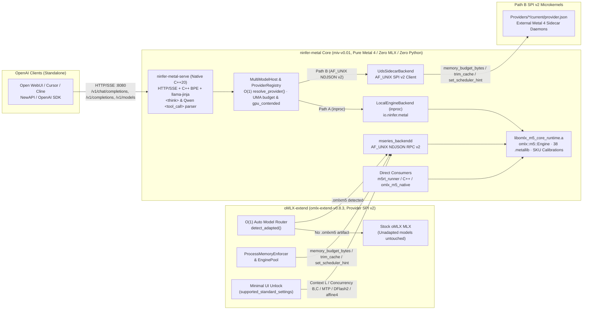

[English](../../architecture.md) | [简体中文](../zh-CN/architecture.md) | [繁體中文](../zh-TW/architecture.md) | [日本語](../ja/architecture.md) | [한국어](../ko/architecture.md) | [Español](../es/architecture.md) | [Français](../fr/architecture.md) | **Deutsch**

# Architektur & Multi-Modell-Koexistenz

`ninfer-metal` läuft in zwei Betriebsmodi auf einem gemeinsamen reinen C++20- / Objective-C++- / Metal-4-Kern (`miv/`, statische Laufzeit `libomlx_m5_core_runtime.a`): als eigenständiger nativer C++-OpenAI-Server (`ninfer-metal-serve`), der auf einem Port sowohl In-Process-`miv` (`LocalEngineBackend`) als auch parallele Pfad-B-SPI-v2-Microkernel (`UdsSidecarBackend`) hostet, und als `oMLX-extend`-Provider-SPI-v2-Sidecar (`mseries_backendd`).

---

## Dual-Mode-Systemtopologie

---

## 1. Eigenständiger nativer C++-Server (`ninfer-metal-serve`)

`ninfer-metal-serve` bettet `omlx::m5::Engine` direkt in ein einzelnes Mach-O-Binary ohne Python- oder MLX-Laufzeitabhängigkeiten ein und hostet auf einem HTTP-Port gleichzeitig In-Process-`miv`-Modelle sowie mehrere Pfad-B-SPI-v2-Microkernel parallel:

- **HTTP/SSE-Transport & Konfiguration**: POSIX-Server auf Basis von `cpp-httplib` (`GET /health`, `GET /metrics`, `GET /v1/models`, `GET /v1/models/:id`, `POST /v1/chat/completions`, `POST /v1/completions`, optionale Bearer-Authentifizierung, CORS), konfiguriert über `ninfer-metal.toml` (`[server]`, `[model]`, `[[models]]`, `[engine]`, `[speculative]`) mit CLI-Flag-Überschreibung. Anfragen werden anhand des JSON-Felds `"model"` geroutet.
- **Natives paralleles Multi-Microkernel-Hosting**: `ProviderRegistry` durchsucht `--providers-dir`, `[server].providers_dir`, `OMLX_PROVIDERS_DIR` sowie `~/Library/Application Support/oMLX/Providers` nach `<dir>/*/current/provider.json`, und `resolve_provider()` routet jedes Modell in O(1). `MultiModelHost` betreibt In-Process-`miv` (`LocalEngineBackend`, `provider_id="io.ninfer.metal"`, `backend_mode="inproc"`) parallel neben externen Pfad-B-SPI-v2-Daemons über POSIX `AF_UNIX` + `posix_spawn` (`UdsSidecarBackend`).
- **Einheitliche UMA-Budget- & GPU-Contention-Koordination**: `MultiModelHost` verwaltet die serverweite UMA-Speicherobergrenze (`81%` von `sysctl hw.memsize` oder `--memory-budget-gb`), löst bei Speicherdruck `trim_cache` auf ruhenden Modellen aus und sendet `set_scheduler_hint(gpu_contended=true)` sobald zwei oder mehr Modelle gleichzeitig rechnen (und `false`, sobald die Konkurrenz endet). Bei `SIGINT`/`SIGTERM` räumt der Host alle Prozessgruppen und Sockets sauber ab.
- **Native Tokenisierung & Templates**: Reiner C++-BPE-Tokenizer (`utf8proc`, direktes Laden von HuggingFace-`tokenizer.json` inklusive `LetterDigit1` für Qwen3.8), gekoppelt mit `llama-jinja`-Chat-Template-Rendering (`--chat-template` -> `model_dir/chat_template.jinja` -> `tokenizer_config.json` -> ChatML-Fallback).
- **Streaming-Parsing für Reasoning & Tool-Calls**: Ein inkrementeller Parser mit UTF-8-Holdback trennt `<think>...</think>` nach `reasoning_content` ab und extrahiert sowohl Qwen3.5/3.8-XML- (`<tool_call><function=...><parameter=...>`) als auch Qwen3-JSON-Aufrufe (`<tool_call>{...}`) in synchronen Antworten wie im SSE-Streaming.
- **Standardmäßige Koexistenz**: Lauscht standardmäßig auf Port `8080` (getrennt von oMLX auf Port `8000`) und lädt automatisch dieselbe bearbeitungsfreie Standardkonfiguration [`omlx-extend/config/ninfer-metal.toml`](../../../omlx-extend/config/ninfer-metal.toml), die auch `oMLX-extend` verwendet.

---

## 2. O(1)-Auto-Routing für Modelle (`oMLX-extend`)

`oMLX-extend` prüft jedes Modellverzeichnis mit `detect_adapted(model_dir)` in `< 1 ms` über reine Dateisystemabfragen (`model.omlxm5`, `model_pack.json`, `omlxm5-manifest.json`), ohne einen Subprozess zu starten:

- **Angepasste Modelle**: Werden bei der ersten Anfrage (oder wenn angepinnt) verzögert an **`miv Core Backend`** (`mseries_backendd`) geroutet und zeigen **`miv Core Backend (Auto)`** in `Model Settings → Advanced Settings`. Durch Ausschalten von **`Use External Engine`** wird `external_engine: "stock"` geschrieben und das Modell auf Stock MLX zurückgestellt.
- **Unangepasste Modelle**: Laufen unverändert über Stock MLX (`BatchedEngine` / `VLMBatchedEngine`) — ohne Sidecar-Prozesse, ohne zusätzlichen Speicherbedarf und ohne Leistungsänderung.

---

## 3. Provider SPI v2 & UMA-Koexistenz

Wenn `ninfer-metal`-Modelle, Pfad-B-Sidecar-Microkernel und Stock-MLX-Modelle auf demselben Apple-Silicon-Rechner laufen, teilen sie sich einen gemeinsamen Unified-Memory-Pool (UMA) und eine GPU-Queue. Sowohl `oMLX-extend` (`ProcessMemoryEnforcer` + `EnginePool`) als auch das eigenständige `ninfer-metal-serve` (`MultiModelHost`) koordinieren diese Ressourcen über denselben Protokoll-v2-Vertrag:

- **Hartes Speicherlimit (`memory_budget_bytes`)**: `ProcessMemoryEnforcer` berechnet die verbleibende Obergrenze jedes Modells innerhalb des Host-Budgets und sendet `memory_budget_bytes` im `load`-RPC. `native_backend.cpp` begrenzt Gewichtspools, `KvPagePool` und Präfix-Caches auf `min(W_ws - cur_alloc, memory_budget_bytes - cur_alloc)`.
- **Cache-Reduktion unter Speicherdruck (`trim_cache`)**: Bevor ein residentes Modell verdrängt wird, ruft `oMLX-extend` `trim_cache(target_free_bytes)` auf. `miv/` räumt ungepinnte Präfix-Einträge und `UmaCheckpointPool`-Slabs innerhalb von `<= 100 ms` frei und löst freigegebene `MTLBuffer`-Objekte aus `MTLResidencySet`, damit macOS verdrahtete Speicherseiten sofort zurückgewinnt.
- **GPU-Contention-Hinweise (`set_scheduler_hint`)**: Führen ein In-Process-MLX-Modell und ein Sidecar-Modell gleichzeitig Arbeit aus, sendet `EnginePool` `gpu_contended: true`. Lange Prefills werden in begrenzte, seitenausgerichtete `64`-Token-Chunks zerlegt, sodass parallel laufende Decode-Streams eine gleichmäßige Inter-Token-Latenz halten.
- **Sauberer Prozessabbau**: Jedes geladene Modell läuft in einem isolierten Kindprozess mit eigenem `MTLDevice`, eigener `MTL4CommandQueue` und instanzspezifischem `AF_UNIX`-Socket (`/tmp/omlx-<provider>-<uid>/...`, keine TCP-Ports). Bei `stop()` leert der Host die Prozessgruppe und prüft `process_memory_bytes() == 0`, bevor ein weiteres Modell geladen wird.

### Minimale UI & Konfigurationsaufteilung

`oMLX-extend` fügt dem oMLX-Dashboard und der macOS-App (`omlx-mac`) keine eigenen Einstellungsformulare hinzu. Stattdessen zeigt **`Integrations → External Engines`** installierte **`miv Core Backend (ninfer-metal)`**- und Pfad-B-Microkernel-Karten oberhalb von Splash an, **`Models`** zeigt aktive Engine-Badges neben `Loaded` und auf Bibliothekszeilen, und `provider.json` samt `hello`-Handshake veröffentlichen `supported_standard_settings`, um bestehende Standard-Steuerelemente pro Fähigkeit freizuschalten (`max_context_window`, `mtp_*`, `dflash_*`, `turboquant_kv_enabled` + `affine4 -> affine4_g128`). Andere Provider wie `Splash` behalten das exakte Upstream-Sperrverhalten. Kernspezifische Parameter (`rolling_prefix_cache`, `prefix_cache_gb`, modellbezogene `max_concurrency`-Überschreibungen, `sampling_contract`) liegen in der gemeinsamen bearbeitungsfreien [`omlx-extend/config/ninfer-metal.toml`](../../../omlx-extend/config/ninfer-metal.toml). Screenshots aller Ansichten zeigt der **[Visuelle Leitfaden zu `oMLX-extend`](omlx-extend-guide.md)**.

---

## 4. Design der Metal-4-Engine (`miv/`)

- **Einfache vor-gekachelte Gewichtskopie**: Offline-`.omlxm5`-Konvertierung (`mx_nax_tiled_bk128_v1` / `oq_nax_tiled_g64_v1`) versorgt breites `64×64`-Prefill-NAX, `T=1`-QMV-Decode und `BM=8/16/32`-Spekulationsverifikation aus einer einzigen residenten Allokation (`1.0×` Artefakt-Footprint gegenüber `~1.92×` bei Online-Re-Tiling).
- **Sichere Compute-ICB-Aufzeichnung**: Alle indirekten Puffersegmente bleiben strikt unter `2 GiB` (`< 1 GiB` für kompakte Hilfs-Caches), um 32-Bit-Hardware-Offset-Überläufe auszuschließen. Doppelt gepufferte `ar_pipe_[2]`-Command-Allocators überlappen Host-Encoding und GPU-Ausführung.
- **Paged CoW KV & UMA-Fortsetzung**: `KvPagePool` verwaltet referenzgezählte `64`-Token-Seiten (`bf16` und `0-ULP` `affine4_g128` bei `0.5625 B/val`). `QwenUmaContinuation` sichert und lädt den 48-Layer-GDN-Zustand (`146.81 MiB`) in einem einzelnen GPU-Command-Buffer (`0.22–1.62 ms`, kein CPU-`memcpy`), und `rolling_prefix_cache` ersetzt ungepinnte Vorgänger direkt am Platz (`1×`-Slab-Wiederverwendung).
- **Strikte Isolation der SKU-Kalibrierungen**: `silicon_tuning.h` lädt SKU-Profile (`apple-m5-ultra-64gpu.json`, `apple-m5-ultra-80gpu.json`) anhand der exakten `profile_id` und fällt bei ungemessenen Chips auf parametrisierte Priors zurück — gemessene Konstanten eines SKUs werden nie auf ein anderes übertragen.

---

## 5. Dual-Track-CI im Monorepo & atomares Hot-Update

Beide Entwicklungsstränge liegen in einem Repository mit unabhängigen Release-Tags und Workflows:

| Strang | Pfad | Tag-Muster | Workflow |
|---|---|---|---|
| **Inferenz-Kern** | `miv/` | `miv-v0.01` (`<codename>-vX.YZ`) | [`.github/workflows/release-ninfer-metal.yml`](../../../.github/workflows/release-ninfer-metal.yml) |
| **Host-Erweiterung** | `omlx/` + `omlx-extend/` | `omlx-extend-v0.8.3` (`omlx-extend-vX.Y.Z` / `omlx-extend-vX.Y.Z-mix1..9`) | [`.github/workflows/sync-omlx-extend.yml`](../../../.github/workflows/sync-omlx-extend.yml) |

Kern-Tarballs werden nebeneinander unter `~/Library/Application Support/oMLX/Providers/io.ninfer.metal/versions/<tag>/` installiert und durch atomares Umlegen des `current`-Symlinks aktiviert — Upgrades und Ein-Befehl-Rollbacks funktionieren ohne Eingriff in die Python-Umgebung von oMLX.

---

## Vertiefende Referenzen

- [Porting-Architektur v2](../../backend/ninfer-m5-porting-architecture-v2.md)
- [`.omlxm5`-Artefaktformat v1](../../backend/artifact-format-v1.md) & [Dispatch-Vertrag v1](../../backend/dispatch-contract-v1.md)
- [Hardware- & Software-Grenzen v1](../../foundations/hardware-software-boundaries-v1.md)
- [Core-Zertifizierungsstandard](../../standards/core-certification-standard.md)
