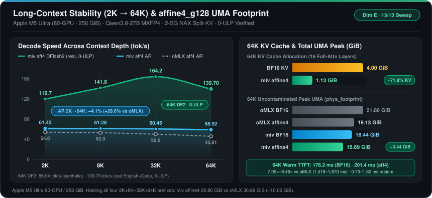
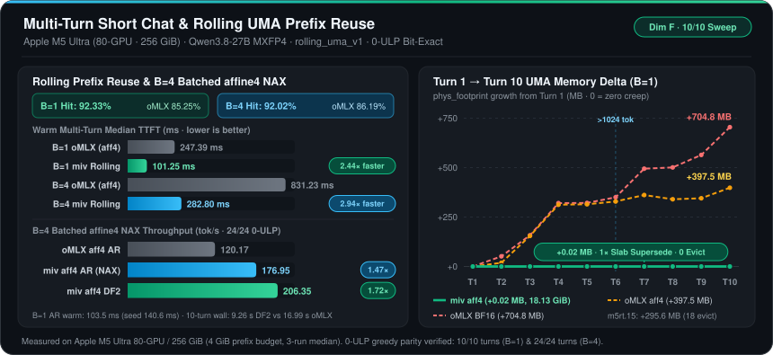

[English](../../releases/miv-v0.01-changelog.md) | [简体中文](../zh-CN/miv-v0.01-changelog.md) | [繁體中文](../zh-TW/miv-v0.01-changelog.md) | [日本語](../ja/miv-v0.01-changelog.md) | [한국어](../ko/miv-v0.01-changelog.md) | [Español](../es/miv-v0.01-changelog.md) | [Français](../fr/miv-v0.01-changelog.md) | **Deutsch**

# `ninfer-metal` `miv-v0.01` Release Notes

> **Release**: `ninfer-metal` `miv-v0.01` (`codename: miv` · `semver: 0.0.1` · `core_abi: 1` · `protocol_version: 2`)
> **Begleit-Host**: `oMLX-extend` `omlx-extend-v0.8.3` (Provider-SPI-v2-Erweiterung auf Basis von `jundot/omlx` `v0.8.3`)
> **Plattform**: Apple M5 / M5 Pro / M5 Max / M5 Ultra (`MTLGPUFamilyApple10+`), macOS 27+ (kein Xcode zur Laufzeit nötig; Xcode 27+ für den Build aus den Quellen)

`miv-v0.01` ist das erste öffentliche Release von `ninfer-metal`, einer reinen C++20-, Objective-C++- und Metal-4-Inferenz-Engine auf Basis der Apple-M5+-Neural-Accelerators (NAX) und Compute ICB – ganz ohne Python- oder MLX-Laufzeitabhängigkeiten. Sie führt **Qwen3.5 / Qwen3.6 / Qwen3.8 Hybrid**-Modelle (Dense 0.8B–27B sowie 256×8-MoE wie 35B-A3B) entweder eigenständig über den nativen OpenAI-HTTP/SSE-Server (`ninfer-metal-serve`) oder in `oMLX-extend` als **`miv Core Backend`** für OpenAI-, Anthropic- und macOS-GUI-Betrieb neben Stock MLX aus. Setup und CLI-Flags stehen unter [Einstieg & Konfiguration](getting-started.md), die geführte macOS-App-Übersicht im [Visuellen Leitfaden zu `oMLX-extend`](omlx-extend-guide.md).

## 1. Benchmarks auf Apple M5 Ultra

Alle Messwerte stammen von physischen Apple-M5-Ultra-Systemen in isolierten Teilprozessen mit identischen Modellgewichten, identischen Token-Sequenzen, `temperature=0` und `phys_footprint`-Speichererfassung im Vergleich zu regulärem `oMLX 0.8.0` (`mlx 0.32.4`, NAX aktiviert). Die Ergebnisse für die 80-GPU / 256-GiB-SKU (`macOS 27.2.1` Build `26B131`, `Xcode 27.2` Build `27B52`) und die 64-GPU / 96-GiB-SKU sind getrennt aufgeführt.

### Single-Stream-Decode & `0-ULP` Speculative Speedup

- Reines AR liegt auf dem 80-GPU-M5-Ultra bei jedem getesteten Gewichtsformat vor Stock oMLX: `64.63 tok/s` (`+14.5%`) bei `Qwen3.8-27B MXFP4`, `54.03 tok/s` (`+7.3%`) bei `27B oQ4e` und `216.44 tok/s` (`+23.7%`) bei `Qwen3.6-35B-A3B MXFP4`.
- Speculative Decoding beschleunigt `27B`-Coding-Streams auf `186.74 tok/s` mit `DFlash2` (`2.89×` AR) und `140.48 tok/s` mit `Native MTP` (`+36.0%` gegenüber Stock-oMLX-MTP mit `103.28 tok/s`) bei vollständiger `128/128` `0-ULP`-Greedy-Parität.
- Auf der 64-GPU / 96-GiB-SKU erreicht `27B oQ4e` im Coding `138.92 tok/s` (`DFlash2`, `+33.9%`) und `107.52 tok/s` (`MTP`, `+21.2%`) sowie im Reasoning `110.01` / `100.28 tok/s` (`6/6` Sätze, `256/256` `0-ULP`).

### Multi-User-Parallelität & Skalierung

- In allen 19 Parallelitäts-Sweeps auf der 80-GPU-SKU schlägt `miv` Stock oMLX an jedem Messpunkt: bei `B=4` erzielt `27B` `500.57 tok/s` (`oQ4e DFlash2`), `496.60 tok/s` (`MXFP4 DFlash2`) und `434.92 tok/s` (`oQ4e MTP`) – `2.93×–3.83×` schneller als Stock oMLX (`148.37` MTP / `129.80` AR).
- `Qwen3.6-35B-A3B` skaliert bei `B=8` in reinem AR auf `846.29 tok/s` im Fenster (`794.39 tok/s` Ende-zu-Ende), `+52.6%` vor Stock oMLX bei `4.16×` schnellerer TTFT.
- Jeder parallele Slot hält `128/128 × 4` `0-ULP`-Greedy-Parität gegenüber der Single-Stream-Ausführung.

### 64K-Langkontext-Stabilität, UMA-Bedarf & Prefill

- Von `2K` bis `64K` sinkt das AR-Tempo von `27B MXFP4` mit `affine4_g128`-KV nur um `-4.1%` (`61.42 → 58.92 tok/s`, `+28.6%` vor oMLX), während `DFlash2` auf realen Englisch+Code-Prompts `139.70 tok/s` bei `64K` hält (`0-ULP` über `2K–64K`).
- `affine4_g128` verkleinert den `64K`-KV-Cache um `71.8%` (`4.00 → 1.13 GiB`) und begrenzt den sauberen UMA-Peak auf `15.69 GiB` (`-3.44 GiB` gegenüber oMLX; `-10.06 GiB` mit allen vier Präfixtiefen im Cache). Warme `64K + 32`-TTFT fällt auf `176.19 ms` (`bf16`) und `201.42 ms` (`affine4`), `7.05×–9.48×` schneller als oMLX.
- Der Prefill erreicht `2,058.5–2,110.6 tok/s` (`100.25–102.80 TF`) bei `1K` und `41.02–41.84 s` kalt bei `64K` auf der 80-GPU-SKU sowie `10,048.5 tok/s` (`35B-A3B`, `+15.9%`) bei `4K` auf der 64-GPU-SKU (`15/15` Siege).

### Multi-Turn-Chat & fortlaufende Präfix-Wiederverwendung

- Fortlaufende UMA-Präfix-Wiederverwendung hebt die Multi-Turn-Trefferquote über `92%` (`92.33%` bei `B=1`, `92.02%` bei `B=4`), halbiert erneut zu berechnende Prefill-Tokens und verkürzt die warme TTFT um `2.44×–2.94×` (`101.25 ms` bei `B=1`, `282.80 ms` bei `B=4`).
- In-Place-Slab-Wiederverwendung hält den UMA-Zuwachs über 10 Turns bei `B=1` auf `+0.02 MB` ohne Verdrängungen (gegenüber `+397.5 MB` bei oMLX `affine4` und `+704.8 MB` bei `bf16`) und drückt die 10-Turn-Gesamtlaufzeit von `16.99 s` auf `9.26 s` (`DFlash2`).
- Bei `B=4` (4 Nutzer × 6 Turns) liefert gebatchtes `affine4`-NAX-Decoding `176.95 tok/s` (`AR`) und `206.35 tok/s` (`DFlash2`, `1.72×` oMLX), spart `2.12 GiB` UMA-Peak und bestätigt `0-ULP` in `10/10` (`B=1`) sowie `24/24` (`B=4`) Turns.

## 2. Lieferumfang von `miv-v0.01`

### Eigenständiger OpenAI-Server (`ninfer-metal-serve`)
- Einzelnes C++20-HTTP/SSE-Binary mit `/v1/chat/completions`, `/v1/completions`, `/v1/models`, `/health` und Prometheus-`/metrics` samt synchronem JSON, SSE-Streaming (`usage`, `[DONE]`), optionaler Bearer-Authentifizierung (`--api-key`), CORS und sauberem Beenden.
- Integrierter C++-BPE-Tokenizer (`tokenizer.json`), Jinja-Chat-Template-Rendering, `<think>`-`reasoning_content`-Trennung sowie synchrones und gestreamtes Qwen-XML/JSON-`<tool_call>`-Parsing.
- Betreibt In-Process-`miv` zusammen mit externen Pfad-B-Provider-SPI-v2-Sidecars auf einem Port (`--providers-dir`, `[[models]]`) unter gemeinsamem UMA-Speicherlimit (`81%` RAM standardmäßig) und Lastkonflikt-bewusstem Scheduling.
- Enthält eine startfertige [`ninfer-metal.toml`](../../../omlx-extend/config/ninfer-metal.toml) (automatisch erkannt und mit `oMLX-extend` geteilt) samt Ein-Befehl-Starter `./omlx-extend/scripts/start_ninfer_serve.sh`.

### Metal-4-NAX-Engine (`miv/`)
- Eigenständiger C++20-/Objective-C++-/Metal-4-Quellbaum mit 38 vorkompilierten `.metallib`-Shadern für NAX-Prefill, fusionierten Decode, 256×8-MoE-Routing, spekulative Verifikation und 4-Bit-Split-KV – gebaut ohne MLX- oder Python-Header.
- Eigene Hardware-Kalibrierungsprofile für beide Apple-M5-Ultra-SKUs ([80-GPU / 256 GiB](../../backend/silicon-calibrations/apple-m5-ultra-80gpu.json) und [64-GPU / 96 GiB](../../backend/silicon-calibrations/apple-m5-ultra-64gpu.json)), die split-K, Split-KV-Partitionen und Draft-Tiefe abstimmen, wobei Umgebungsvariablen Vorrang haben.
- Zero-Copy-GPU-Präfixfortsetzung (`0.73–1.62 ms` Wiederherstellung bei `64K`), In-Place-Rolling-UMA-Präfix-Wiederverwendung und gebatchte `affine4_g128`-NAX-Attention für gleichzeitige Sitzungen.

### `oMLX-extend` `omlx-extend-v0.8.3` (macOS-App & Sidecar)
- Registriert **`miv Core Backend`** über einen `AF_UNIX`-Sidecar (`mseries_backendd`): angepasste `.omlxm5`-Modelle werden in O(1) automatisch geroutet, während reguläre MLX-Modelle ohne Zusatzprozesse auf Stock MLX bleiben.
- Die native macOS-Oberfläche ergänzt unter `Integrations → External Engines` Karten für `miv Core Backend` und Pfad-B-Microkernel, Engine-Badges pro Modell, einen Auto-/Stock-MLX-Umschalter sowie fähigkeitsgesteuerte Regler für `64K+`-Kontext, `MTP`, `DFlash2` und `affine4_g128`-KV-Cache.
- Koordiniert UMA-Budgets, Leerlauf-Cache-Bereinigung und konfliktbewussten Chunked-Prefill zwischen Sidecar- und MLX-Modellen, mit atomaren Symlink-Updates unter `~/Library/Application Support/oMLX/Providers/io.ninfer.metal/current/`.

## 3. Clean-Mac-Paketierung & Verifikation

- Das Release-Archiv `ninfer-metal-miv-v0.01-macos27-arm64.tar.gz` bündelt 16 Mach-O-Binaries (einschließlich `ninfer-metal-serve`, `mseries_backendd` sowie CLI- und Kalibrierungswerkzeugen), 38 Metal-4-`.metallib`-Shader, 2 SKU-Kalibrierungsprofile, `provider.json` und SHA-256-Prüfsummen.
- `otool -L` über alle 16 Binaries bestätigt ausschließlich Verknüpfungen mit Apple-System-Frameworks (`CoreFoundation`, `Foundation`, `IOKit`, `Metal`) und System-dylibs (`libc++.1`, `libSystem.B`, `libobjc.A`) – ohne Homebrew-, Xcode-, MLX-, OpenSSL- oder Python-Laufzeitabhängigkeiten.
- Ende-zu-Ende-Servertests (Sync/SSE, `<think>`/`<tool_call>`, `B=4`-Batching sowie paralleles In-Process- + Sidecar-Hosting), `638 / 638` `oMLX-extend`-pytest-Tests und `75 / 75` macOS-XCTests laufen fehlerfrei durch; der Provider-SPI-Patch lässt sich sauber auf `jundot/omlx` `v0.8.3` anwenden.

## 4. Unterstützter Umfang

| Bereich | `miv-v0.01`-Unterstützung |
|---|---|
| Hardware | Apple Silicon `MTLGPUFamilyApple10+` (Apple M5 / M5 Pro / M5 Max / M5 Ultra, 64-GPU & 80-GPU) |
| OS & Toolchain | macOS 27+ (kein Xcode zur Laufzeit; Xcode 27+ / macOS 27 SDK für den Build aus den Quellen) |
| Modelle | **Qwen3.5 / Qwen3.6 / Qwen3.8 Hybrid** (3:1 GDN + GQA; Dense 0.8B–27B und 256×8-MoE, z. B. 35B-A3B) |
| Gewichtsformate | Offline NAX-vorgekacheltes `.omlxm5`: `MXFP4` (`E2M1 × UE8M0`) und `oQ` Affine (`q3–q8`, `g64 / g128`) |
| KV-Cache | `bf16` und `affine4_g128` (`0.5625 B/val`, `0-ULP`-verifiziert über `2K–64K`) |
| Speculative Decoding | Reines AR (`none`), integriertes `Native MTP` und `DFlash2` (Single-Stream und `B=2..4` gebatcht) |
| Serving-Schnittstellen | OpenAI-HTTP/SSE-Endpoints in `ninfer-metal-serve`; OpenAI- + Anthropic-Endpoints und macOS-GUI in `oMLX-extend` |
