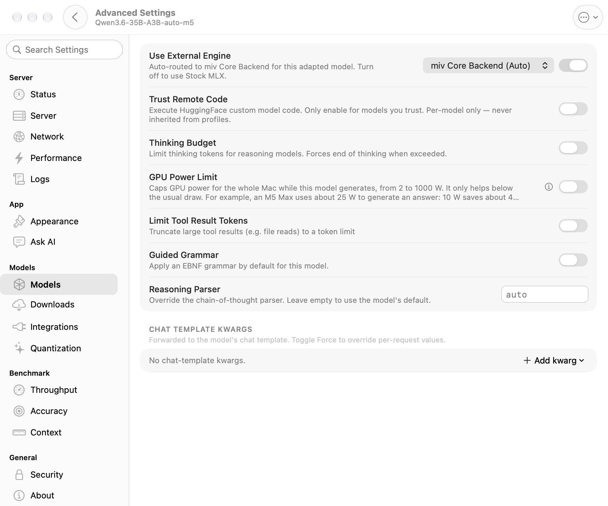

[English](../../omlx-extend-guide.md) | [简体中文](../zh-CN/omlx-extend-guide.md) | [繁體中文](../zh-TW/omlx-extend-guide.md) | [日本語](../ja/omlx-extend-guide.md) | [한국어](../ko/omlx-extend-guide.md) | [Español](../es/omlx-extend-guide.md) | [Français](../fr/omlx-extend-guide.md) | **Deutsch**

# Visueller Leitfaden zu `oMLX-extend`

`oMLX-extend` erweitert die `oMLX`-macOS-App auf Apple-M5+-Macs (`macOS 27+`) um **`miv Core Backend (ninfer-metal)`** und Community-Metal-4-Microkernel aus Pfad B. Angepasste `.miv`-Modelle nutzen automatisch die native Metal-4-NAX-Ausführung, während reguläre MLX-Modelle unverändert auf Stock MLX weiterlaufen.

Gehe die folgenden fünf Ansichten durch, um die Installation zu prüfen, das Engine-Routing zu kontrollieren, schnelle Decode-Funktionen einzuschalten und den eigenständigen Server ohne manuell geschriebene Konfigurationsdatei zu starten.

---

## Schritt 1: Microkernel entdecken, herunterladen, per Hot-Update aktualisieren & verwalten

Öffne **`Integrations → External Engines`** in `oMLX`, um **`miv Core Backend (ninfer-metal)`** sowie installierte Community-Pfad-B-SPI-v2-Microkernel direkt aus der macOS-App zu verwalten:


- **Microkernel Registry (oberer Bereich)**:
  - Klicke auf **`Refresh`**, um das aktuelle Haupt-Repository-Verzeichnis (`microkernels.json`) abzurufen und die Remote-Versionen in `latest.json` zu prüfen.
  - Wähle einen Kern im Dropdown aus, um direkt darunter dessen **unterstützte Modelle (Supported Models)**, Topologien, SPI-Version und macOS-Mindestanforderung vor dem Download zu prüfen.
  - Klicke auf **`Download`** (rechts neben **`Refresh`**), um das Archiv herunterzuladen, per SHA-256 zu prüfen, sicher zu entpacken, `provider.json` (SPI v2) zu validieren und unter `~/Library/Application Support/oMLX/Providers/` zu installieren (ist bereits die aktuelle verwaltete Version installiert, zeigt der Button deaktiviert **`Installed`**).
- **Liste installierter Microkernel (untere Zeilen)**:
  - **Quadratische Checkbox links (`☑️`)**: Angehakt bedeutet aktiviert (Standard nach dem Download) und wird in `settings.json` gespeichert. Abwählen deaktiviert den Kern sofort — O(1)-Auto-Routing überspringt ihn und das Modell-Dropdown blendet ihn aus.
  - **`Update`-Button (rechts)**: Standardmäßig abgeblendet; leuchtet erst auf, nachdem **`Refresh`** eine neuere Remote-Version gefunden hat. Ein Klick schaltet den Symlink `current` atomar für ein unterbrechungsfreies Hot-Update um (laufende Modelle wechseln beim Neuladen).
  - **`Delete`-Button (rechts)**: Entfernt einen verwalteten Kern unter `Providers/` nach Bestätigung (mit Option zum vorherigen Entladen aktiver Modelle). Externe oder lokale Build-Pfade lassen **`Delete`** zum Schutz deaktiviert — zum Deaktivieren einfach abwählen.
- **CLI-Alternative**: Für Skripte oder Headless-Setups steht weiterhin `./omlx-extend/scripts/sync_microkernels.sh --provider io.ninfer.metal` (sowie `--all` / `--rollback`) bereit.
- **Splash**: Bleibt direkt darunter mit allen bestehenden Steuerelementen unverändert erhalten.

---

## Schritt 2: Prüfen, welche Engine jedes Modell ausführt

Wechsle zur Ansicht **`Models`**, um zu sehen, wie `oMLX` jedes Modell auf deinem Mac routet:


- **Active Models**: Jedes geladene Modell zeigt direkt neben **`Loaded`** ein Engine-Badge (`miv Core`, den Namen deines Pfad-B-Microkernels oder `MLX`).
- **Model Library**: Modelle mit `.miv`-Gewichten tragen eine hervorgehobene Kennzeichnung (`miv Core · Auto`, ein Pfad-B-Microkernel oder `Stock MLX`, falls externes Routing deaktiviert wurde).
- **Unangepasste Modelle bleiben unberührt**: Reguläre MLX-Checkpoints haben kein externes Engine-Badge und laufen ohne Sidecar-Prozesse über Stock MLX. Du kannst `miv Core Backend`-, Pfad-B- und Stock-MLX-Modelle parallel unter einem gemeinsamen Unified-Memory-Limit geladen halten.

---

## Schritt 3: Auto-Routing & Rückwechsel zu Stock MLX

Klicke in der **Model Library** auf ein angepasstes Modell und öffne **`Advanced Settings`**:



- **`Use External Engine`** ist für angepasste `.miv`-Modelle standardmäßig **ON**, mit **`miv Core Backend (Auto)`** im Auswahlmenü (die Kopfzeile von Model Settings zeigt ebenfalls das aktive Engine-Badge).
- **Jederzeit zurück zu Stock MLX wechseln**: Schalte **`Use External Engine`** auf **OFF**. `oMLX` speichert `external_engine: "stock"` und zeigt *"Using Stock MLX (auto-route overridden)"*, ohne deine `.miv`-Gewichte zu löschen. Schalte wieder auf **ON**, um zum Auto-Routing zurückzukehren.
- **Andere Engine auswählen**: Ist für dasselbe Modell ein kompatibler Pfad-B-Microkernel oder Splash installiert, wähle ihn direkt im Dropdown aus.

---

## Schritt 4: MTP / DFlash2 & 4-Bit-KVQuant aktivieren

`oMLX-extend` nutzt die regulären `oMLX`-Einstellungsseiten weiter. Vom aktiven Microkernel unterstützte Steuerelemente erscheinen voll beleuchtet; reine MLX-Optionen bleiben abgeblendet, sodass sofort erkennbar ist, was die Engine ausführt.

### Acceleration (`Lightning MTP` & `DFlash`)

Öffne **`Model Settings → Acceleration`**:


- **`Lightning MTP`** (samt **`Adaptive max depth`**) wird freigeschaltet, sobald das Modell einen eingebetteten MTP-Head enthält.
- **`DFlash`** (mit **`DFlash Draft Model`** und **`Runtime Block Size`**) wird für Block-Diffusion-Spekulationsdekodierung freigeschaltet.
- Reine MLX-Zeilen (`Draft Quantization`, `Verify Mode`, `Draft Window Size`, `VLM MTP`) bleiben abgeblendet.

### Memory Saving (`4-bit KVQuant`)

Öffne **`Model Settings → Memory Saving`**:


- Aktiviere **`TurboQuant KV Cache`** und wähle **`Affine4 · 4-bit`**, um den `affine4_g128`-KV-Cache von `miv Core Backend` zu nutzen (`0.5625 B/val`, verifizierte `0-ULP`-Parität bis `64K+` Kontext).
- Ist der Schalter aus, läuft der vollständige `bf16`-KV-Cache. Die Auswahl von `affine8` oder `turboquant` fällt in `miv-v0.01` auf `bf16` zurück.
- Reine MLX-Speicheroptionen wie **`MoE Expert Offload`** bleiben abgeblendet.

---

## Schritt 5: Gemeinsame Standardkonfiguration & 1-Klick-Standalone-Start

Du musst keine Konfigurationsdatei von Hand schreiben. Sowohl **`oMLX-extend`** als auch der eigenständige C++-Server (**`ninfer-metal-serve`**) laden automatisch [`omlx-extend/config/ninfer-metal.toml`](../../../omlx-extend/config/ninfer-metal.toml) mit sofort lauffähigen Apple-M5+-Standardwerten:

| Einstellung | Gemeinsamer Standard | Wirkung |
|---|---|---|
| `max_concurrency` | `4` | Parallele Multi-User-Batch-Slots (`1..8`) |
| `max_context` | `65536` | Kontextfensterlänge (Tokens) |
| `kv_dtype` | `"affine4_g128"` | 4-Bit-Group-128-KV-Cache (`0-ULP` bei `64K+`) |
| `rolling_prefix_cache` / `prefix_cache_gb` | `true` / `4.0` | Rollierende Multi-Turn-UMA-Präfix-Wiederverwendung (`4 GiB`-Pool) |
| `speculative.backend` | `"auto"` | Wählt `dflash2`, falls ein Begleit-Draft vorliegt, sonst `mtp`, sonst reines AR |
| `providers_dir` | `["~/Library/Application Support/oMLX/Providers"]` | Erkennt installierte Pfad-B-SPI-v2-Microkernel automatisch |

Um den eigenständigen OpenAI-kompatiblen Server auf Port `8080` (getrennt von `oMLX` auf Port `8000`) zu starten, führe aus:

```bash
# Direkt auf ein angepasstes Modellverzeichnis zeigen
./omlx-extend/scripts/start_ninfer_serve.sh /path/to/Qwen3.8-27B

# Oder den Pfad weglassen, um automatisch das erste .miv-Modell in ./models oder im oMLX-Modellordner zu wählen
./omlx-extend/scripts/start_ninfer_serve.sh
```

**Rangfolge von Überschreibungen:**
- In **`oMLX-extend`**: Modellbezogene UI-Einstellungen haben höchste Priorität, gefolgt von `[sidecar.models."<name>"]` und anschließend den gemeinsamen `[engine]`- / `[speculative]`-Werten aus `ninfer-metal.toml`.
- In **`ninfer-metal-serve`**: CLI-Flags überschreiben `ninfer-metal.toml` immer. Kopiere `ninfer-metal.toml` nach `~/.config/ninfer-metal/ninfer-metal.toml`, wenn eigene Standardwerte Updates überdauern sollen.

---

## Nächste Schritte

- **[Einstieg & Konfiguration](getting-started.md)** — Aus dem Quellcode bauen, Checkpoints nach `.miv` konvertieren und alle CLI-Flags von `ninfer-metal-serve` nachschlagen.
- **[Architektur & Koexistenz](architecture.md)** — Wie O(1)-Routing, Provider SPI v2 und gemeinsame UMA-Speicherbudgets unter der Haube arbeiten.
- **[Microkernel Foundry](microkernel-foundry.md)** — Neue Pfad-A- oder Pfad-B-Modellfamilien für Apple M5+ hinzufügen.
