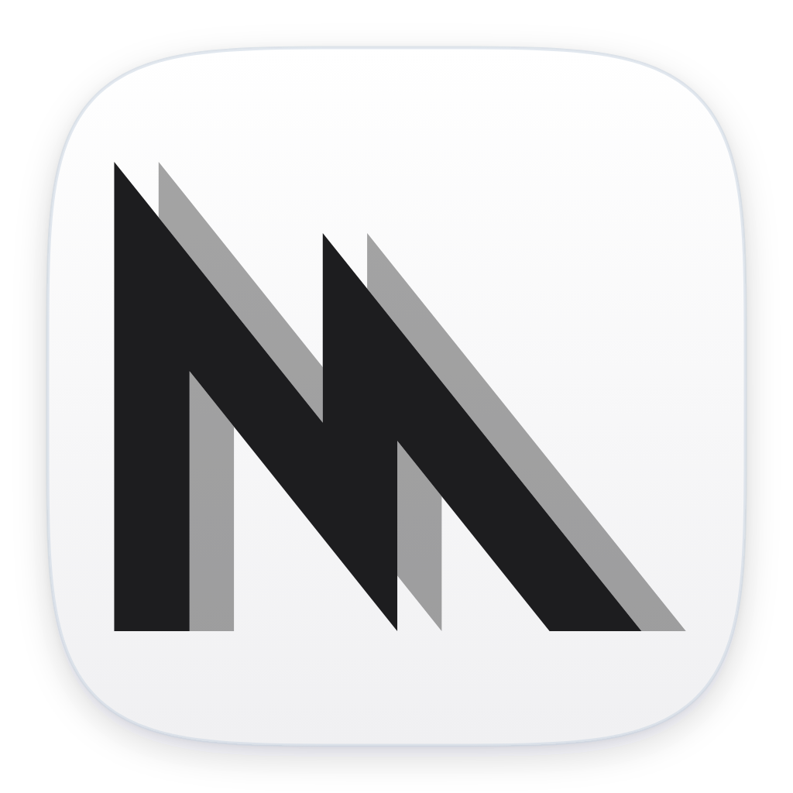

<p align="center"></p>

<h1 align="center">ninfer-metal</h1>

<p align="center">
  <strong>Motor nativo de inferencia LLM sobre Metal 4 NAX y Compute ICB para Apple M5+ (nombre en clave del núcleo v1: <code>miv</code>)</strong>
</p>

<!-- Replace scoltzero/ninfer-metal with final GitHub slug if changed -->
<p align="center">
  <a href="https://github.com/scoltzero/ninfer-metal/stargazers"></a>
  <a href="https://github.com/scoltzero/ninfer-metal/releases"></a>
  <a href="miv-v0.01-changelog.md"></a>
  
  
  <a href="../../../LICENSE"></a>
</p>

<div align="center">

[English](../../../README.md) | [简体中文](../zh-CN/README.md) | [繁體中文](../zh-TW/README.md) | [日本語](../ja/README.md) | [한국어](../ko/README.md) | **Español** | [Français](../fr/README.md) | [Deutsch](../de/README.md)

</div>

---

**`ninfer-metal`** es un motor de inferencia en C++20 / Objective-C++ / Metal 4 puro diseñado para Apple Silicon con **Neural Accelerators (NAX)** y **Compute ICB** en hardware (`M5 / M5 Pro / M5 Max / M5 Ultra`, `MTLGPUFamilyApple10+`, `macOS 27+`).

- **Sin Python, sin MLX**: Incluye 16 binarios Mach-O (entre ellos el servidor nativo `ninfer-metal-serve` y el demonio `mseries_backendd`) y 38 shaders `.metallib` precompilados enlazados únicamente con frameworks del sistema macOS. Se ejecuta en Mac limpios sin Xcode, Python ni bibliotecas dinámicas de Homebrew.
- **Servidor OpenAI autónomo (`ninfer-metal-serve`)**: Un único binario C++20 que aloja `miv` en proceso y microkernels SPI v2 de la Vía B en paralelo en un mismo puerto HTTP/SSE (`/v1/chat/completions`, `/v1/completions`, `/v1/models`, `/health`, `/metrics`), con tokenizador BPE en C++, plantillas de chat Jinja, separación de `<think>` en `reasoning_content` y análisis de `<tool_call>` en formato XML/JSON de Qwen — listo para Open WebUI, Cursor, Cline, NewAPI y los SDK de OpenAI.
- **Copia única de pesos NAX y paridad `0-ULP`**: El premosaico offline para NAX (`.miv`) alimenta el Prefill, la descodificación AR `T=1` y la verificación especulativa desde una sola copia residente en memoria (`1.0×` del tamaño del artefacto). La versión base **`miv-v0.01`** ejecuta modelos híbridos Qwen3.5 / Qwen3.6 / Qwen3.8 (Dense 27B y 35B-A3B MoE) en `MXFP4` y `oQ` Affine (`q3–q8`) con caché KV `affine4_g128`, Native MTP / DFlash2, procesamiento por lotes multiusuario (`B/C = 1..8`) y reutilización continua de prefijos en UMA.
- **Coexistencia directa con `oMLX-extend`**: Integra `oMLX-extend` (`omlx-extend-v0.8.3` sobre `jundot/omlx`) exponiendo **`miv Core Backend`** mediante un sidecar AF_UNIX Provider SPI v2. Los modelos `.miv` adaptados se enrutan automáticamente en O(1), los modelos no adaptados permanecen intactos en Stock MLX y el sidecar y MLX comparten la UMA bajo un único límite de memoria.

---

## Rendimiento de un vistazo


Medido en hardware físico Apple M5 Ultra (`80-GPU / 256 GiB` y `64-GPU / 96 GiB`) frente a `oMLX 0.8.0` estándar (`mlx 0.32.4`, NAX activado) en subprocesos aislados con paridad greedy `0-ULP`. Las cuatro gráficas y las cifras completas de Dim A–F figuran en las **[Notas de lanzamiento de `miv-v0.01`](miv-v0.01-changelog.md)**.

---

## Modelos y microkernels soportados

| Familia de modelos | Cuantización | Microkernel | Modo | Crédito / Fuente |
|---|---|---|---|---|
| **Qwen3.5 / 3.6 / 3.8 Dense** (0.8B – 27B, 3:1 GDN+GQA) | `MXFP4`, `oQ4e` | `miv-v0.01` | Vía A (Mainline) | núcleo `ninfer-metal` |
| **Qwen3.5 / 3.6 Hybrid MoE** (256×8 + compartido, p. ej. 35B-A3B) | `MXFP4`, `oQ4e` | `miv-v0.01` | Vía A (Mainline) | núcleo `ninfer-metal` |
| *Llama, Qwen3 (Pure-Attn), DeepSeek MLA, Gemma, GLM, MiniMax, ...* | *Abierto* | *Convocatoria PR* | Vía A / Vía B | **[Unirse a Microkernel Foundry →](microkernel-foundry.md)** |

Colaboradores y agentes de código pueden ampliar este catálogo mediante **[Microkernel Foundry](microkernel-foundry.md)**:

- **Vía A (PR Mainline)**: Integra tu arquitectura directamente sobre el sustrato compartido Metal 4 NAX de `ninfer-metal` — listado aquí con **crédito al colaborador**.
- **Vía B (Sidecar paralelo)**: Abre un PR o Issue cuando esté listo — lo registramos en [`omlx-extend/registry/microkernels.json`](../../../omlx-extend/registry/microkernels.json) (`sync_microkernels.sh`), lo listamos aquí con un **enlace a tu repositorio original**, y tanto `oMLX-extend` como el servidor autónomo `ninfer-metal-serve --providers-dir` descubren automáticamente `Providers/*/current/provider.json` y ejecutan los microkernels de la Vía B en paralelo junto a `miv` (y junto a MLX estándar en `oMLX-extend`).

---

## Inicio rápido

Compila el núcleo `miv/` sin MLX (`macOS 27+`, `Xcode 27+`):

```bash
export DEVELOPER_DIR=/Applications/Xcode.app/Contents/Developer
cmake -S . -B build/miv-v001 -G Ninja -DCMAKE_BUILD_TYPE=Release -DOMLX_M5_BUILD_NAX_METALLIB=ON -DOMLX_M5_BUILD_MLX_LEGACY_SMOKE=OFF -DOMLX_M5_BUILD_PYTHON=OFF
cmake --build build/miv-v001
```

Inicia el servidor OpenAI autónomo en C++ con un solo comando (carga automáticamente los valores compartidos de [`omlx-extend/config/ninfer-metal.toml`](../../../omlx-extend/config/ninfer-metal.toml), reutilizados por `oMLX-extend`) o valida la capa sidecar `oMLX-extend`:

```bash
./omlx-extend/scripts/start_ninfer_serve.sh /path/to/Qwen3.8-27B
./omlx-extend/scripts/apply_spi_patch.sh --omlx-dir ./omlx --test
```

Todas las opciones de compilación, conversión de pesos `.miv`, configuraciones multimicrokernel `ninfer-metal-serve --providers-dir` / `[[models]]` e instrucciones de actualización en caliente para `oMLX-extend` están en **[Inicio y configuración](getting-started.md)**; para un recorrido con capturas de la app macOS, consulta la **[Guía visual de `oMLX-extend`](omlx-extend-guide.md)**.

---

## Explorar más

| Guía | Contenido |
|---|---|
| **[Guía visual de `oMLX-extend`](omlx-extend-guide.md)** | Recorrido de 5 pasos con capturas de `oMLX` en macOS: tarjetas de microkernels, insignias de motor activo, enrutamiento automático / Stock MLX, MTP / DFlash2 y KVQuant de 4 bits, y configuración compartida en 1 clic |
| **[Inicio y configuración](getting-started.md)** | Requisitos previos, compilación CMake sin MLX, arranque en 1 clic `start_ninfer_serve.sh`, servidor autónomo `ninfer-metal-serve`, configuración del sidecar `oMLX-extend`, `ninfer-metal.toml` y uso de CLI/demonio de bajo nivel |
| **[Arquitectura y coexistencia](architecture.md)** | Núcleo dual `miv/` (`ninfer-metal-serve` + `mseries_backendd`), Provider SPI v2, enrutamiento automático O(1), coordinación de memoria UMA y actualización atómica por enlace simbólico |
| **[Microkernel Foundry](microkernel-foundry.md)** | Convocatoria abierta para microkernels de nuevas familias de modelos en M5+ (Llama, DeepSeek, Gemma, GLM, MiniMax) con el Silicon-Squeeze Skill |
| **[Notas de lanzamiento (`miv-v0.01`)](miv-v0.01-changelog.md)** | Gráficas de benchmarks Dim A–F, cambios en `ninfer-metal-serve` y `oMLX-extend`, pruebas, auditoría `otool -L` y alcance soportado |
| **[Hoja de ruta](roadmap.md)** | Hitos planificados más allá de `miv-v0.01` |
| **[Índice de documentación](../../README.md)** | Réplica completa en 8 idiomas, guías de hardware, calibraciones por SKU (`64-GPU` / `80-GPU`), especificaciones de backend y estándares de certificación |

---

## Agradecimientos

- **[`jundot/omlx`](https://github.com/jundot/omlx)** — Servidor de inferencia oMLX upstream y aplicación macOS extendida mediante `oMLX-extend`.
- **[`Neroued/ninfer`](https://github.com/Neroued/ninfer)** — Motor de inferencia nativo de referencia para propiedad explícita de memoria y planificación determinista.
- **[`z-lab/dflash`](https://github.com/z-lab/dflash)** y **[`bstnxbt/dflash-mlx`](https://github.com/bstnxbt/dflash-mlx)** — Decodificación especulativa por difusión en bloques DFlash / DFlash2 y ecosistema de modelos borrador para Apple Silicon.
- **[`SqueezeAILab/KVQuant`](https://github.com/SqueezeAILab/KVQuant)** y **[`FutureMLS-Lab/FOSCAR`](https://github.com/FutureMLS-Lab/FOSCAR)** — Investigación en cuantización de caché KV de bajos bits y atención de decodificación con plegado afín detrás de los kernels `affine4_g128` Metal 4 NAX de `miv`.
- **[`p-e-w/heretic`](https://github.com/p-e-w/heretic)** y **[`scoltzero/heretic-mlx`](https://github.com/scoltzero/heretic-mlx)** — Framework Heretic de modificación de modelos sin reentrenamiento y su puerto nativo MLX para Apple Silicon junto con pesos comunitarios cuantizados.
