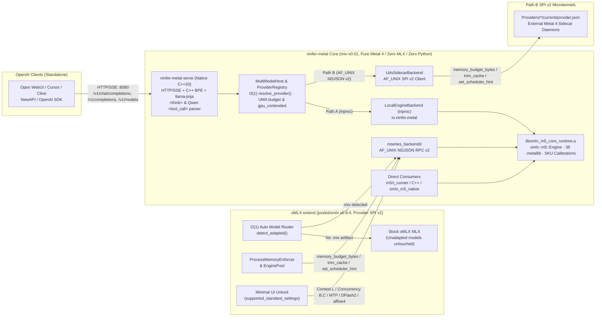

[English](../../architecture.md) | [简体中文](../zh-CN/architecture.md) | [繁體中文](../zh-TW/architecture.md) | [日本語](../ja/architecture.md) | [한국어](../ko/architecture.md) | **Español** | [Français](../fr/architecture.md) | [Deutsch](../de/architecture.md)

# Arquitectura y coexistencia multimodelo

`ninfer-metal` opera en dos modos de despliegue sobre un único núcleo puro C++20 / Objective-C++ / Metal 4 (`miv/`, runtime estático `libomlx_m5_core_runtime.a`): un servidor OpenAI nativo y autónomo en C++ (`ninfer-metal-serve`) que aloja en un mismo puerto tanto `miv` en proceso (`LocalEngineBackend`) como microkernels SPI v2 de la Vía B en paralelo (`UdsSidecarBackend`), y un sidecar Provider SPI v2 para `oMLX-extend` (`mseries_backendd`).

---

## Topología del sistema en modo dual

---

## 1. Servidor C++ nativo autónomo (`ninfer-metal-serve`)

`ninfer-metal-serve` incrusta `omlx::m5::Engine` directamente en un único binario Mach-O sin dependencias de Python ni de MLX, y aloja en un único puerto HTTP tanto modelos `miv` en proceso como múltiples microkernels SPI v2 de la Vía B en paralelo:

- **Transporte HTTP/SSE y configuración**: Servidor POSIX `cpp-httplib` (`GET /health`, `GET /metrics`, `GET /v1/models`, `GET /v1/models/:id`, `POST /v1/chat/completions`, `POST /v1/completions`, autenticación Bearer opcional y CORS) configurado mediante `ninfer-metal.toml` (`[server]`, `[model]`, `[[models]]`, `[engine]`, `[speculative]`) con sobrescritura desde la línea de comandos. Las solicitudes se enrutan según el campo JSON `"model"`.
- **Alojamiento paralelo nativo multimicrokernel**: `ProviderRegistry` escanea `--providers-dir`, `[server].providers_dir`, `OMLX_PROVIDERS_DIR` y `~/Library/Application Support/oMLX/Providers` buscando `<dir>/*/current/provider.json`, y `resolve_provider()` enruta cada modelo en O(1). `MultiModelHost` coordina en paralelo `miv` en proceso (`LocalEngineBackend`, `provider_id="io.ninfer.metal"`, `backend_mode="inproc"`) junto a demonios externos SPI v2 de la Vía B lanzados mediante POSIX `AF_UNIX` + `posix_spawn` (`UdsSidecarBackend`).
- **Arbitraje unificado de presupuesto UMA y contención GPU**: `MultiModelHost` reparte el techo global de memoria UMA (`81%` de `sysctl hw.memsize` o `--memory-budget-gb`), invoca `trim_cache` sobre modelos inactivos bajo presión y envía `set_scheduler_hint(gpu_contended=true)` cuando dos o más modelos infieren a la vez (volviendo a `false` al despejarse la contención). Al recibir `SIGINT`/`SIGTERM`, limpia todos los grupos de procesos y sockets.
- **Tokenización y plantillas nativas**: Tokenizador BPE en C++ puro (`utf8proc`, carga directa de `tokenizer.json` de HuggingFace incluido `LetterDigit1` para Qwen3.8) emparejado con el renderizador de plantillas `llama-jinja` (`--chat-template` -> `model_dir/chat_template.jinja` -> `tokenizer_config.json` -> respaldo ChatML).
- **Análisis en streaming de razonamiento y herramientas**: Un analizador incremental con retención UTF-8 separa `<think>...</think>` en `reasoning_content` y extrae llamadas tanto en formato XML de Qwen3.5/3.8 (`<tool_call><function=...><parameter=...>`) como JSON de Qwen3 (`<tool_call>{...}`) en respuestas síncronas y streaming SSE.
- **Coexistencia por defecto**: Escucha en el puerto `8080` por defecto (separado del puerto `8000` de oMLX) y carga automáticamente el mismo archivo predeterminado sin edición [`omlx-extend/config/ninfer-metal.toml`](../../../omlx-extend/config/ninfer-metal.toml) reutilizado por `oMLX-extend`.

---

## 2. Enrutamiento automático de modelos en O(1) (`oMLX-extend`)

`oMLX-extend` inspecciona cada directorio de modelo con `detect_adapted(model_dir)` en `< 1 ms` mediante comprobaciones directas en el sistema de archivos (`model.miv` / `model.omlxm5`, `model_pack.json`, `omlxm5-manifest.json`) sin lanzar subprocesos:

- **Modelos adaptados**: Se enrutan de forma diferida a **`miv Core Backend`** (`mseries_backendd`) en la primera solicitud (o cuando están fijados), mostrando **`miv Core Backend (Auto)`** en `Model Settings → Advanced Settings`. Desactivar **`Use External Engine`** escribe `external_engine: "stock"` y devuelve el modelo a Stock MLX.
- **Modelos no adaptados**: Se ejecutan sin cambios en Stock MLX (`BatchedEngine` / `VLMBatchedEngine`), sin procesos sidecar, sin consumo extra de memoria y sin impacto en el rendimiento.

---

## 3. Provider SPI v2 y coexistencia en UMA

Cuando los modelos `ninfer-metal`, los microkernels sidecar de la Vía B y los modelos MLX estándar se ejecutan en el mismo equipo Apple Silicon, comparten un único pool de memoria unificada (UMA) y una misma cola GPU. Tanto `oMLX-extend` (`ProcessMemoryEnforcer` + `EnginePool`) como el servidor autónomo `ninfer-metal-serve` (`MultiModelHost`) coordinan estos recursos mediante el mismo contrato del protocolo v2:

- **Límite estricto de memoria (`memory_budget_bytes`)**: `ProcessMemoryEnforcer` calcula el techo restante de cada modelo dentro del presupuesto del host y envía `memory_budget_bytes` en la RPC `load`. `native_backend.cpp` acota los pools de pesos, `KvPagePool` y cachés de prefijos a `min(W_ws - cur_alloc, memory_budget_bytes - cur_alloc)`.
- **Recorte de caché bajo presión (`trim_cache`)**: Antes de expulsar un modelo residente, `oMLX-extend` invoca `trim_cache(target_free_bytes)`. `miv/` desaloja entradas de prefijo no fijadas y bloques `UmaCheckpointPool` en `<= 100 ms` y desvincula los objetos `MTLBuffer` liberados de `MTLResidencySet` para que macOS recupere de inmediato las páginas cableadas.
- **Señales de contención GPU (`set_scheduler_hint`)**: Cuando un modelo MLX en proceso y un modelo sidecar ejecutan de forma simultánea, `EnginePool` envía `gpu_contended: true`. Los prefills largos pasan a dividirse en bloques acotados de `64` tokens alineados a página para que los flujos de descodificación paralelos mantengan una latencia estable entre tokens.
- **Apagado limpio de procesos**: Cada modelo cargado corre en un proceso hijo aislado con su propio `MTLDevice`, `MTL4CommandQueue` y socket `AF_UNIX` por instancia (`/tmp/omlx-<provider>-<uid>/...`, sin puertos TCP). Al ejecutar `stop()`, el host drena el grupo de procesos y verifica `process_memory_bytes() == 0` antes de cargar otro modelo.

### Interfaz mínima y separación de configuración

`oMLX-extend` no añade formularios personalizados al panel de oMLX ni a la aplicación macOS (`omlx-mac`). En su lugar, **`Integrations → External Engines`** muestra las tarjetas de **`miv Core Backend (ninfer-metal)`** y de los microkernels de la Vía B instalados encima de Splash, **`Models`** muestra insignias de motor activo junto a `Loaded` y en las filas de la biblioteca, y `provider.json` junto con el handshake `hello` publican `supported_standard_settings` para desbloquear los controles estándar según capacidad (`max_context_window`, `mtp_*`, `dflash_*`, `turboquant_kv_enabled` + `affine4 -> affine4_g128`). Otros proveedores como `Splash` conservan el bloqueo exacto del upstream. Los ajustes propios del núcleo (`rolling_prefix_cache`, `prefix_cache_gb`, sobrescrituras por modelo de `max_concurrency`, `sampling_contract`) residen en el archivo compartido sin edición [`omlx-extend/config/ninfer-metal.toml`](../../../omlx-extend/config/ninfer-metal.toml). Consulta la **[Guía visual de `oMLX-extend`](omlx-extend-guide.md)** para ver capturas de cada pantalla.

---

## 4. Diseño del motor Metal 4 (`miv/`)

- **Copia única de pesos premosaico**: La conversión offline a `.miv` (`mx_nax_tiled_bk128_v1` / `oq_nax_tiled_g64_v1`) abastece el Prefill NAX ancho `64×64`, la descodificación QMV `T=1` y la verificación especulativa `BM=8/16/32` desde una sola asignación residente (`1.0×` de huella del artefacto frente a `~1.92×` con remosaico en línea).
- **Grabación segura de Compute ICB**: Todos los segmentos de búfer indirecto permanecen estrictamente por debajo de `2 GiB` (`< 1 GiB` para cachés auxiliares compactas) para evitar el desbordamiento de desplazamientos hardware de 32 bits. Los asignadores de comandos con doble búfer `ar_pipe_[2]` solapan la codificación en host con la ejecución en GPU.
- **KV paginada CoW y continuación en UMA**: `KvPagePool` gestiona páginas de `64` tokens con conteo de referencias (`bf16` y `affine4_g128` `0-ULP` a `0.5625 B/val`). `QwenUmaContinuation` guarda y restaura el estado GDN de 48 capas (`146.81 MiB`) en un solo búfer de comandos GPU (`0.22–1.62 ms`, cero `memcpy` en CPU), y `rolling_prefix_cache` sustituye in-situ los ancestros no fijados (reutilización de bloques `1×`).
- **Aislamiento estricto de calibración por SKU**: `silicon_tuning.h` carga perfiles por SKU (`apple-m5-ultra-64gpu.json`, `apple-m5-ultra-80gpu.json`) indexados por `profile_id` exacto y recurre a valores a priori parametrizados en chips sin medir — nunca aplica las constantes medidas de un SKU a otro.

---

## 5. CI de doble vía en monorrepositorio y actualización atómica

Ambas vías conviven en un único repositorio con etiquetas de lanzamiento y flujos de trabajo independientes:

| Vía | Ruta | Patrón de etiqueta | Flujo de trabajo |
|---|---|---|---|
| **Núcleo de inferencia** | `miv/` | `miv-v0.01` (`<codename>-vX.YZ`) | [`.github/workflows/release-ninfer-metal.yml`](../../../.github/workflows/release-ninfer-metal.yml) |
| **Extensión de host** | `omlx/` + `omlx-extend/` | `omlx-extend-vX.Y.Z` / `omlx-extend-vX.Y.Z-mixN` | [`.github/workflows/sync-omlx-extend.yml`](../../../.github/workflows/sync-omlx-extend.yml) |

Los archivos tar del núcleo se instalan en paralelo bajo `~/Library/Application Support/oMLX/Providers/io.ninfer.metal/versions/<tag>/` y se activan cambiando atómicamente el enlace simbólico `current`, lo que permite actualizar y revertir en un solo comando sin alterar el entorno Python de oMLX.

---

## Referencias en profundidad

- [Arquitectura de portado v2](../../backend/ninfer-m5-porting-architecture-v2.md)
- [Formato de artefacto `.miv` v1](../../backend/artifact-format-v1.md) y [Contrato de despacho v1](../../backend/dispatch-contract-v1.md)
- [Fronteras de hardware y software v1](../../foundations/hardware-software-boundaries-v1.md)
- [Estándar de certificación del núcleo](../../standards/core-certification-standard.md)
