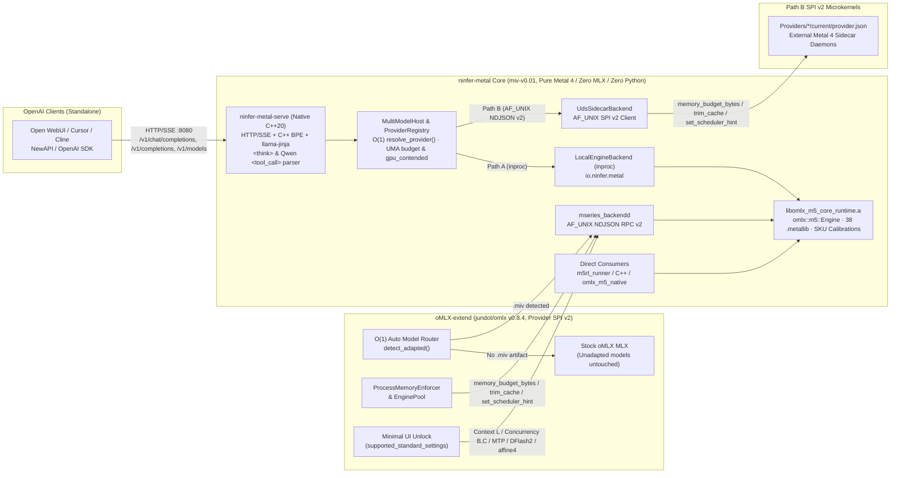

[English](../../architecture.md) | [简体中文](../zh-CN/architecture.md) | [繁體中文](../zh-TW/architecture.md) | [日本語](../ja/architecture.md) | [한국어](../ko/architecture.md) | [Español](../es/architecture.md) | **Français** | [Deutsch](../de/architecture.md)

# Architecture et coexistence multi-modèles

`ninfer-metal` fonctionne selon deux modes de déploiement au-dessus d'un même cœur pur C++20 / Objective-C++ / Metal 4 (`miv/`, runtime statique `libomlx_m5_core_runtime.a`) : un serveur OpenAI C++ natif autonome (`ninfer-metal-serve`) hébergeant sur un même port à la fois `miv` in-process (`LocalEngineBackend`) et des microkernels SPI v2 Voie B en parallèle (`UdsSidecarBackend`), et un sidecar Provider SPI v2 pour `oMLX-extend` (`mseries_backendd`).

---

## Topologie du système bimode

---

## 1. Serveur C++ natif autonome (`ninfer-metal-serve`)

`ninfer-metal-serve` embarque directement `omlx::m5::Engine` dans un unique binaire Mach-O sans aucune dépendance Python ni MLX, et héberge sur un seul port HTTP des modèles `miv` in-process ainsi que plusieurs microkernels SPI v2 Voie B en parallèle :

- **Transport HTTP/SSE et configuration** : Serveur POSIX `cpp-httplib` (`GET /health`, `GET /metrics`, `GET /v1/models`, `GET /v1/models/:id`, `POST /v1/chat/completions`, `POST /v1/completions`, authentification Bearer optionnelle, CORS) configuré via `ninfer-metal.toml` (`[server]`, `[model]`, `[[models]]`, `[engine]`, `[speculative]`) avec surcharge par les arguments CLI. Chaque requête est routée selon le champ JSON `"model"`.
- **Hébergement parallèle natif multi-microkernel** : `ProviderRegistry` parcourt `--providers-dir`, `[server].providers_dir`, `OMLX_PROVIDERS_DIR` et `~/Library/Application Support/oMLX/Providers` à la recherche de `<dir>/*/current/provider.json`, et `resolve_provider()` route chaque modèle en O(1). `MultiModelHost` gère en parallèle `miv` in-process (`LocalEngineBackend`, `provider_id="io.ninfer.metal"`, `backend_mode="inproc"`) et les démons externes SPI v2 Voie B lancés via POSIX `AF_UNIX` + `posix_spawn` (`UdsSidecarBackend`).
- **Coordination unifiée UMA et contention GPU** : `MultiModelHost` répartit le plafond mémoire UMA du serveur (`81%` de `sysctl hw.memsize` ou `--memory-budget-gb`), appelle `trim_cache` sur les modèles inactifs sous pression et transmet `set_scheduler_hint(gpu_contended=true)` dès que deux modèles ou plus infèrent simultanément (puis `false` à la fin de la contention). Sur `SIGINT`/`SIGTERM`, il nettoie proprement les groupes de processus et les sockets.
- **Tokenisation et templates natifs** : Tokenizer BPE pur C++ (`utf8proc`, chargement direct de `tokenizer.json` HuggingFace incluant `LetterDigit1` pour Qwen3.8) couplé au rendu de templates `llama-jinja` (`--chat-template` -> `model_dir/chat_template.jinja` -> `tokenizer_config.json` -> repli ChatML).
- **Parsing en streaming du raisonnement et des outils** : Un parseur incrémental à retenue UTF-8 extrait `<think>...</think>` vers `reasoning_content` et décode à la fois les appels XML Qwen3.5/3.8 (`<tool_call><function=...><parameter=...>`) et JSON Qwen3 (`<tool_call>{...}`) en mode synchrone comme en streaming SSE.
- **Coexistence par défaut** : Écoute par défaut sur le port `8080` (distinct du port `8000` d'oMLX) et charge automatiquement la même configuration par défaut sans édition [`omlx-extend/config/ninfer-metal.toml`](../../../omlx-extend/config/ninfer-metal.toml) réutilisée par `oMLX-extend`.

---

## 2. Routage automatique des modèles en O(1) (`oMLX-extend`)

`oMLX-extend` inspecte chaque répertoire de modèle via `detect_adapted(model_dir)` en `< 1 ms` par de simples contrôles du système de fichiers (`model.miv` / `model.omlxm5`, `model_pack.json`, `omlxm5-manifest.json`), sans lancer de sous-processus :

- **Modèles adaptés** : Routés à la demande vers **`miv Core Backend`** (`mseries_backendd`) dès la première requête (ou lorsqu'ils sont épinglés), en affichant **`miv Core Backend (Auto)`** dans `Model Settings → Advanced Settings`. Désactiver **`Use External Engine`** écrit `external_engine: "stock"` et bascule le modèle vers Stock MLX.
- **Modèles non adaptés** : Exécutés tels quels par Stock MLX (`BatchedEngine` / `VLMBatchedEngine`), sans processus sidecar, sans surcoût mémoire et sans changement de performances.

---

## 3. Provider SPI v2 et coexistence en UMA

Lorsque des modèles `ninfer-metal`, des microkernels sidecar Voie B et des modèles MLX standard tournent sur la même machine Apple Silicon, ils partagent un pool unique de mémoire unifiée (UMA) et une même file GPU. Aussi bien `oMLX-extend` (`ProcessMemoryEnforcer` + `EnginePool`) que le serveur autonome `ninfer-metal-serve` (`MultiModelHost`) coordonnent ces ressources via le même contrat Protocole v2 :

- **Plafond mémoire strict (`memory_budget_bytes`)** : `ProcessMemoryEnforcer` calcule l'enveloppe restante pour chaque modèle dans le budget de l'hôte et transmet `memory_budget_bytes` dans le RPC `load`. `native_backend.cpp` borne les pools de poids, `KvPagePool` et les caches de préfixes à `min(W_ws - cur_alloc, memory_budget_bytes - cur_alloc)`.
- **Réduction de cache sous pression (`trim_cache`)** : Avant d'évincer un modèle résident, `oMLX-extend` appelle `trim_cache(target_free_bytes)`. `miv/` évince les entrées de préfixes non épinglées et les blocs `UmaCheckpointPool` en `<= 100 ms` et détache les `MTLBuffer` libérés de `MTLResidencySet` afin que macOS récupère immédiatement les pages verrouillées.
- **Signaux de contention GPU (`set_scheduler_hint`)** : Quand un modèle MLX in-process et un modèle sidecar s'exécutent simultanément, `EnginePool` envoie `gpu_contended: true`. Les prefills longs basculent en tranches bornées de `64` tokens alignées sur les pages pour maintenir une latence inter-token régulière sur les flux de décodage concurrents.
- **Arrêt propre des processus** : Chaque modèle chargé tourne dans un processus fils isolé disposant de son propre `MTLDevice`, de sa propre `MTL4CommandQueue` et de son socket `AF_UNIX` dédié (`/tmp/omlx-<provider>-<uid>/...`, aucun port TCP). Sur `stop()`, l'hôte vide le groupe de processus et vérifie `process_memory_bytes() == 0` avant de charger un autre modèle.

### Interface minimale et séparation de la configuration

`oMLX-extend` n'ajoute aucun formulaire personnalisé au tableau de bord oMLX ni à l'application macOS (`omlx-mac`). À la place, **`Integrations → External Engines`** affiche les cartes **`miv Core Backend (ninfer-metal)`** et des microkernels Voie B installés au-dessus de Splash, **`Models`** affiche les badges de moteur actif à côté de `Loaded` et sur les lignes de la bibliothèque, et `provider.json` + le handshake `hello` publient `supported_standard_settings` pour débloquer les contrôles standard par capacité (`max_context_window`, `mtp_*`, `dflash_*`, `turboquant_kv_enabled` + `affine4 -> affine4_g128`). Les autres fournisseurs comme `Splash` conservent exactement le verrouillage upstream. Les paramètres propres au cœur (`rolling_prefix_cache`, `prefix_cache_gb`, surcharges par modèle de `max_concurrency`, `sampling_contract`) résident dans le fichier partagé sans édition [`omlx-extend/config/ninfer-metal.toml`](../../../omlx-extend/config/ninfer-metal.toml). Voir le **[Guide visuel d'`oMLX-extend`](omlx-extend-guide.md)** pour les captures de chaque écran.

---

## 4. Conception du moteur Metal 4 (`miv/`)

- **Copie unique des poids pré-tuilés** : La conversion hors ligne `.miv` (`mx_nax_tiled_bk128_v1` / `oq_nax_tiled_g64_v1`) dessert le Prefill NAX large `64×64`, le décodage QMV `T=1` et la vérification spéculative `BM=8/16/32` depuis une seule allocation résidente (`1.0×` l'empreinte de l'artefact contre `~1.92×` pour un re-tuilage en ligne).
- **Enregistrement Compute ICB sécurisé** : Tous les segments de buffers indirects restent strictement inférieurs à `2 GiB` (`< 1 GiB` pour les caches auxiliaires compacts) afin d'éviter le débordement des offsets matériels 32 bits. Les allocateurs de commandes en double tampon `ar_pipe_[2]` recouvrent l'encodage hôte et l'exécution GPU.
- **KV paginé CoW et continuation UMA** : `KvPagePool` gère des pages de `64` tokens à comptage de références (`bf16` et `affine4_g128` `0-ULP` à `0.5625 B/val`). `QwenUmaContinuation` capture et restaure l'état GDN sur 48 couches (`146.81 MiB`) dans un unique command buffer GPU (`0.22–1.62 ms`, zéro `memcpy` CPU), et `rolling_prefix_cache` remplace sur place les ancêtres non épinglés (réutilisation de slab `1×`).
- **Isolation stricte des calibrations par SKU** : `silicon_tuning.h` charge les profils par SKU (`apple-m5-ultra-64gpu.json`, `apple-m5-ultra-80gpu.json`) indexés par `profile_id` exact et bascule sur des a priori paramétrés pour les puces non mesurées — sans jamais appliquer les constantes mesurées d'un SKU à un autre.

---

## 5. CI double piste en monorepo et mise à jour atomique

Les deux pistes cohabitent dans un seul dépôt avec des tags de version et des workflows indépendants :

| Piste | Chemin | Format de tag | Workflow |
|---|---|---|---|
| **Cœur d'inférence** | `miv/` | `miv-v0.01` (`<codename>-vX.YZ`) | [`.github/workflows/release-ninfer-metal.yml`](../../../.github/workflows/release-ninfer-metal.yml) |
| **Extension hôte** | `omlx/` + `omlx-extend/` | `omlx-extend-vX.Y.Z` / `omlx-extend-vX.Y.Z-mixN` | [`.github/workflows/sync-omlx-extend.yml`](../../../.github/workflows/sync-omlx-extend.yml) |

Les archives du cœur s'installent côte à côte sous `~/Library/Application Support/oMLX/Providers/io.ninfer.metal/versions/<tag>/` et s'activent par bascule atomique du lien symbolique `current`, autorisant mises à jour et retours arrière en une commande sans toucher à l'environnement Python d'oMLX.

---

## Références approfondies

- [Architecture de portage v2](../../backend/ninfer-m5-porting-architecture-v2.md)
- [Format d'artefact `.miv` v1](../../backend/artifact-format-v1.md) et [Contrat de dispatch v1](../../backend/dispatch-contract-v1.md)
- [Frontières matériel et logiciel v1](../../foundations/hardware-software-boundaries-v1.md)
- [Standard de certification du cœur](../../standards/core-certification-standard.md)
