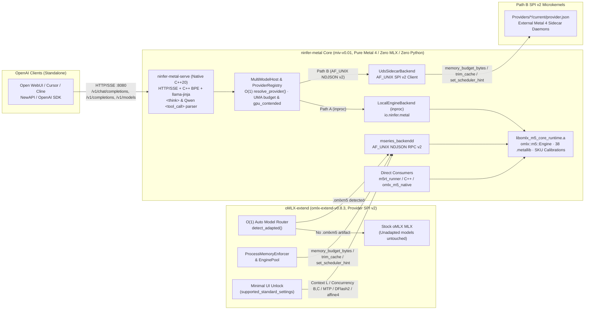

[English](../../architecture.md) | [简体中文](../zh-CN/architecture.md) | [繁體中文](../zh-TW/architecture.md) | **日本語** | [한국어](../ko/architecture.md) | [Español](../es/architecture.md) | [Français](../fr/architecture.md) | [Deutsch](../de/architecture.md)

# アーキテクチャとマルチモデル共存

`ninfer-metal` は、単一の純 C++20 / Objective-C++ / Metal 4 コア（`miv/`、静的ランタイム `libomlx_m5_core_runtime.a`）上で 2 つのデプロイ形態をサポートする：インプロセス `miv`（`LocalEngineBackend`）と並列ルート B SPI v2 マイクロカーネル（`UdsSidecarBackend`）を単一ポートでホストする単体ネイティブ C++ OpenAI サーバー（`ninfer-metal-serve`）、および `oMLX-extend` Provider SPI v2 サイドカー（`mseries_backendd`）である。

---

## デュアルモード・システムトポロジ

---

## 1. 単体ネイティブ C++ サーバー（`ninfer-metal-serve`）

`ninfer-metal-serve` は `omlx::m5::Engine` を単一の Mach-O バイナリに直接組み込み、Python と MLX のランタイム依存を排除しつつ、単一 HTTP ポート上でインプロセス `miv` モデルと複数のルート B SPI v2 マイクロカーネルを並列ホストする：

- **HTTP/SSE トランスポート & 設定**: POSIX `cpp-httplib` サーバー（`GET /health`、`GET /metrics`、`GET /v1/models`、`GET /v1/models/:id`、`POST /v1/chat/completions`、`POST /v1/completions`、任意 Bearer 認証、CORS）を搭載し、`ninfer-metal.toml`（`[server]`、`[model]`、`[[models]]`、`[engine]`、`[speculative]`）と CLI フラグ上書きで設定する。リクエストは JSON `"model"` フィールドでルーティングされる。
- **ネイティブ・マルチマイクロカーネル並列ホスト**: `ProviderRegistry` が `--providers-dir`、`[server].providers_dir`、`OMLX_PROVIDERS_DIR`、および `~/Library/Application Support/oMLX/Providers` から `<dir>/*/current/provider.json` を走査し、`resolve_provider()` が O(1) で各モデルを振り分ける。`MultiModelHost` がインプロセス `miv`（`LocalEngineBackend`、`provider_id="io.ninfer.metal"`、`backend_mode="inproc"`）と POSIX `AF_UNIX` + `posix_spawn` 経由の外部ルート B SPI v2 デーモン（`UdsSidecarBackend`）を並列に管理する。
- **UMA 予算・GPU 競合の統一調停**: `MultiModelHost` はサーバー全体の UMA メモリ上限（`sysctl hw.memsize` の `81%` または `--memory-budget-gb`）を各モデルへ配分し、メモリ圧迫時にアイドルモデルの `trim_cache` を呼び出す。2 モデル以上が同時推論すると `set_scheduler_hint(gpu_contended=true)` を送出し、競合解消時に `false` へ戻す。終了時は `SIGINT`/`SIGTERM` でプロセスグループとソケットを回収する。
- **ネイティブトークナイザ & テンプレート**: 純 C++ BPE トークナイザ（`utf8proc`、Qwen3.8 の `LetterDigit1` を含め HuggingFace `tokenizer.json` を直接読み込み）と `llama-jinja` チャットテンプレートレンダリング（`--chat-template` -> `model_dir/chat_template.jinja` -> `tokenizer_config.json` -> ChatML フォールバック）を組み合わせる。
- **ストリーミング推論出力 & ツール解析**: 逐次 UTF-8 ホールドバックパーサが `<think>...</think>` を `reasoning_content` へ分離し、同期応答と SSE ストリーミングの両方で Qwen3.5/3.8 XML（`<tool_call><function=...><parameter=...>`）および Qwen3 JSON（`<tool_call>{...}`）呼び出しを抽出する。
- **デフォルト共存設計**: デフォルトの待受ポートは `8080`（oMLX の `8000` と分離）であり、`oMLX-extend` と共有する編集不要のデフォルト設定 [`omlx-extend/config/ninfer-metal.toml`](../../../omlx-extend/config/ninfer-metal.toml) を自動読み込みする。

---

## 2. O(1) 自動モデルルーティング（`oMLX-extend`）

`oMLX-extend` はサブプロセスを起動せず、ファイルシステム検査のみで `detect_adapted(model_dir)` を `< 1 ms` で完了し、`model.omlxm5`、`model_pack.json`、`omlxm5-manifest.json` の存在を判定する：

- **変換済みモデル**: 初回リクエスト時（またはピン留め時）に遅延で **`miv Core Backend`**（`mseries_backendd`）へルーティングし、`Model Settings → Advanced Settings` に **`miv Core Backend (Auto)`** と表示する。**`Use External Engine`** をオフにすると `external_engine: "stock"` を書き込み、モデルを Stock MLX へ戻す。
- **未変換モデル**: Stock MLX（`BatchedEngine` / `VLMBatchedEngine`）をそのまま通過し、サイドカープロセス・追加メモリ・性能オーバーヘッドはいずれもゼロである。

---

## 3. Provider SPI v2 と UMA 共存

同一 Apple Silicon マシン上で `ninfer-metal` モデル、ルート B サイドカーマイクロカーネル、標準 MLX モデルが並列動作する場合、全プロセスが単一の Unified Memory（UMA）プールと GPU キューを共有する。Protocol v2 は `oMLX-extend`（`ProcessMemoryEnforcer` + `EnginePool`）と単体 `ninfer-metal-serve`（`MultiModelHost`）の双方から同じ制御契約で調停する：

- **ハードメモリ上限（`memory_budget_bytes`）**: `ProcessMemoryEnforcer` がホスト予算内の残余上限を算出し、`load` RPC で `memory_budget_bytes` を渡す。`native_backend.cpp` はウェイトプール・`KvPagePool`・プレフィックスキャッシュを `min(W_ws - cur_alloc, memory_budget_bytes - cur_alloc)` にクランプする。
- **メモリ圧迫時のキャッシュ解放（`trim_cache`）**: 常駐モデルをアンロードする前に `oMLX-extend` が `trim_cache(target_free_bytes)` を呼ぶ。`miv/` は未ピン留めのプレフィックスエントリと `UmaCheckpointPool` スラブを `<= 100 ms` 以内に退避し、解放した `MTLBuffer` を `MTLResidencySet` から切り離して macOS がワイヤードページを即時回収できるようにする。
- **GPU 競合ヒント（`set_scheduler_hint`）**: インプロセス MLX モデルとサイドカーモデルが並列実行されている間、`EnginePool` が `gpu_contended: true` を通知する。長文 Prefill はページ境界に揃えた `64` トークン単位の有界チャンクへ切り替わり、同時実行中のデコードストリームのトークン間レイテンシを一定に保つ。
- **クリーンなプロセス終了**: ロードされた各モデルは独立した子プロセスで実行され、専用の `MTLDevice`・`MTL4CommandQueue`・インスタンス固有の `AF_UNIX` ソケット（`/tmp/omlx-<provider>-<uid>/...`、TCP ポート不使用）を持つ。`stop()` 時にホストはプロセスグループをドレインし、`process_memory_bytes() == 0` を確認してから次のモデルをロードする。

### 最小限の UI 解放と設定分離

`oMLX-extend` は oMLX ダッシュボードや macOS アプリ（`omlx-mac`）に独自の設定フォームを追加しない。代わりに **`Integrations → External Engines`** で Splash の上部に導入済みの **`miv Core Backend (ninfer-metal)`** とルート B マイクロカーネルカードを表示し、**`Models`** で `Loaded` の横やライブラリ行にアクティブエンジンバッジを表示する。さらに `provider.json` と `hello` ハンドシェイクが `supported_standard_settings` を公開し、機能単位で標準 UI コントロールを解放する（`max_context_window`、`mtp_*`、`dflash_*`、`turboquant_kv_enabled` + `affine4 -> affine4_g128`）。`Splash` などの他プロバイダはアップストリームのロック挙動を維持する。コア固有のパラメータ（`rolling_prefix_cache`、`prefix_cache_gb`、モデル別 `max_concurrency` 上書き、`sampling_contract`）は編集不要の共有 [`omlx-extend/config/ninfer-metal.toml`](../../../omlx-extend/config/ninfer-metal.toml) に分離する。各画面のスクリーンショットは **[`oMLX-extend` ビジュアルガイド](omlx-extend-guide.md)** を参照。

---

## 4. Metal 4 エンジン設計（`miv/`）

- **単一プリタイル・ウェイトコピー**: オフライン `.omlxm5` 変換（`mx_nax_tiled_bk128_v1` / `oq_nax_tiled_g64_v1`）により、ワイド `64×64` Prefill NAX、`T=1` QMV デコード、`BM=8/16/32` 投機検証を単一の常駐確保領域から供給する（オンライン再タイリング時の `~1.92×` に対し成果物フットプリント `1.0×`）。
- **安全な Compute ICB 記録**: 32 ビットハードウェアオフセットのラップアラウンドを防ぐため、すべての間接バッファセグメントを `2 GiB` 未満（補助コンパクトキャッシュは `< 1 GiB`）に厳密制限する。ダブルバッファ化された `ar_pipe_[2]` コマンドアロケータがホストエンコードと GPU 実行をオーバーラップさせる。
- **ページ化 CoW KV & UMA コンティニュエーション**: `KvPagePool` が参照カウント付き `64` トークンページ（`bf16` および `0.5625 B/val` の `0-ULP` `affine4_g128`）を管理する。`QwenUmaContinuation` は 48 層 GDN 状態（`146.81 MiB`）を単一 GPU コマンドバッファで保存・復元し（`0.22–1.62 ms`、CPU `memcpy` ゼロ）、`rolling_prefix_cache` が未ピン留め祖先をインプレース置換（`1×` スラブ再利用）する。
- **厳格な SKU キャリブレーション分離**: `silicon_tuning.h` は正確な `profile_id` をキーとして SKU 別プロファイル（`apple-m5-ultra-64gpu.json`、`apple-m5-ultra-80gpu.json`）を読み込み、未計測チップではパラメータ化事前分布へフォールバックする。ある SKU の実測定数を別 SKU に流用することはない。

---

## 5. モノレポ・デュアルトラック CI & アトミックホットアップデート

両トラックは単一リポジトリ内で独立したリリースタグとワークフローを持つ：

| トラック | パス | タグ形式 | ワークフロー |
|---|---|---|---|
| **推論コア** | `miv/` | `miv-v0.01`（`<codename>-vX.YZ`） | [`.github/workflows/release-ninfer-metal.yml`](../../../.github/workflows/release-ninfer-metal.yml) |
| **ホスト拡張** | `omlx/` + `omlx-extend/` | `omlx-extend-v0.8.3`（`omlx-extend-vX.Y.Z` / `omlx-extend-vX.Y.Z-mix1..9`） | [`.github/workflows/sync-omlx-extend.yml`](../../../.github/workflows/sync-omlx-extend.yml) |

コアの tarball は `~/Library/Application Support/oMLX/Providers/io.ninfer.metal/versions/<tag>/` に並列配置され、`current` シンボリックリンクのアトミック切り替えで有効化される。oMLX の Python 環境を変更せず、アップグレードと単一コマンドのロールバックを実行できる。

---

## 詳細技術リファレンス

- [Porting Architecture v2](../../backend/ninfer-m5-porting-architecture-v2.md)
- [`.omlxm5` Artifact Format v1](../../backend/artifact-format-v1.md) & [Dispatch Contract v1](../../backend/dispatch-contract-v1.md)
- [Hardware & Software Boundaries v1](../../foundations/hardware-software-boundaries-v1.md)
- [Core Certification Standard](../../standards/core-certification-standard.md)
