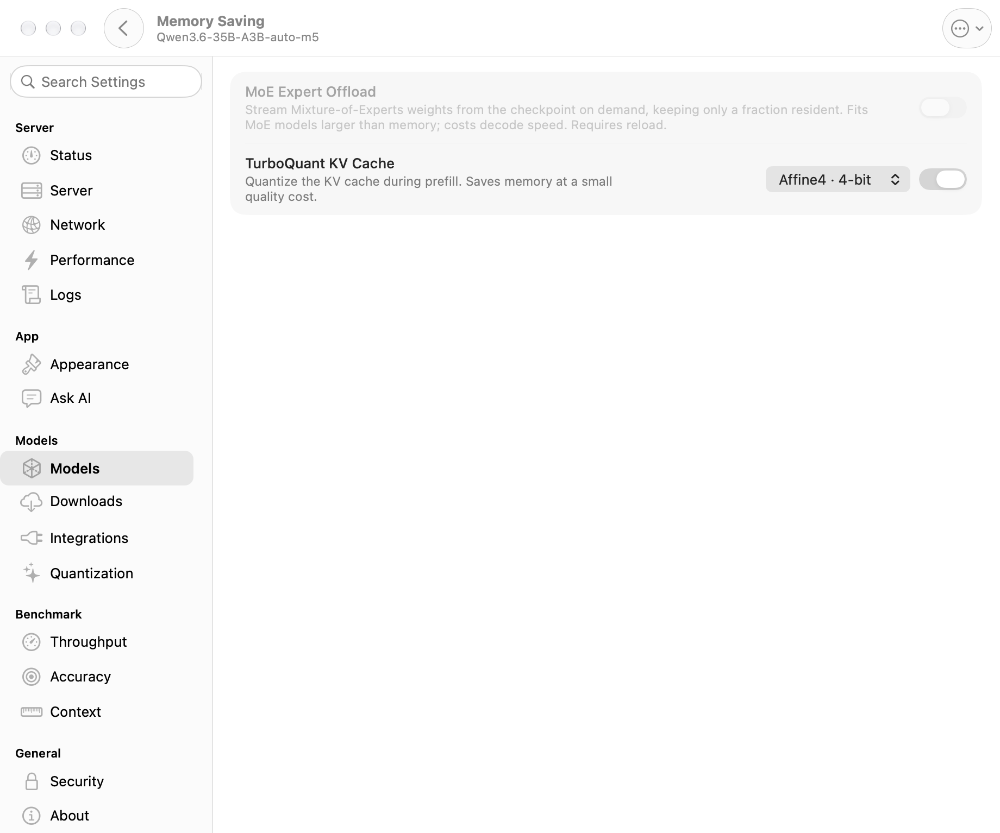

[English](../../omlx-extend-guide.md) | [简体中文](../zh-CN/omlx-extend-guide.md) | [繁體中文](../zh-TW/omlx-extend-guide.md) | **日本語** | [한국어](../ko/omlx-extend-guide.md) | [Español](../es/omlx-extend-guide.md) | [Français](../fr/omlx-extend-guide.md) | [Deutsch](../de/omlx-extend-guide.md)

# `oMLX-extend` ビジュアルガイド

`oMLX-extend` は、Apple M5+ Mac（`macOS 27+`）上の `oMLX` macOS アプリに **`miv Core Backend (ninfer-metal)`** とコミュニティ製ルート B Metal 4 マイクロカーネルを追加する。変換済みの `.miv` モデルは自動でネイティブ Metal 4 NAX 実行に切り替わり、通常の MLX モデルはそのまま Stock MLX で動作する。

以下の 5 つの画面に沿って、インストール状態の確認、エンジンルーティングの把握、高速デコード機能の有効化、および設定ファイルを手書きしない単体サーバー起動を確認する。

---

## ステップ 1：マイクロカーネルの検索・ダウンロード・ホットアップデート管理

`oMLX` で **`Integrations → External Engines`** を開くと、**`miv Core Backend (ninfer-metal)`** およびコミュニティ製ルート B SPI v2 マイクロカーネルを macOS アプリ上から直接管理できる：


- **マイクロカーネルレジストリ（上部バー）**：
  - **`Refresh`** を押すと、メインリポジトリの最新 `microkernels.json` を取得し、各コアの `latest.json` とバージョン比較を行う。
  - ドロップダウンで任意のコアを選ぶと、その直下に **対応モデル（Supported Models）**・トポロジ・SPI バージョン・必要 macOS バージョンが表示されるため、ダウンロード前に適合性を確認できる。
  - **`Refresh`** 右側の **`Download`** を押すと、ダウンロード・SHA-256 検証・安全な展開・SPI v2 検証を経て `~/Library/Application Support/oMLX/Providers/` へ導入される（最新管理版が導入済みの場合は **`Installed`** として無効化）。
- **導入済みコア一覧（下部リスト）**：
  - **左側の四角いチェックボックス（`☑️`）**：チェックで有効化（新規導入時は既定で有効）し、`settings.json` に永続化。チェックを外すと O(1) 自動ルーティングおよびモデル別エンジン選択から即座に除外される。
  - **右側の `Update` ボタン**：通常は無効表示で、**`Refresh` 後にリモートで新しいバージョンが検出された場合のみ点灯**する。クリックすると `current` シンボリックリンクをアトミックに切り替え、稼働中モデルを止めずにホットアップデートする（再ロードで新コアへ切替）。
  - **右側の `Delete` ボタン**：確認ダイアログ後に `Providers/` 配下の管理ディレクトリを削除する（稼働中モデルがある場合はアンロード後に削除）。外部またはローカルビルドパスのコアは誤削除防止のため無効化される（無効化したい場合はチェックを外す）。
- **CLI 併用（任意）**：自動化や端末操作では `./omlx-extend/scripts/sync_microkernels.sh --provider io.ninfer.metal`（`--all` / `--rollback` 対応）も引き続き利用できる。
- **Splash**：直下に配置され、既存のコントロールはすべてそのまま維持される。

---

## ステップ 2：各モデルの実行エンジンを確認する

**`Models`** 画面へ切り替えると、Mac 上の各モデルがどのエンジンへルーティングされているかを一覧で確認できる：


- **Active Models**：ロード済みの各モデルには **`Loaded`** のすぐ隣にエンジンバッジ（`miv Core`、ルート B マイクロカーネル名、または `MLX`）が表示される。
- **Model Library**：`.miv` ウェイトを持つモデルにはハイライトバッジ（`miv Core · Auto`、ルート B マイクロカーネル、または外部ルーティングをオフにした場合は `Stock MLX`）が表示される。
- **未変換モデルへの影響はゼロ**：通常の MLX チェックポイントには外部エンジンバッジが付かず、サイドカープロセスを一切起動せずに Stock MLX で動作する。`miv Core Backend`、ルート B、および Stock MLX の各モデルは、単一の統合メモリ上限のもとで並列ロードできる。

---

## ステップ 3：自動ルーティングと Stock MLX への切り替え

**Model Library** で任意の変換済みモデルをクリックし、**`Advanced Settings`** を開く：


- 変換済み `.miv` モデルでは **`Use External Engine`** が初期状態で **ON** になっており、ドロップダウンに **`miv Core Backend (Auto)`** が選択されている（上位の Model Settings ヘッダにもアクティブエンジンバッジが表示される）。
- **いつでも Stock MLX へ戻せる**：**`Use External Engine`** を **OFF** に切り替えると、`oMLX` は `.miv` ウェイトを削除せずに `external_engine: "stock"` を記録し、*"Using Stock MLX (auto-route overridden)"* と表示する。再び **ON** に戻せば自動ルーティングへ復帰する。
- **別エンジンの選択**：同じモデルに対応するルート B マイクロカーネルや Splash が導入されている場合は、同じドロップダウンから直接切り替えられる。

---

## ステップ 4：MTP / DFlash2 と 4-bit KVQuant を有効化する

`oMLX-extend` は標準の `oMLX` 設定画面をそのまま利用する。アクティブなマイクロカーネルが対応する項目は通常の明るさで有効化され、MLX 専用項目はグレーアウトされたままとなるため、実行対象の機能を一目で判別できる。

### Acceleration（`Lightning MTP` と `DFlash`）

**`Model Settings → Acceleration`** を開く：


- モデルに組み込み MTP ヘッドがある場合、**`Lightning MTP`**（および **`Adaptive max depth`**）が解放される。
- ブロック拡散投機デコード向けに **`DFlash`**（**`DFlash Draft Model`** および **`Runtime Block Size`** を含む）が解放される。
- MLX 専用項目（`Draft Quantization`、`Verify Mode`、`Draft Window Size`、`VLM MTP`）はグレーアウトのまま維持される。

### Memory Saving（`4-bit KVQuant`）

**`Model Settings → Memory Saving`** を開く：



- **`TurboQuant KV Cache`** をオンにして **`Affine4 · 4-bit`** を選択すると、`miv Core Backend` の `affine4_g128` KV キャッシュ（`0.5625 B/val`、`64K+` コンテキストまで `0-ULP` 検証済み）が有効になる。
- スイッチをオフにするとフル精度 `bf16` KV キャッシュを使用する。`miv-v0.01` で `affine8` または `turboquant` を選んだ場合は `bf16` にフォールバックする。
- **`MoE Expert Offload`** などの MLX 専用メモリ項目はグレーアウトのまま維持される。

---

## ステップ 5：編集不要の共有設定とワンクリック単体起動

設定ファイルを手書きする必要はない。**`oMLX-extend`** と単体 C++ サーバー（**`ninfer-metal-serve`**）の双方が [`omlx-extend/config/ninfer-metal.toml`](../../../omlx-extend/config/ninfer-metal.toml) を自動読み込みし、Apple M5+ 向けの標準デフォルトをそのまま適用する：

| 設定項目 | 共有デフォルト | 役割 |
|---|---|---|
| `max_concurrency` | `4` | マルチユーザー同時バッチスロット数（`1..8`） |
| `max_context` | `65536` | コンテキストウィンドウ長（トークン数） |
| `kv_dtype` | `"affine4_g128"` | 4-bit group-128 KV キャッシュ（`64K+` で `0-ULP`） |
| `rolling_prefix_cache` / `prefix_cache_gb` | `true` / `4.0` | マルチターン UMA プレフィックス再利用（`4 GiB` プール） |
| `speculative.backend` | `"auto"` | 付属ドラフトがあれば `dflash2`、なければ `mtp`、それもなければ純 AR を選択 |
| `providers_dir` | `["~/Library/Application Support/oMLX/Providers"]` | 導入済みのルート B SPI v2 マイクロカーネルを自動検出 |

単体の OpenAI 互換サーバーをポート `8080`（`oMLX` のポート `8000` と分離）で起動するには、次のコマンドを実行する：

```bash
# 変換済みモデルディレクトリを直接指定して起動
./omlx-extend/scripts/start_ninfer_serve.sh /path/to/Qwen3.8-27B

# パスを省略すると ./models または oMLX のモデルフォルダ内の最初の .miv モデルを自動選択
./omlx-extend/scripts/start_ninfer_serve.sh
```

**上書きの優先順位：**
- **`oMLX-extend`**：UI 上のモデル別設定が最優先され、続いて TOML の `[sidecar.models."<name>"]`、最後に `ninfer-metal.toml` の共有 `[engine]` / `[speculative]` 値が適用される。
- **`ninfer-metal-serve`**：CLI フラグが常に `ninfer-metal.toml` を上書きする。アップデート後も独自のデフォルト値を維持したい場合は、`ninfer-metal.toml` を `~/.config/ninfer-metal/ninfer-metal.toml` にコピーして編集する。

---

## 次のステップ

- **[クイックスタートと設定](getting-started.md)** — ソースからのビルド、`.miv` へのチェックポイント変換、`ninfer-metal-serve` の全 CLI フラグ解説。
- **[アーキテクチャと共存設計](architecture.md)** — O(1) 自動ルーティング、Provider SPI v2、共有 UMA メモリ予算の内部設計。
- **[Microkernel Foundry](microkernel-foundry.md)** — Apple M5+ 向けに新しいルート A / ルート B モデルファミリーを追加する手順。
