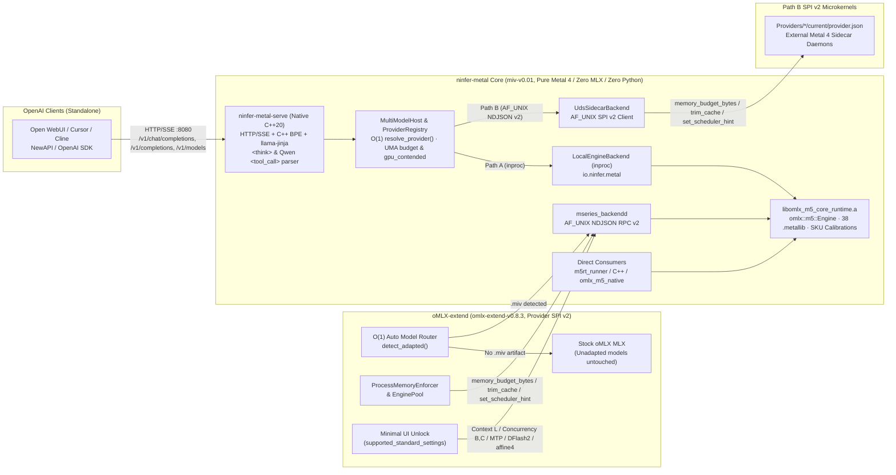

[English](../../architecture.md) | [简体中文](../zh-CN/architecture.md) | [繁體中文](../zh-TW/architecture.md) | [日本語](../ja/architecture.md) | **한국어** | [Español](../es/architecture.md) | [Français](../fr/architecture.md) | [Deutsch](../de/architecture.md)

# 아키텍처 및 멀티 모델 공존

`ninfer-metal`은 단일 순수 C++20 / Objective-C++ / Metal 4 코어(`miv/`, 정적 런타임 `libomlx_m5_core_runtime.a`) 위에서 두 가지 배포 모드를 지원합니다: 인프로세스 `miv`(`LocalEngineBackend`)와 병렬 경로 B SPI v2 마이크로커널(`UdsSidecarBackend`)을 단일 HTTP 포트에서 함께 호스팅하는 독립 실행형 네이티브 C++ OpenAI 서버(`ninfer-metal-serve`), 그리고 `oMLX-extend` Provider SPI v2 사이드카(`mseries_backendd`)입니다.

---

## 듀얼 모드 시스템 토폴로지

---

## 1. 독립 실행형 네이티브 C++ 서버 (`ninfer-metal-serve`)

`ninfer-metal-serve`는 `omlx::m5::Engine`을 단일 Mach-O 바이너리에 직접 임베드해 Python과 MLX 런타임 의존성을 제거하며, 단일 HTTP 포트에서 인프로세스 `miv` 모델과 여러 경로 B SPI v2 마이크로커널을 병렬 호스팅합니다:

- **HTTP/SSE 전송 및 설정**: POSIX `cpp-httplib` 서버(`GET /health`, `GET /metrics`, `GET /v1/models`, `GET /v1/models/:id`, `POST /v1/chat/completions`, `POST /v1/completions`, 선택적 Bearer 인증, CORS)를 내장하며 `ninfer-metal.toml`(`[server]`, `[model]`, `[[models]]`, `[engine]`, `[speculative]`)과 CLI 플래그 재정의로 설정합니다. 요청은 JSON `"model"` 필드로 라우팅됩니다.
- **네이티브 멀티 마이크로커널 병렬 호스팅**: `ProviderRegistry`가 `--providers-dir`, `[server].providers_dir`, `OMLX_PROVIDERS_DIR`, `~/Library/Application Support/oMLX/Providers`에서 `<dir>/*/current/provider.json`을 스캔하고 `resolve_provider()`가 O(1)로 각 모델을 라우팅합니다. `MultiModelHost`는 인프로세스 `miv`(`LocalEngineBackend`, `provider_id="io.ninfer.metal"`, `backend_mode="inproc"`)와 POSIX `AF_UNIX` + `posix_spawn` 기반 외부 경로 B SPI v2 데몬(`UdsSidecarBackend`)을 병렬로 실행합니다.
- **통합 UMA 예산 및 GPU 경합 조정**: `MultiModelHost`는 서버 전체 UMA 메모리 상한(`sysctl hw.memsize`의 `81%` 또는 `--memory-budget-gb`)을 모델별로 배분하고 메모리 압박 시 유휴 모델에 `trim_cache`를 호출합니다. 두 개 이상의 모델이 동시에 추론하면 `set_scheduler_hint(gpu_contended=true)`를 전파하고 경합 종료 시 `false`로 되돌리며, `SIGINT`/`SIGTERM` 수신 시 프로세스 그룹과 소켓을 정리합니다.
- **네이티브 토크나이징 및 템플릿**: 순수 C++ BPE 토크나이저(`utf8proc`, Qwen3.8의 `LetterDigit1`을 포함해 HuggingFace `tokenizer.json` 직접 로드)와 `llama-jinja` 채팅 템플릿 렌더링(`--chat-template` -> `model_dir/chat_template.jinja` -> `tokenizer_config.json` -> ChatML 폴백)을 결합합니다.
- **스트리밍 추론 내용 및 도구 파싱**: 점진적 UTF-8 홀드백 파서가 `<think>...</think>`를 `reasoning_content`로 분리하고, 동기 응답과 SSE 스트리밍 모두에서 Qwen3.5/3.8 XML(`<tool_call><function=...><parameter=...>`)과 Qwen3 JSON(`<tool_call>{...}`) 호출을 추출합니다.
- **기본 공존 구성**: 기본 포트는 `8080`(oMLX의 `8000` 포트와 분리)이며 `oMLX-extend`가 그대로 재사용하는 편집 없는 기본 설정 [`omlx-extend/config/ninfer-metal.toml`](../../../omlx-extend/config/ninfer-metal.toml)을 자동으로 로드합니다.

---

## 2. O(1) 자동 모델 라우팅 (`oMLX-extend`)

`oMLX-extend`는 서브프로세스를 띄우지 않고 파일시스템 검사만으로 `detect_adapted(model_dir)`를 `< 1 ms` 안에 끝내 `model.miv` / `model.omlxm5`, `model_pack.json`, `omlxm5-manifest.json` 존재 여부를 판별합니다:

- **변환된 모델**: 첫 요청 시(또는 고정 시) 지연 방식으로 **`miv Core Backend`**(`mseries_backendd`)로 라우팅하며, `Model Settings → Advanced Settings`에 **`miv Core Backend (Auto)`**를 표시합니다. **`Use External Engine`**을 끄면 `external_engine: "stock"`을 기록해 모델을 Stock MLX로 되돌립니다.
- **미변환 모델**: Stock MLX(`BatchedEngine` / `VLMBatchedEngine`)로 그대로 통과하며 사이드카 프로세스, 추가 메모리, 성능 오버헤드가 발생하지 않습니다.

---

## 3. Provider SPI v2 및 UMA 공존

동일한 Apple Silicon 머신에서 `ninfer-metal` 모델, 경로 B 사이드카 마이크로커널, 기본 MLX 모델이 함께 실행되면 하나의 Unified Memory(UMA) 풀과 GPU 큐를 공유합니다. Protocol v2는 `oMLX-extend`(`ProcessMemoryEnforcer` + `EnginePool`)와 독립형 `ninfer-metal-serve`(`MultiModelHost`) 양쪽에서 동일한 제어 계약으로 이를 조정합니다:

- **하드 메모리 상한 (`memory_budget_bytes`)**: `ProcessMemoryEnforcer`가 호스트 예산 내 잔여 한도를 계산해 `load` RPC에 `memory_budget_bytes`를 전달합니다. `native_backend.cpp`는 가중치 풀, `KvPagePool`, 프리픽스 캐시를 `min(W_ws - cur_alloc, memory_budget_bytes - cur_alloc)` 범위로 제한합니다.
- **메모리 압박 시 캐시 정리 (`trim_cache`)**: 상주 모델을 축출하기 전에 `oMLX-extend`가 `trim_cache(target_free_bytes)`를 호출합니다. `miv/`는 고정되지 않은 프리픽스 엔트리와 `UmaCheckpointPool` 슬랩을 `<= 100 ms` 안에 비우고, 해제된 `MTLBuffer` 객체를 `MTLResidencySet`에서 분리해 macOS가 와이어드 페이지를 즉시 회수하도록 합니다.
- **GPU 경합 힌트 (`set_scheduler_hint`)**: 인프로세스 MLX 모델과 사이드카 모델이 동시에 실행 중일 때 `EnginePool`이 `gpu_contended: true`를 전달합니다. 긴 Prefill은 페이지 경계에 맞춘 `64` 토큰 단위 제한 청크로 분할되어 병행 실행 중인 디코딩 스트림의 토큰 간 지연 시간을 일정하게 유지합니다.
- **클린 프로세스 종료**: 로드된 각 모델은 독립 자식 프로세스에서 전용 `MTLDevice`, `MTL4CommandQueue`, 인스턴스별 `AF_UNIX` 소켓(`/tmp/omlx-<provider>-<uid>/...`, TCP 포트 미사용)으로 실행됩니다. `stop()` 호출 시 호스트는 프로세스 그룹을 정리하고 `process_memory_bytes() == 0`을 확인한 뒤 다음 모델을 로드합니다.

### 최소 UI 해제 및 설정 분리

`oMLX-extend`는 oMLX 대시보드나 macOS 앱(`omlx-mac`)에 별도 커스텀 설정 폼을 추가하지 않습니다. 대신 **`Integrations → External Engines`**에서 Splash 위에 설치된 **`miv Core Backend (ninfer-metal)`** 및 경로 B 마이크로커널 카드를 표시하고, **`Models`**에서 `Loaded` 옆과 라이브러리 행에 활성 엔진 배지를 표시하며, `provider.json`과 `hello` 핸드셰이크가 `supported_standard_settings`를 게시해 지원 기능별 기본 UI 컨트롤을 해제합니다(`max_context_window`, `mtp_*`, `dflash_*`, `turboquant_kv_enabled` + `affine4 -> affine4_g128`). `Splash` 등 다른 프로바이더는 업스트림 잠금 동작을 그대로 유지합니다. 코어 전용 옵션(`rolling_prefix_cache`, `prefix_cache_gb`, 모델별 `max_concurrency` 재정의, `sampling_contract`)은 편집 없는 공유 [`omlx-extend/config/ninfer-metal.toml`](../../../omlx-extend/config/ninfer-metal.toml)에 분리합니다. 모든 화면의 스크린샷은 **[`oMLX-extend` 비주얼 가이드](omlx-extend-guide.md)**를 참고하세요.

---

## 4. Metal 4 엔진 설계 (`miv/`)

- **단일 프리타일 가중치 사본**: 오프라인 `.miv` 변환(`mx_nax_tiled_bk128_v1` / `oq_nax_tiled_g64_v1`)으로 와이드 `64×64` Prefill NAX, `T=1` QMV 디코딩, `BM=8/16/32` 투기적 검증을 단일 상주 할당에서 처리합니다(온라인 리타일링 `~1.92×` 대비 아티팩트 점유량 `1.0×`).
- **안전한 Compute ICB 기록**: 32비트 하드웨어 오프셋 랩어라운드를 막기 위해 모든 간접 버퍼 세그먼트를 `2 GiB` 미만(보조 컴팩트 캐시는 `< 1 GiB`)으로 엄격히 제한합니다. 더블 버퍼링된 `ar_pipe_[2]` 커맨드 할당기가 호스트 인코딩과 GPU 실행을 중첩합니다.
- **페이지 기반 CoW KV & UMA 연속성**: `KvPagePool`이 참조 카운트 기반 `64` 토큰 페이지(`bf16` 및 `0.5625 B/val` `0-ULP` `affine4_g128`)를 관리합니다. `QwenUmaContinuation`은 48레이어 GDN 상태(`146.81 MiB`)를 단일 GPU 커맨드 버퍼로 저장·복원하며(`0.22–1.62 ms`, CPU `memcpy` 없음), `rolling_prefix_cache`는 미고정 상위 엔트리를 인플레이스로 교체합니다(`1×` 슬랩 재사용).
- **엄격한 SKU 캘리브레이션 격리**: `silicon_tuning.h`는 정확한 `profile_id`를 키로 SKU별 프로파일(`apple-m5-ultra-64gpu.json`, `apple-m5-ultra-80gpu.json`)을 로드하며, 미측정 칩에서는 파라미터화된 사전 추정치로 폴백해 다른 SKU의 실측 상수를 혼용하지 않습니다.

---

## 5. 모노레포 듀얼 트랙 CI 및 원자적 핫 업데이트

두 트랙은 단일 저장소 안에서 독립된 릴리스 태그와 워크플로를 유지합니다:

| 트랙 | 경로 | 태그 패턴 | 워크플로 |
|---|---|---|---|
| **추론 코어** | `miv/` | `miv-v0.01` (`<codename>-vX.YZ`) | [`.github/workflows/release-ninfer-metal.yml`](../../../.github/workflows/release-ninfer-metal.yml) |
| **호스트 확장** | `omlx/` + `omlx-extend/` | `omlx-extend-v0.8.3` (`omlx-extend-vX.Y.Z` / `omlx-extend-vX.Y.Z-mix1..9`) | [`.github/workflows/sync-omlx-extend.yml`](../../../.github/workflows/sync-omlx-extend.yml) |

코어 타르볼은 `~/Library/Application Support/oMLX/Providers/io.ninfer.metal/versions/<tag>/` 아래 병렬 설치되며, `current` 심볼릭 링크를 원자적으로 전환해 활성화합니다. oMLX의 Python 환경을 건드리지 않고 업그레이드와 단일 명령 롤백을 처리합니다.

---

## 심화 기술 레퍼런스

- [Porting Architecture v2](../../backend/ninfer-m5-porting-architecture-v2.md)
- [`.miv` Artifact Format v1](../../backend/artifact-format-v1.md) & [Dispatch Contract v1](../../backend/dispatch-contract-v1.md)
- [Hardware & Software Boundaries v1](../../foundations/hardware-software-boundaries-v1.md)
- [Core Certification Standard](../../standards/core-certification-standard.md)
