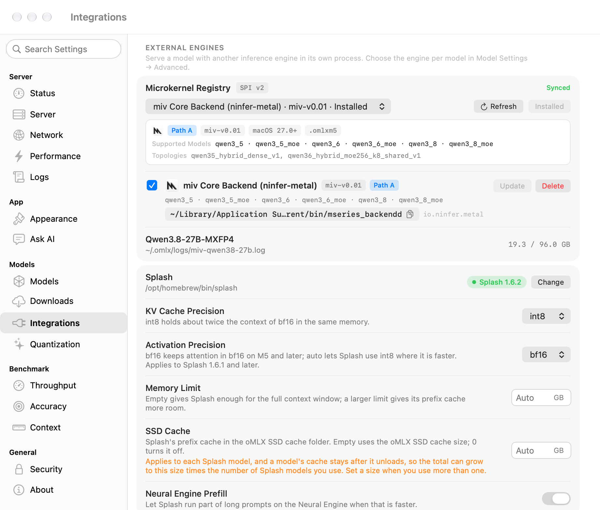

[English](../../omlx-extend-guide.md) | [简体中文](../zh-CN/omlx-extend-guide.md) | [繁體中文](../zh-TW/omlx-extend-guide.md) | [日本語](../ja/omlx-extend-guide.md) | **한국어** | [Español](../es/omlx-extend-guide.md) | [Français](../fr/omlx-extend-guide.md) | [Deutsch](../de/omlx-extend-guide.md)

# `oMLX-extend` 비주얼 가이드

`oMLX-extend`는 Apple M5+ Mac(`macOS 27+`)의 `oMLX` macOS 앱에 **`miv Core Backend (ninfer-metal)`**와 커뮤니티 경로 B Metal 4 마이크로커널을 추가합니다. 변환된 `.miv` 모델은 네이티브 Metal 4 NAX 실행을 자동으로 선택하고, 일반 MLX 모델은 기존 Stock MLX에서 그대로 실행됩니다.

아래 다섯 화면을 따라 설치 상태를 확인하고, 모델별 엔진 라우팅을 파악하며, 고속 디코딩 기능을 켜고, 설정 파일을 손으로 쓰지 않고 독립 실행형 서버를 시작해 보세요.

---

## 1단계: 마이크로커널 탐색, 다운로드, 핫 업데이트 및 관리

`oMLX`에서 **`Integrations → External Engines`**를 열면 **`miv Core Backend (ninfer-metal)`** 및 커뮤니티 경로 B SPI v2 마이크로커널을 macOS 앱에서 직접 관리할 수 있습니다:



- **Microkernel Registry(상단 바)**:
  - **`Refresh`**를 클릭하면 메인 저장소의 최신 `microkernels.json`을 불러와 각 코어의 원격 `latest.json` 버전을 비교합니다.
  - 드롭다운에서 코어를 선택하면 바로 아래에 **지원 모델(Supported Models)**, 토폴로지, SPI 버전, 최소 macOS 요구사항이 표시되어 다운로드 여부를 바로 판단할 수 있습니다.
  - **`Refresh`** 오른쪽의 **`Download`**를 누르면 다운로드, SHA-256 검증, 안전 압축 해제, SPI v2 검증을 거쳐 `~/Library/Application Support/oMLX/Providers/`에 설치됩니다(최신 관리 버전이 이미 설치된 경우 **`Installed`**로 비활성화).
- **설치된 마이크로커널 목록(하단 리스트)**:
  - **왼쪽 사각 체크박스(`☑️`)**: 체크하면 활성화(신규 설치 시 기본 체크)되며 `settings.json`에 저장됩니다. 체크를 해제하면 O(1) 자동 라우팅과 모델별 엔진 드롭다운에서 즉시 제외됩니다.
  - **오른쪽 `Update` 버튼**: 평소에는 비활성 상태로 유지되며, **`Refresh` 이후 더 새로운 원격 릴리스가 확인된 경우에만 활성화**됩니다. 클릭 시 `current` 심볼릭 링크를 원자적으로 교체해 무중단 핫 업데이트를 수행합니다(실행 중인 모델은 재로드 시 새 코어로 전환).
  - **오른쪽 `Delete` 버튼**: 확인 후 `Providers/` 아래의 관리 디렉터리를 삭제합니다(실행 중인 모델이 있으면 먼저 언로드 후 삭제). 외부 또는 로컬 빌드 경로 코어는 실수 삭제 방지를 위해 비활성화되며 체크 해제로 끌 수 있습니다.
- **CLI 대안**: 터미널/자동화 환경에서는 `./omlx-extend/scripts/sync_microkernels.sh --provider io.ninfer.metal`(`--all`, `--rollback` 지원)도 그대로 사용할 수 있습니다.
- **Splash**: 바로 아래에 기존 컨트롤 그대로 유지됩니다.

---

## 2단계: 각 모델이 어떤 엔진으로 실행되는지 확인

**`Models`** 화면으로 전환하면 Mac에 있는 모든 모델의 라우팅 상태를 한눈에 확인할 수 있습니다:


- **Active Models**: 로드된 각 모델의 **`Loaded`** 바로 옆에 엔진 배지(`miv Core`, 경로 B 마이크로커널 이름, 또는 `MLX`)가 표시됩니다.
- **Model Library**: `.miv` 가중치가 있는 모델에는 강조 배지(`miv Core · Auto`, 경로 B 마이크로커널, 또는 외부 라우팅을 끈 경우 `Stock MLX`)가 표시됩니다.
- **미변환 모델은 영향 없음**: 일반 MLX 체크포인트에는 외부 엔진 배지가 붙지 않으며 사이드카 프로세스 없이 Stock MLX로 실행됩니다. `miv Core Backend`, 경로 B, Stock MLX 모델은 하나의 통합 메모리 상한 아래 나란히 로드할 수 있습니다.

---

## 3단계: 자동 라우팅 및 Stock MLX로 전환

**Model Library**에서 변환된 모델을 클릭한 뒤 **`Advanced Settings`**를 엽니다:


- 변환된 `.miv` 모델에서는 **`Use External Engine`**이 기본적으로 **ON** 상태이며 드롭다운이 **`miv Core Backend (Auto)`**로 설정됩니다(상위 Model Settings 헤더에도 활성 엔진 배지가 표시됩니다).
- **언제든 Stock MLX로 복귀**: **`Use External Engine`**을 **OFF**로 전환하면 `oMLX`가 `.miv` 가중치를 삭제하지 않고 `external_engine: "stock"`을 기록하며 *"Using Stock MLX (auto-route overridden)"*을 표시합니다. 다시 **ON**으로 켜면 자동 라우팅으로 돌아갑니다.
- **다른 엔진 선택**: 같은 모델과 호환되는 경로 B 마이크로커널이나 Splash가 설치되어 있다면 드롭다운에서 바로 선택할 수 있습니다.

---

## 4단계: MTP / DFlash2 및 4-bit KVQuant 켜기

`oMLX-extend`는 기본 `oMLX` 설정 화면을 그대로 재사용합니다. 활성 마이크로커널이 지원하는 컨트롤은 정상 밝기로 활성화되고, MLX 전용 컨트롤은 흐리게 유지되므로 엔진이 실행하는 옵션을 바로 구분할 수 있습니다.

### Acceleration (`Lightning MTP` 및 `DFlash`)

**`Model Settings → Acceleration`**을 엽니다:


- 모델에 내장 MTP 헤드가 있으면 **`Lightning MTP`**(및 **`Adaptive max depth`**)가 활성화됩니다.
- 블록 디퓨전 투기적 디코딩용 **`DFlash`**(**`DFlash Draft Model`** 및 **`Runtime Block Size`** 포함)가 활성화됩니다.
- MLX 전용 항목(`Draft Quantization`, `Verify Mode`, `Draft Window Size`, `VLM MTP`)은 흐리게 유지됩니다.

### Memory Saving (`4-bit KVQuant`)

**`Model Settings → Memory Saving`**을 엽니다:


- **`TurboQuant KV Cache`**를 켜고 **`Affine4 · 4-bit`**을 선택하면 `miv Core Backend`의 `affine4_g128` KV 캐시(`0.5625 B/val`, `64K+` 컨텍스트까지 `0-ULP` 검증 완료)가 활성화됩니다.
- 스위치를 끄면 전체 정밀도 `bf16` KV 캐시를 사용합니다. `miv-v0.01`에서 `affine8`이나 `turboquant`를 선택하면 `bf16`으로 폴백합니다.
- **`MoE Expert Offload`** 같은 MLX 전용 메모리 옵션은 흐리게 유지됩니다.

---

## 5단계: 편집 없는 공유 설정 및 원클릭 독립 실행

설정 파일을 직접 작성할 필요가 없습니다. **`oMLX-extend`**와 독립 실행형 C++ 서버(**`ninfer-metal-serve`**) 모두 Apple M5+용 기본값이 바로 준비된 [`omlx-extend/config/ninfer-metal.toml`](../../../omlx-extend/config/ninfer-metal.toml)을 자동으로 불러옵니다:

| 설정 | 공유 기본값 | 역할 |
|---|---|---|
| `max_concurrency` | `4` | 다중 사용자 동시 배치 슬롯 수 (`1..8`) |
| `max_context` | `65536` | 컨텍스트 윈도우 길이 (토큰) |
| `kv_dtype` | `"affine4_g128"` | 4-bit group-128 KV 캐시 (`64K+`에서 `0-ULP`) |
| `rolling_prefix_cache` / `prefix_cache_gb` | `true` / `4.0` | 멀티턴 UMA 프리픽스 재사용 (`4 GiB` 풀) |
| `speculative.backend` | `"auto"` | 동반 드래프트가 있으면 `dflash2`, 없으면 `mtp`, 둘 다 없으면 순수 AR 선택 |
| `providers_dir` | `["~/Library/Application Support/oMLX/Providers"]` | 설치된 경로 B SPI v2 마이크로커널 자동 탐색 |

독립 실행형 OpenAI 호환 서버를 포트 `8080`(`oMLX`의 `8000` 포트와 분리)에서 시작하려면 아래 명령을 실행합니다:

```bash
# 변환된 모델 디렉터리를 직접 지정해 실행
./omlx-extend/scripts/start_ninfer_serve.sh /path/to/Qwen3.8-27B

# 경로를 생략하면 ./models 또는 oMLX 모델 폴더의 첫 번째 .miv 모델을 자동 선택
./omlx-extend/scripts/start_ninfer_serve.sh
```

**재정의 우선순위:**
- **`oMLX-extend`**: UI의 모델별 설정이 최우선이며, 다음으로 TOML의 `[sidecar.models."<name>"]`, 마지막으로 `ninfer-metal.toml`의 공유 `[engine]` / `[speculative]` 값이 적용됩니다.
- **`ninfer-metal-serve`**: CLI 플래그가 항상 `ninfer-metal.toml`을 덮어씁니다. 업데이트 후에도 유지되는 사용자 지정 기본값이 필요하면 `ninfer-metal.toml`을 `~/.config/ninfer-metal/ninfer-metal.toml`로 복사해 수정하세요.

---

## 다음 단계

- **[시작 가이드 및 설정](getting-started.md)** — 소스 빌드, `.miv` 체크포인트 변환, `ninfer-metal-serve` 전체 CLI 플래그 확인.
- **[아키텍처 및 공존 설계](architecture.md)** — O(1) 라우팅, Provider SPI v2, 공유 UMA 메모리 예산의 내부 동작 구조.
- **[Microkernel Foundry](microkernel-foundry.md)** — Apple M5+용 신규 경로 A 또는 경로 B 모델 패밀리 추가 방법.
