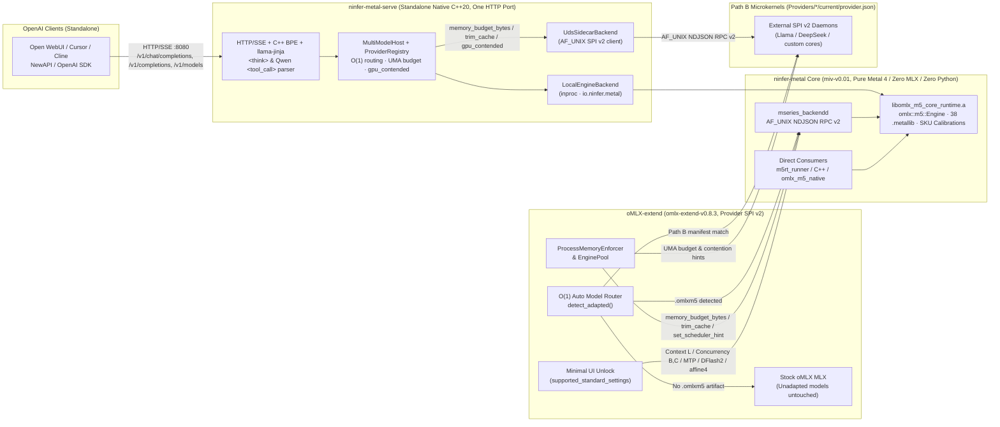

[English](../../architecture.md) | **简体中文** | [繁體中文](../zh-TW/architecture.md) | [日本語](../ja/architecture.md) | [한국어](../ko/architecture.md) | [Español](../es/architecture.md) | [Français](../fr/architecture.md) | [Deutsch](../de/architecture.md)

# 架构与多模型共存

`ninfer-metal` 在同一个纯 C++20 / Objective-C++ / Metal 4 推理核心（`miv/`，静态运行时 `libomlx_m5_core_runtime.a`）之上提供两种部署形态：在同一 HTTP 端口并行托管进程内 `miv` 与路径 B SPI v2 微内核的原生 C++ 独立 OpenAI 服务（`ninfer-metal-serve`），以及 `oMLX-extend` Provider SPI v2 Sidecar（`mseries_backendd`）。

---

## 双模式系统拓扑

---

## 1. 原生 C++ 独立服务（`ninfer-metal-serve`）

`ninfer-metal-serve` 是单个 Mach-O 二进制，不依赖 Python 或 MLX 运行时。它在同一个 HTTP 端口上同时托管进程内 `miv` 模型（`LocalEngineBackend`）与并行的外部路径 B SPI v2 Sidecar 微内核（`UdsSidecarBackend`）：

- **多微内核并行托管与 UMA 协调**：`ProviderRegistry` 扫描 `--providers-dir`、TOML `[server].providers_dir`、`$OMLX_PROVIDERS_DIR` 与 `~/Library/Application Support/oMLX/Providers` 中的 `<dir>/*/current/provider.json`，按 O(1) 解析每个模型的后端且不劫持其他 Provider。`MultiModelHost` 在统一 UMA 内存上限（`--memory-budget-gb` 或 `sysctl hw.memsize` 的 81%）内跟踪各模型常驻占用，承压时对空闲模型触发 `trim_cache`，并在两个及以上模型并发推理时下发 `set_scheduler_hint(gpu_contended=true/false)`。
- **HTTP/SSE 传输与配置**：使用 POSIX `cpp-httplib` 服务端（`GET /health` 返回 `models[]`、`gpu_contended`、`memory_budget_bytes`；`GET /metrics` 输出汇总及按 `model`/`provider`/`backend_mode` 区分的指标；`GET /v1/models` 与 `GET /v1/models/:id` 暴露 `provider_id`/`backend_mode`；`POST /v1/chat/completions` 与 `POST /v1/completions` 按 JSON `"model"` 路由，支持可选 Bearer 鉴权与 CORS），由 `tomlplusplus` 读取 `ninfer-metal.toml`（含 `[[models]]`）并允许 CLI 参数覆盖。
- **原生分词与模板渲染**：纯 C++ BPE 分词器（基于 `utf8proc`，直接加载 HuggingFace `tokenizer.json`，含 Qwen3.8 的 `LetterDigit1` 规则）搭配 `llama-jinja` 聊天模板渲染（优先级：`--chat-template` -> `model_dir/chat_template.jinja` -> `tokenizer_config.json` -> ChatML 回退）。
- **流式思考段与工具调用解析**：增量 UTF-8 暂存解析器将 `<think>...</think>` 拆入 `reasoning_content`，并在同步响应和 SSE 流式响应中解析 Qwen3.5/3.8 XML（`<tool_call><function=...><parameter=...>`）与 Qwen3 JSON（`<tool_call>{...}`）工具调用。
- **默认端口隔离共存**：默认监听 `8080` 端口（避开 oMLX 默认的 `8000` 端口），并与 `oMLX-extend` 自动加载同一份零手写默认配置 [`omlx-extend/config/ninfer-metal.toml`](../../../omlx-extend/config/ninfer-metal.toml)。

---

## 2. O(1) 自动模型路由（`oMLX-extend`）

`oMLX-extend` 通过 `detect_adapted(model_dir)` 在 `< 1 ms` 内完成文件系统探测（检查 `model.omlxm5`、`model_pack.json`、`omlxm5-manifest.json`），不拉起任何子进程：

- **已适配模型**：首次请求到达时（或配置常驻时）懒加载路由至 **`miv 核心后端`**（`mseries_backendd`），并在 `Model Settings → Advanced Settings` 显示 **`miv Core Backend (Auto)`**。关闭 **`Use External Engine`** 开关即写入 `external_engine: "stock"`，随时切回原生 MLX。
- **未适配模型**：原样交由 Stock MLX（`BatchedEngine` / `VLMBatchedEngine`）运行，不启动 Sidecar 进程，零额外内存开销，性能零变化。

---

## 3. Provider SPI v2 与 UMA 同机共存

当多个推理引擎运行在同一台 Apple Silicon 设备上时——无论是 `oMLX-extend` 下的 Sidecar 微内核与 Stock MLX，还是 `ninfer-metal-serve` 下的进程内 `miv` 与路径 B Sidecar——双方共享同一片统一内存（UMA）池与 GPU 队列。Protocol v2 在两种宿主中均负责显式协调资源：

- **内存硬上限（`memory_budget_bytes`）**：`ProcessMemoryEnforcer` 在宿主预算内计算每个模型的剩余额度，并通过 `load` RPC 下发 `memory_budget_bytes`。`native_backend.cpp` 将权重池、`KvPagePool` 与前缀缓存钳制在 `min(W_ws - cur_alloc, memory_budget_bytes - cur_alloc)` 以内。
- **软压力缓存回收（`trim_cache`）**：在驱逐常驻模型前，`oMLX-extend` 先调用 `trim_cache(target_free_bytes)`。`miv/` 在 `<= 100 ms` 内回收未固定前缀条目与 `UmaCheckpointPool` slab，并将释放的 `MTLBuffer` 从 `MTLResidencySet` 解绑，让 macOS 立即回收常驻页。
- **GPU 争用提示（`set_scheduler_hint`）**：当进程内 MLX 模型与 Sidecar 模型同时执行时，`EnginePool` 会下发 `gpu_contended: true`。长预填随即切分为有界的 `64`-token 页对齐分块，防止同机并发解码流的步间延迟抖动。
- **干净的进程退出与清理**：每个加载的模型都在独立子进程中运行，拥有独立的 `MTLDevice`、`MTL4CommandQueue` 与按实例隔离的 `AF_UNIX` 套接字（`/tmp/omlx-<provider>-<uid>/...`，不占用 TCP 端口）。调用 `stop()` 时，宿主回收整个进程组，并在确认 `process_memory_bytes() == 0` 后再加载下一个模型。

### 极简 UI 与配置拆分

`oMLX-extend` 不在 oMLX 控制台或 macOS 应用（`omlx-mac`）里新增自定义配置表单。**`Integrations → External Engines`** 在 Splash 上方展示已安装的 **`miv Core Backend (ninfer-metal)`** 与路径 B 微内核卡片，**`Models`** 页面在 `Loaded` 旁及模型库行显示当前引擎徽章；`provider.json` 与 `hello` 握手通过 `supported_standard_settings` 声明能力，按项解锁原生控件（`max_context_window`、`mtp_*`、`dflash_*`、`turboquant_kv_enabled` + `affine4 -> affine4_g128`），`Splash` 等其他 Provider 保持上游原有锁定行为。引擎专属参数（`rolling_prefix_cache`、`prefix_cache_gb`、单模型 `max_concurrency` 覆盖、`sampling_contract`）统一放在共享的免手写默认配置 [`omlx-extend/config/ninfer-metal.toml`](../../../omlx-extend/config/ninfer-metal.toml) 中。各界面实机截图见 **[`oMLX-extend` 可视化上手指南](omlx-extend-guide.md)**。

---

## 4. Metal 4 引擎设计（`miv/`）

- **单副本预重排权重**：离线 `.omlxm5` 转换（`mx_nax_tiled_bk128_v1` / `oq_nax_tiled_g64_v1`）让 `64×64` 宽块预填 NAX、`T=1` QMV 解码与 `BM=8/16/32` 投机校验共享同一份驻留内存分配（体积 `1.0×`，在线重排则需要 `~1.92×`）。
- **安全的 Compute ICB 录制**：所有间接缓冲区段严格控制在 `2 GiB` 以下（辅助紧凑缓存 `< 1 GiB`），避免 32 位硬件偏移回绕。双缓冲 `ar_pipe_[2]` 命令分配器将主机端编码与 GPU 执行流水重叠。
- **分页写时复制（CoW）KV 与 UMA 续算**：`KvPagePool` 管理 `64`-token 引用计数页（支持 `bf16` 与 `0.5625 B/val` 的 `0-ULP` `affine4_g128`）。`QwenUmaContinuation` 在单条 GPU 命令缓冲区内完成 48 层 GDN 状态（`146.81 MiB`）的快照保存与恢复（`0.22–1.62 ms`，零 CPU `memcpy`），`rolling_prefix_cache` 对未固定祖先槽位做原地 `1×` 覆写复用。
- **严格的 SKU 校准隔离**：`silicon_tuning.h` 按精确 `profile_id` 加载单机校准档案（`apple-m5-ultra-64gpu.json`、`apple-m5-ultra-80gpu.json`），遇到未实测芯片时回退到参数化先验，绝不把某一款 SKU 的实测常数套用到另一款芯片上。

---

## 5. Monorepo 双轨 CI 与原子热更新

核心引擎与宿主扩展位于同一仓库，使用各自独立的发布标签和工作流：

| 轨道 | 路径 | 标签格式 | 工作流 |
|---|---|---|---|
| **推理核心** | `miv/` | `miv-v0.01`（`<codename>-vX.YZ`） | [`.github/workflows/release-ninfer-metal.yml`](../../../.github/workflows/release-ninfer-metal.yml) |
| **宿主扩展** | `omlx/` + `omlx-extend/` | `omlx-extend-v0.8.3`（`omlx-extend-vX.Y.Z` / `omlx-extend-vX.Y.Z-mix1..9`） | [`.github/workflows/sync-omlx-extend.yml`](../../../.github/workflows/sync-omlx-extend.yml) |

核心发布包并排解压至 `~/Library/Application Support/oMLX/Providers/io.ninfer.metal/versions/<tag>/`，通过原子切换 `current` 符号链接生效——升级和单命令回滚都不触动 oMLX 的 Python 环境。

---

## 深入参考文档

- [移植架构规范 v2](../../backend/ninfer-m5-porting-architecture-v2.md)
- [`.omlxm5` 权重容器规范 v1](../../backend/artifact-format-v1.md) 与 [派发契约 v1](../../backend/dispatch-contract-v1.md)
- [软硬件边界规范 v1](../../foundations/hardware-software-boundaries-v1.md)
- [核心认证标准](../../standards/core-certification-standard.md)
