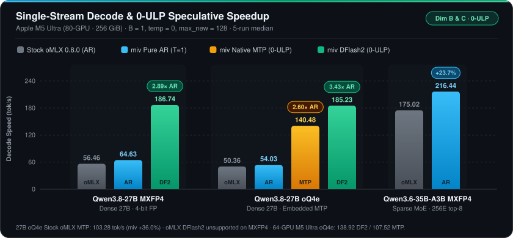

<p align="center"></p>

<h1 align="center">ninfer-metal</h1>

<p align="center">
  <strong>Apple M5+ 原生 Metal 4 NAX 與 Compute ICB 大型語言模型推論引擎（v1 核心代號 <code>miv</code>）</strong>
</p>

<!-- Replace scoltzero/ninfer-metal with final GitHub slug if changed -->
<p align="center">
  <a href="https://github.com/scoltzero/ninfer-metal/stargazers"></a>
  <a href="https://github.com/scoltzero/ninfer-metal/releases"></a>
  <a href="miv-v0.01-changelog.md"></a>
  
  
  <a href="../../../LICENSE"></a>
</p>

<div align="center">

[English](../../../README.md) | [简体中文](../zh-CN/README.md) | **繁體中文** | [日本語](../ja/README.md) | [한국어](../ko/README.md) | [Español](../es/README.md) | [Français](../fr/README.md) | [Deutsch](../de/README.md)

</div>

---

**`ninfer-metal`** 是純 C++20 / Objective-C++ / Metal 4 推論引擎，鎖定配備硬體 **Neural Accelerators (NAX)** 與 **Compute ICB** 的 Apple Silicon 晶片（`M5 / M5 Pro / M5 Max / M5 Ultra`，`MTLGPUFamilyApple10+`，`macOS 27+`）。

- **零 Python，零 MLX**：包含 16 個 Mach-O 二進位檔（含原生 `ninfer-metal-serve` 與 `mseries_backendd`）以及 38 個預先編譯的 `.metallib` 著色器，僅連結 macOS 系統框架——在未安裝 Xcode、Python 或 Homebrew 動態函式庫的潔淨 Mac 上即可直接執行。
- **獨立 OpenAI 伺服器（`ninfer-metal-serve`）**：單一 C++20 二進位檔，在同一 HTTP/SSE 連接埠平行託管程序內 `miv` 與路徑 B SPI v2 微核心（`/v1/chat/completions`、`/v1/completions`、`/v1/models`、`/health`、`/metrics`），內建 C++ BPE 分詞器、Jinja 聊天範本、`<think>` `reasoning_content` 拆分與 Qwen XML/JSON `<tool_call>` 解析，可直接介接 Open WebUI、Cursor、Cline、NewAPI 與各類 OpenAI SDK。
- **單副本 NAX 權重與 `0-ULP` 一致性**：離線 NAX 預先磚塊化重排（`.omlxm5`）讓 Prefill、`T=1` 自回歸解碼與推測驗證共用同一份常駐權重（檔案體積 `1.0×`）。基線版本 **`miv-v0.01`** 支援 Qwen3.5 / Qwen3.6 / Qwen3.8 混合架構模型（Dense 27B 與 35B-A3B MoE），涵蓋 `MXFP4` 與 `oQ` Affine（`q3–q8`）量化，並提供 `affine4_g128` KV 快取、Native MTP / DFlash2、多使用者並發批次處理（`B/C = 1..8`）及滾動 UMA 前綴重用。
- **`oMLX-extend` 即插即用共存**：隨附 `oMLX-extend`（基於 `jundot/omlx` 的 `omlx-extend-v0.8.3`），透過 AF_UNIX Provider SPI v2 Sidecar 接入 **`miv 核心後端`**——已適配的 `.omlxm5` 模型以 O(1) 自動路由，未適配模型維持原版 MLX 執行不變，Sidecar 與 MLX 模型在同一記憶體上限下共享 UMA。

---

## 效能一覽




以上數據實測於實體 Apple M5 Ultra（`80-GPU / 256 GiB` 與 `64-GPU / 96 GiB`），於隔離潔淨子程序中對標原版 `oMLX 0.8.0`（`mlx 0.32.4`，開啟 NAX），並全數通過 `0-ULP` 貪婪解碼一致性驗證。完整四張基準圖表與 Dim A–F 數據見 **[`miv-v0.01` 發行說明](miv-v0.01-changelog.md)**。

---

## 支援的模型與微核心

| 模型家族 | 量化格式 | 微核心 | 模式 | 署名 / 來源 |
|---|---|---|---|---|
| **Qwen3.5 / 3.6 / 3.8 Dense**（0.8B – 27B，3:1 GDN+GQA） | `MXFP4`、`oQ4e` | `miv-v0.01` | 路徑 A（主線） | `ninfer-metal` 核心 |
| **Qwen3.5 / 3.6 Hybrid MoE**（256×8 + 共享專家，如 35B-A3B） | `MXFP4`、`oQ4e` | `miv-v0.01` | 路徑 A（主線） | `ninfer-metal` 核心 |
| *Llama、Qwen3（純注意力）、DeepSeek MLA、Gemma、GLM、MiniMax 等* | *開放* | *徵集 PR* | 路徑 A / 路徑 B | **[加入微核心工坊 →](microkernel-foundry.md)** |

開發者與開發 Agent 可透過 **[微核心工坊](microkernel-foundry.md)** 擴充這份清單：

- **路徑 A（主線 PR）**：直接併入 `ninfer-metal` 的共享 Metal 4 NAX 基底，並於此表標註**貢獻者署名**。
- **路徑 B（平行 Sidecar）**：就緒後發送 PR 或開啟 Issue，維護者會將其登錄至 [`omlx-extend/registry/microkernels.json`](../../../omlx-extend/registry/microkernels.json)（`sync_microkernels.sh`）並於此表附上**原始專案儲存庫連結**。`oMLX-extend` 與獨立伺服器 `ninfer-metal-serve --providers-dir` 皆原生探索 `Providers/*/current/provider.json`，與 `miv`（以及 `oMLX-extend` 中的原版 MLX）平行運作路徑 B 微核心。

---

## 快速開始

編譯零 MLX 的 `miv/` 核心（`macOS 27+`、`Xcode 27+`）：

```bash
export DEVELOPER_DIR=/Applications/Xcode.app/Contents/Developer
cmake -S . -B build/miv-v001 -G Ninja -DCMAKE_BUILD_TYPE=Release -DOMLX_M5_BUILD_NAX_METALLIB=ON -DOMLX_M5_BUILD_MLX_LEGACY_SMOKE=OFF -DOMLX_M5_BUILD_PYTHON=OFF
cmake --build build/miv-v001
```

一行指令啟動獨立 C++ OpenAI 伺服器（自動載入與 `oMLX-extend` 共用的預設組態 [`omlx-extend/config/ninfer-metal.toml`](../../../omlx-extend/config/ninfer-metal.toml)），或驗證 `oMLX-extend` Sidecar 擴充層：

```bash
./omlx-extend/scripts/start_ninfer_serve.sh /path/to/Qwen3.8-27B
./omlx-extend/scripts/apply_spi_patch.sh --omlx-dir ./omlx --test
```

完整編譯旗標、`.omlxm5` 權重轉換、多微核心 `ninfer-metal-serve --providers-dir` / `[[models]]` 設定與 `oMLX-extend` 熱更新流程見 **[快速上手與設定](getting-started.md)**；macOS 應用程式畫面圖文教學見 **[`oMLX-extend` 視覺化上手指南](omlx-extend-guide.md)**。

---

## 延伸閱讀

| 指南 | 內容摘要 |
|---|---|
| **[`oMLX-extend` 視覺化上手指南](omlx-extend-guide.md)** | 5 步驟圖解 `oMLX` macOS 介面：微核心卡片、執行引擎徽章、自動路由與切回原版 MLX、MTP / DFlash2 與 4-bit KV 量化，以及免手寫共用設定檔 |
| **[快速上手與設定](getting-started.md)** | 環境需求、零 MLX CMake 編譯、一鍵 `start_ninfer_serve.sh`、`ninfer-metal-serve` 獨立伺服器、`oMLX-extend` Sidecar 設定、`ninfer-metal.toml` 與底層 CLI／常駐程式用法 |
| **[架構與多模型共存](architecture.md)** | 雙模式 `miv/` 核心（`ninfer-metal-serve` + `mseries_backendd`）、Provider SPI v2、O(1) 自動路由、UMA 記憶體協調與原子符號連結熱更新 |
| **[微核心工坊](microkernel-foundry.md)** | 公開徵集 M5+ 新模型家族微核心（Llama、DeepSeek、Gemma、GLM、MiniMax）與 Silicon-Squeeze Skill 指南 |
| **[發行說明（`miv-v0.01`）](miv-v0.01-changelog.md)** | Dim A–F 效能圖表、`ninfer-metal-serve` 與 `oMLX-extend` 變更摘要、測試與 `otool -L` 稽核結果及支援範圍 |
| **[開發路線圖](roadmap.md)** | `miv-v0.01` 之後的規劃里程碑 |
| **[文件索引](../../README.md)** | 8 語系完整文件鏡像、硬體指南、SKU 校準檔（`64-GPU` / `80-GPU`）、後端規格與認證標準 |

---

## 鳴謝

- **[`jundot/omlx`](https://github.com/jundot/omlx)** — 上游 oMLX 推論伺服器與 macOS 應用程式，`oMLX-extend` 在此基礎上擴充。
- **[`Neroued/ninfer`](https://github.com/Neroued/ninfer)** — 參考原生推論引擎，為顯式記憶體所有權與確定性排程設計提供關鍵啟發。
- **[`z-lab/dflash`](https://github.com/z-lab/dflash)** 與 **[`bstnxbt/dflash-mlx`](https://github.com/bstnxbt/dflash-mlx)** — DFlash / DFlash2 區塊擴散投機解碼架構與 Apple Silicon 草稿模型生態。
- **[`SqueezeAILab/KVQuant`](https://github.com/SqueezeAILab/KVQuant)** 與 **[`FutureMLS-Lab/FOSCAR`](https://github.com/FutureMLS-Lab/FOSCAR)** — 低位元 KV Cache 量化研究與仿射摺疊（Affine Folding）解碼注意力方法，支撐 `miv` 的 `affine4_g128` Metal 4 NAX 核心。
- **[`p-e-w/heretic`](https://github.com/p-e-w/heretic)** 與 **[`scoltzero/heretic-mlx`](https://github.com/scoltzero/heretic-mlx)** — 上游 Heretic 免訓練模型修改框架，及其 Apple Silicon 原生 MLX 移植與社群量化衍生權重。
