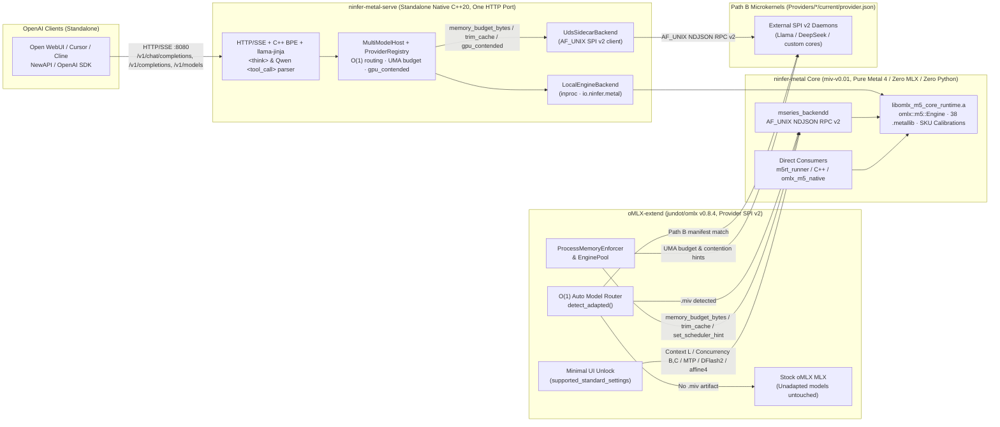

[English](../../architecture.md) | [简体中文](../zh-CN/architecture.md) | **繁體中文** | [日本語](../ja/architecture.md) | [한국어](../ko/architecture.md) | [Español](../es/architecture.md) | [Français](../fr/architecture.md) | [Deutsch](../de/architecture.md)

# 架構與多模型共存

`ninfer-metal` 在單一純 C++20 / Objective-C++ / Metal 4 核心（`miv/`，靜態執行期函式庫 `libomlx_m5_core_runtime.a`）之上提供兩種部署模式：於單一 HTTP 連接埠平行託管程序內 `miv` 與路徑 B SPI v2 微核心的原生 C++ 獨立 OpenAI 伺服器（`ninfer-metal-serve`），以及 `oMLX-extend` Provider SPI v2 Sidecar（`mseries_backendd`）。

---

## 雙模式系統拓撲

---

## 1. 原生 C++ 獨立伺服器（`ninfer-metal-serve`）

`ninfer-metal-serve` 為單一 Mach-O 二進位檔，無需任何 Python 或 MLX 執行期相依。它在同一 HTTP 連接埠同時託管程序內 `miv` 模型（`LocalEngineBackend`）與平行的外部路徑 B SPI v2 Sidecar 微核心（`UdsSidecarBackend`）：

- **多微核心平行託管與 UMA 協調**：`ProviderRegistry` 掃描 `--providers-dir`、TOML `[server].providers_dir`、`$OMLX_PROVIDERS_DIR` 與 `~/Library/Application Support/oMLX/Providers` 內的 `<dir>/*/current/provider.json`，以 O(1) 解析各模型後端且不劫持其他 Provider。`MultiModelHost` 在統一 UMA 記憶體上限（`--memory-budget-gb` 或 `sysctl hw.memsize` 的 81%）內追蹤各模型常駐用量，記憶體吃緊時對閒置模型觸發 `trim_cache`，並於兩個以上模型並發推論時發送 `set_scheduler_hint(gpu_contended=true/false)`。
- **HTTP/SSE 傳輸與設定**：採用 POSIX `cpp-httplib` 伺服器（`GET /health` 回傳 `models[]`、`gpu_contended`、`memory_budget_bytes`；`GET /metrics` 輸出彙總與依 `model`/`provider`/`backend_mode` 標記的分模型指標；`GET /v1/models` 與 `GET /v1/models/:id` 揭露 `provider_id`/`backend_mode`；`POST /v1/chat/completions` 與 `POST /v1/completions` 依 JSON `"model"` 路由，支援選用 Bearer 驗證與 CORS），由 `tomlplusplus` 讀取 `ninfer-metal.toml`（含 `[[models]]`）並支援 CLI 旗標覆寫。
- **原生分詞與範本算繪**：純 C++ BPE 分詞器（以 `utf8proc` 直接載入 HuggingFace `tokenizer.json`，支援 Qwen3.8 的 `LetterDigit1` 切分）搭配 `llama-jinja` 聊天範本算繪（優先順序：`--chat-template` -> `model_dir/chat_template.jinja` -> `tokenizer_config.json` -> ChatML 備援）。
- **串流推理內容與工具呼叫解析**：漸進式 UTF-8 暫存解析器將 `<think>...</think>` 拆入 `reasoning_content`，並在同步與 SSE 串流回應中擷取 Qwen3.5/3.8 XML（`<tool_call><function=...><parameter=...>`）與 Qwen3 JSON（`<tool_call>{...}`）工具呼叫。
- **預設隔離共存**：預設監聽連接埠 `8080`（與 oMLX 預設的 `8000` 錯開），並與 `oMLX-extend` 自動載入同一份免手寫預設設定檔 [`omlx-extend/config/ninfer-metal.toml`](../../../omlx-extend/config/ninfer-metal.toml)。

---

## 2. O(1) 自動模型路由（`oMLX-extend`）

`oMLX-extend` 透過 `detect_adapted(model_dir)` 在 `< 1 ms` 內完成檔案系統檢查（偵測 `model.miv` / `model.omlxm5`、`model_pack.json`、`omlxm5-manifest.json`），不啟動任何子程序：

- **已適配模型**：於首次請求到達時（或設為常駐時）延遲路由至 **`miv 核心後端`**（`mseries_backendd`），並在 `Model Settings → Advanced Settings` 顯示 **`miv Core Backend (Auto)`**。關閉 **`Use External Engine`** 開關即寫入 `external_engine: "stock"`，隨時退回原版 MLX。
- **未適配模型**：維持原版 MLX（`BatchedEngine` / `VLMBatchedEngine`）執行，零 Sidecar 程序、零額外記憶體佔用、效能零變動。

---

## 3. Provider SPI v2 與 UMA 同機共存

當多個推論引擎在同一台 Apple Silicon 機器上運作時——不論是 `oMLX-extend` 下的 Sidecar 微核心與原版 MLX，或是 `ninfer-metal-serve` 下的程序內 `miv` 與路徑 B Sidecar——雙方共用同一塊統一記憶體（UMA）池與 GPU 佇列。Protocol v2 於兩種宿主中均明確協調資源：

- **記憶體硬上限（`memory_budget_bytes`）**：`ProcessMemoryEnforcer` 在宿主總預算內計算各模型的剩餘上限，並透過 `load` RPC 傳入 `memory_budget_bytes`。`native_backend.cpp` 將權重池、`KvPagePool` 與前綴快取限制在 `min(W_ws - cur_alloc, memory_budget_bytes - cur_alloc)` 之內。
- **軟壓力快取回收（`trim_cache`）**：在逐出常駐模型前，`oMLX-extend` 會先呼叫 `trim_cache(target_free_bytes)`。`miv/` 於 `<= 100 ms` 內逐出未固定的前綴項目與 `UmaCheckpointPool` slab，並將釋放的 `MTLBuffer` 自 `MTLResidencySet` 解除繫結，讓 macOS 立即回收常駐分頁。
- **GPU 爭用提示（`set_scheduler_hint`）**：當同程序內的 MLX 模型與 Sidecar 模型並發執行時，`EnginePool` 會送出 `gpu_contended: true`。長 Prefill 隨即改以有界的 `64`-token 分頁對齊區塊執行，確保同時運作的解碼串流維持穩定的 Token 間延遲。
- **乾淨的程序終止與回收**：每個載入的模型皆運行於獨立子程序中，各自擁有 `MTLDevice`、`MTL4CommandQueue` 與單一實例專用的 `AF_UNIX` socket（`/tmp/omlx-<provider>-<uid>/...`，不佔用 TCP 連接埠）。呼叫 `stop()` 時，宿主會排空整個程序群組，並在確認 `process_memory_bytes() == 0` 後才載入下一個模型。

### 極簡 UI 與設定拆分

`oMLX-extend` 不會在 oMLX 控制台或 macOS 應用程式（`omlx-mac`）中新增自訂設定表單。**`Integrations → External Engines`** 在 Splash 上方呈現已安裝的 **`miv Core Backend (ninfer-metal)`** 與路徑 B 微核心卡片，**`Models`** 畫面於 `Loaded` 旁與模型庫列顯示執行引擎徽章；`provider.json` 與 `hello` 交握透過 `supported_standard_settings` 宣告支援項目，依能力解鎖既有標準控制項（`max_context_window`、`mtp_*`、`dflash_*`、`turboquant_kv_enabled` + `affine4 -> affine4_g128`），`Splash` 等其他 Provider 則維持上游既有的鎖定行為。引擎專屬參數（`rolling_prefix_cache`、`prefix_cache_gb`、單一模型 `max_concurrency` 覆寫、`sampling_contract`）統一集中於共用的免手寫預設檔 [`omlx-extend/config/ninfer-metal.toml`](../../../omlx-extend/config/ninfer-metal.toml)。各畫面實機截圖見 **[`oMLX-extend` 視覺化上手指南](omlx-extend-guide.md)**。

---

## 4. Metal 4 引擎設計（`miv/`）

- **單副本預先重排權重**：離線 `.miv` 轉換（`mx_nax_tiled_bk128_v1` / `oq_nax_tiled_g64_v1`）讓 `64×64` 寬磚塊 Prefill NAX、`T=1` QMV 解碼與 `BM=8/16/32` 推測驗證共用同一份常駐配置（記憶體體積 `1.0×`，線上重排則需 `~1.92×`）。
- **安全的 Compute ICB 錄製**：所有間接緩衝區區段嚴格低於 `2 GiB`（輔助緊湊快取 `< 1 GiB`），防止 32 位元硬體偏移量溢位回繞。雙緩衝 `ar_pipe_[2]` 命令配置器讓主機端編碼與 GPU 執行流水重疊。
- **分頁寫入時複製（CoW）KV 與 UMA 接續**：`KvPagePool` 管理 `64`-token 參考計數分頁（支援 `bf16` 與 `0.5625 B/val` 的 `0-ULP` `affine4_g128`）。`QwenUmaContinuation` 在單一 GPU 命令緩衝區內完成 48 層 GDN 狀態（`146.81 MiB`）的快照儲存與還原（`0.22–1.62 ms`，零 CPU `memcpy`），`rolling_prefix_cache` 對未固定祖先項目原地覆寫重用（`1×` slab）。
- **嚴格的 SKU 校準隔離**：`silicon_tuning.h` 依精確 `profile_id` 載入各 SKU 實測檔案（`apple-m5-ultra-64gpu.json`、`apple-m5-ultra-80gpu.json`），遇到未實測晶片時退回參數化先驗模型，絕不將某一款 SKU 的實測常數套用於其他晶片。

---

## 5. Monorepo 雙軌 CI 與原子熱更新

兩條軌道共存於單一儲存庫，各自保有獨立的發行標籤與工作流程：

| 軌道 | 路徑 | 標籤格式 | 工作流程 |
|---|---|---|---|
| **推論核心** | `miv/` | `miv-v0.01`（`<codename>-vX.YZ`） | [`.github/workflows/release-ninfer-metal.yml`](../../../.github/workflows/release-ninfer-metal.yml) |
| **宿主擴充** | `omlx/` + `omlx-extend/` | `omlx-extend-vX.Y.Z` / `omlx-extend-vX.Y.Z-mixN` | [`.github/workflows/sync-omlx-extend.yml`](../../../.github/workflows/sync-omlx-extend.yml) |

核心壓縮檔並排安裝於 `~/Library/Application Support/oMLX/Providers/io.ninfer.metal/versions/<tag>/`，並以原子切換 `current` 符號連結啟用——升級與單指令回滾均不改動 oMLX 的 Python 環境。

---

## 深度參考文件

- [移植架構規格 v2](../../backend/ninfer-m5-porting-architecture-v2.md)
- [`.miv` 權重容器格式 v1](../../backend/artifact-format-v1.md) 與 [派發契約 v1](../../backend/dispatch-contract-v1.md)
- [軟硬體邊界規格 v1](../../foundations/hardware-software-boundaries-v1.md)
- [核心認證標準](../../standards/core-certification-standard.md)
