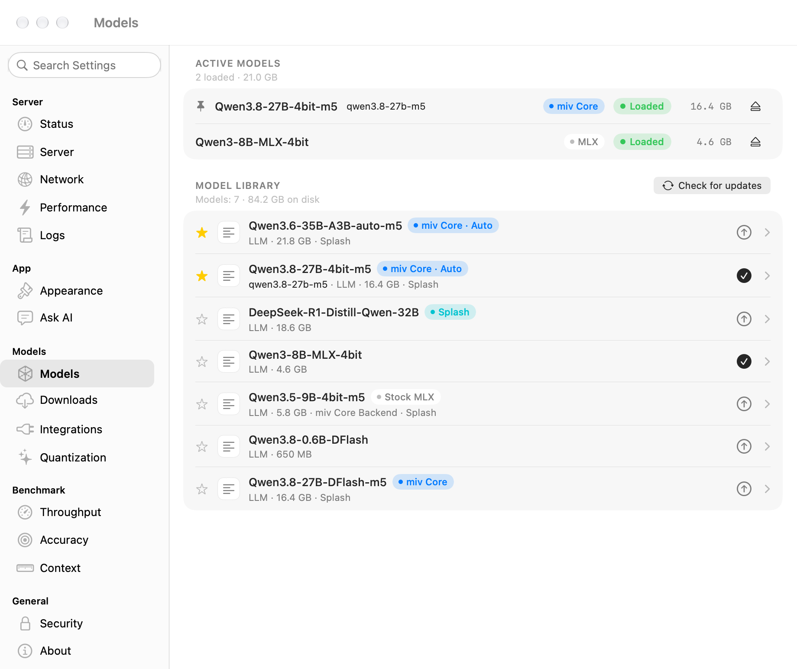

[English](../../omlx-extend-guide.md) | [简体中文](../zh-CN/omlx-extend-guide.md) | **繁體中文** | [日本語](../ja/omlx-extend-guide.md) | [한국어](../ko/omlx-extend-guide.md) | [Español](../es/omlx-extend-guide.md) | [Français](../fr/omlx-extend-guide.md) | [Deutsch](../de/omlx-extend-guide.md)

# `oMLX-extend` 視覺化上手指南

`oMLX-extend` 為 Apple M5+（`macOS 27+`）上的 `oMLX` macOS 應用程式加入 **`miv 核心後端（ninfer-metal）`** 與社群路徑 B Metal 4 微核心。已轉換 `.miv` 權重的模型會自動交由原生 Metal 4 NAX 執行，未適配的模型照常在原版 MLX 上運作。

跟著以下 5 個畫面逐步確認，就能檢查微核心狀態、辨識每個模型使用的引擎、開啟推測加速與 4-bit KV 量化，並直接共用預設設定檔一鍵啟動獨立伺服器。

---

## 第 1 步：探索、下載、熱更新與管理微核心

在 `oMLX` 打開 **整合 → 外部引擎**（`Integrations → External Engines`），即可在 macOS 介面內直接管理 **`miv 核心後端（ninfer-metal）`** 與後續接入的社群路徑 B SPI v2 微核心：


- **微核心主庫（頂部操作區）**：
  - 點擊 **`重新整理`**，即時抓取主庫最新核心清單（`microkernels.json`）並比對各核心的遠端 `latest.json` 版本。
  - 在下拉選單切換任意核心，下方會立即顯示該核心的 **支援模型**、拓撲與最低系統版本，方便判斷是否下載。
  - 點擊重新整理右側的 **`下載`**，自動完成下載、SHA-256 驗證、安全解壓與 SPI v2 檢查，並安裝至 `~/Library/Application Support/oMLX/Providers/`（已為最新受管版本時按鈕自動顯示 **`已安裝`** 並停用）。
- **已安裝核心清單（下方列表區）**：
  - **左側方形勾選框（`☑️`）**：勾選即啟用（新下載核心預設勾選）並寫入 `settings.json`；取消勾選後，O(1) 自動路由與單模型引擎下拉選單會立即略過該核心。
  - **右側 `更新` 按鈕**：預設停用灰顯，**只有在點擊 `重新整理` 且偵測到遠端新版時才會亮起**；點擊後於背景下載並以原子方式切換 `current` 軟連結完成熱更新（執行中的模型不中斷，重新載入模型後切換至新核心）。
  - **右側 `刪除` 按鈕**：確認後移除 `Providers/` 下的受管安裝目錄（若仍有執行中模型，會提示先卸載再刪除）；外部或本機編譯路徑掛載的核心會停用刪除以防誤刪，改用取消勾選停用即可。
- **指令列方式（選用）**：終端或自動化環境仍可直接執行 `./omlx-extend/scripts/sync_microkernels.sh --provider io.ninfer.metal`（支援 `--all` 與 `--rollback`）。
- **Splash**：保留在下方，既有控制項維持原樣。

---

## 第 2 步：查看每個模型由哪個引擎執行

切換至 **模型**（`Models`）畫面，即可一目了然看到各模型的執行引擎：



- **執行中模型**（`Active Models`）：每個已載入模型在綠色 **`Loaded`** 旁都會顯示引擎徽章（`miv Core`、路徑 B 微核心名稱或 `MLX`）。
- **模型庫**（`Model Library`）：含 `.miv` 權重的模型會亮出對應標籤（`miv Core · Auto`、路徑 B 微核心，或關閉外部路由後的 `Stock MLX`）。
- **未適配模型不受影響**：一般 MLX 模型不帶外部引擎徽章，維持原版 MLX 運作且不啟動任何 Sidecar 程序。`miv 核心後端`、路徑 B 微核心與原版 MLX 模型可在同一個統一記憶體上限下並存載入。

---

## 第 3 步：自動路由與切回原版 MLX

在模型庫點選任一已適配模型，打開 **進階設定**（`Model Settings → Advanced Settings`）：


- 已適配 `.miv` 的模型會自動將 **使用外部引擎**（`Use External Engine`）開關設為**開啟**，下拉選單預設為 **`miv Core Backend (Auto)`**（上一層模型設定頁首亦會顯示目前引擎徽章）。
- **隨時切回原版 MLX**：把 **`Use External Engine`** 開關**關閉**。`oMLX` 會寫入 `external_engine: "stock"` 並顯示 *"Using Stock MLX (auto-route overridden)"*，不會刪除磁碟上的 `.miv` 檔案；重新打開開關即可恢復自動路由。
- **改選其他引擎**：若同一個模型也安裝了相容的路徑 B 微核心或 Splash，直接從同一個下拉選單切換即可。

---

## 第 4 步：開啟 MTP / DFlash2 與 4-bit KV 量化

`oMLX-extend` 沿用 `oMLX` 原生設定頁：目前微核心支援的開關會正常點亮，僅供原版 MLX 使用的項目則保持灰顯，避免調整無效選項。

### 推論加速（`Lightning MTP` 與 `DFlash`）

開啟 **模型設定 → 加速**（`Model Settings → Acceleration`）：


- 模型具備內嵌 MTP 頭時，**`Lightning MTP`**（與 **`Adaptive max depth`**）會自動解鎖。
- 需要區塊擴散推測解碼時，**`DFlash`**（含 **`DFlash Draft Model`** 與 **`Runtime Block Size`**）可直接使用。
- 僅限 MLX 的項目（`Draft Quantization`、`Verify Mode`、`Draft Window Size`、`VLM MTP`）保持灰顯。

### 記憶體節省（4-bit KV 量化）

開啟 **模型設定 → 記憶體節省**（`Model Settings → Memory Saving`）：


- 開啟 **`TurboQuant KV Cache`** 並選擇 **`Affine4 · 4-bit`**，即啟用 `miv 核心後端` 的 `affine4_g128` KV 快取（`0.5625 B/val`，`64K+` 上下文通過 `0-ULP` 驗證）。
- 關閉開關則回到完整 `bf16` KV 快取；在 `miv-v0.01` 中選擇 `affine8` 或 `turboquant` 會退回 `bf16`。
- 僅限 MLX 的選項（例如 **`MoE Expert Offload`**）保持灰顯。

---

## 第 5 步：免手寫共用設定檔與一鍵啟動獨立伺服器

不需手動撰寫設定檔。**`oMLX-extend`** 與獨立 C++ 伺服器（**`ninfer-metal-serve`**）開箱都會自動載入同一份 [`omlx-extend/config/ninfer-metal.toml`](../../../omlx-extend/config/ninfer-metal.toml)，內含 Apple M5+ 調校預設值：

| 設定項 | 共用預設值 | 用途 |
|---|---|---|
| `max_concurrency` | `4` | 多使用者並發批次槽位數（`1..8`） |
| `max_context` | `65536` | 上下文視窗長度（Token 數） |
| `kv_dtype` | `"affine4_g128"` | 4-bit 分組 128 KV 快取（`64K+` `0-ULP`） |
| `rolling_prefix_cache` / `prefix_cache_gb` | `true` / `4.0` | 多輪對話 UMA 前綴重用（`4 GiB` 池） |
| `speculative.backend` | `"auto"` | 偵測到配套 `dflash2/` 時自動啟用 DFlash2，其次 `mtp`，否則純自回歸 |
| `providers_dir` | `["~/Library/Application Support/oMLX/Providers"]` | 自動探索已安裝的路徑 B SPI v2 微核心 |

想在連接埠 `8080` 啟動獨立 OpenAI 相容伺服器（與 `oMLX` 的 `8000` 互不衝突），只需一行指令：

```bash
# 指定已轉換的 .miv 模型目錄
./omlx-extend/scripts/start_ninfer_serve.sh /path/to/Qwen3.8-27B

# 省略路徑時，自動選取 ./models 或 oMLX 模型目錄中的第一個 .miv 模型
./omlx-extend/scripts/start_ninfer_serve.sh
```

**設定優先順序：**
- **`oMLX-extend` 模式**：介面上的個別模型設定 > TOML 中的 `[sidecar.models."<name>"]` > 共用 `ninfer-metal.toml` 的 `[engine]` / `[speculative]` 預設值。
- **`ninfer-metal-serve` 獨立模式**：命令列旗標一律優先於 `ninfer-metal.toml`。如需長期自訂預設值，複製一份至 `~/.config/ninfer-metal/ninfer-metal.toml` 修改即可，後續更新不會覆寫。

---

## 下一步

- **[快速上手與設定](getting-started.md)** — 從原始碼編譯、轉換 `.miv` 權重以及檢視全部 `ninfer-metal-serve` 命令列旗標。
- **[架構與多模型共存](architecture.md)** — 了解 O(1) 自動路由、Provider SPI v2 與共用 UMA 記憶體預算的內部機制。
- **[微核心工坊](microkernel-foundry.md)** — 為 Apple M5+ 貢獻新的路徑 A 或路徑 B 模型家族微核心。
