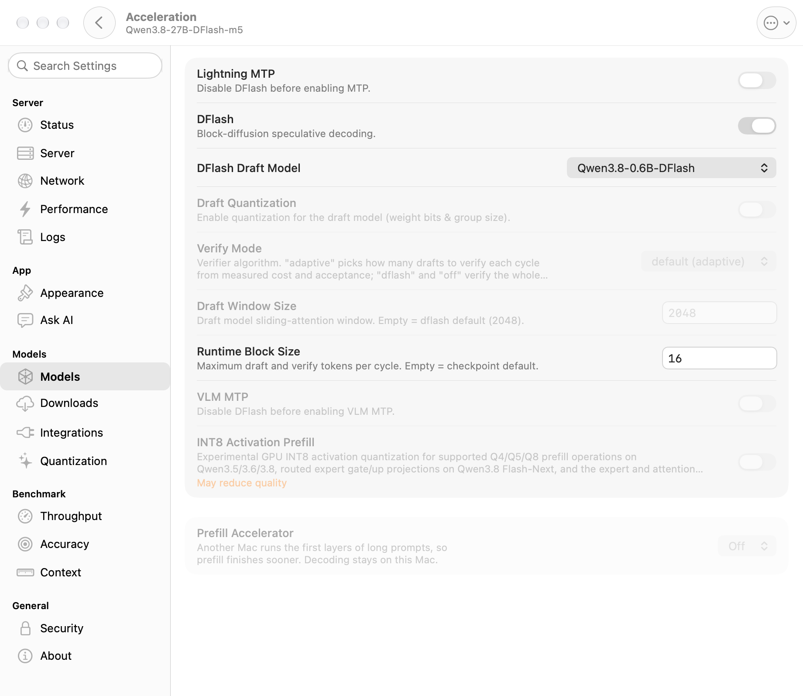

**English** | [简体中文](i18n/zh-CN/omlx-extend-guide.md) | [繁體中文](i18n/zh-TW/omlx-extend-guide.md) | [日本語](i18n/ja/omlx-extend-guide.md) | [한국어](i18n/ko/omlx-extend-guide.md) | [Español](i18n/es/omlx-extend-guide.md) | [Français](i18n/fr/omlx-extend-guide.md) | [Deutsch](i18n/de/omlx-extend-guide.md)

# `oMLX-extend` Visual Guide

`oMLX-extend` adds **`miv Core Backend (ninfer-metal)`** and community Path B Metal 4 microkernels to the `oMLX` macOS app on Apple M5+ Macs (`macOS 27+`). Adapted `.omlxm5` models pick up native Metal 4 NAX execution automatically, while your regular MLX models keep running on Stock MLX.

Walk through the five screens below to verify your install, check engine routing, turn on fast decode features, and launch the standalone server without writing config by hand.

---

## Step 1: Discover, Download, Hot-Update & Manage Microkernels

Open **`Integrations → External Engines`** in `oMLX` to manage **`miv Core Backend (ninfer-metal)`** and any installed Path B SPI v2 microkernels directly from the macOS app:


- **Microkernel Registry (top bar)**:
  - Click **`Refresh`** to pull the latest main-repository registry (`microkernels.json`) and check remote `latest.json` release versions.
  - Pick any core from the dropdown to inspect its **Supported Models**, topologies, SPI version, and minimum macOS requirement right below the picker before downloading.
  - Click **`Download`** (to the right of **`Refresh`**) to download, verify SHA-256, safely unpack, validate SPI v2 `provider.json`, and install into `~/Library/Application Support/oMLX/Providers/` (the button switches to **`Installed`** once the latest managed release is present).
- **Installed Microkernels list (bottom rows)**:
  - **Left square checkbox (`☑️`)**: Checked means enabled (default for newly downloaded cores) and persisted in `settings.json`. Unchecking disables the core immediately — O(1) auto-routing skips it and per-model engine dropdowns hide it.
  - **`Update` button (right)**: Dimmed by default; lights up only after **`Refresh`** detects a newer remote release. Clicking **`Update`** downloads and atomically flips the `current` symlink for zero-downtime hot-updates (any active models keep serving until reloaded).
  - **`Delete` button (right)**: Removes a managed core under `Providers/` after confirmation (offering to unload active models first). External or local build paths keep **`Delete`** disabled to prevent accidental removal — uncheck to disable instead.
- **CLI alternative**: For headless Macs or scripted installs, use `./omlx-extend/scripts/sync_microkernels.sh --provider io.ninfer.metal` (or `--all` / `--rollback io.ninfer.metal`).
- **Splash**: Stays right below with all of its existing controls untouched.

---

## Step 2: See Which Engine Runs Each Model

Switch to the **`Models`** screen to see how `oMLX` routes every model on your Mac:


- **Active Models**: Each loaded model displays an engine badge (`miv Core`, your Path B microkernel name, or `MLX`) right beside **`Loaded`**.
- **Model Library**: Models with `.omlxm5` weights show a highlighted pill (`miv Core · Auto`, a Path B microkernel, or `Stock MLX` if you turned external routing off).
- **Unadapted models stay untouched**: Standard MLX checkpoints have no external-engine pill and run through Stock MLX with zero sidecar processes. You can keep `miv Core Backend`, Path B, and Stock MLX models loaded side by side under one unified memory cap.

---

## Step 3: Auto-Routing & Switching Back to Stock MLX

Click any adapted model in **Model Library**, then open **`Advanced Settings`**:


- **`Use External Engine`** starts **ON** for adapted `.omlxm5` models, with the dropdown set to **`miv Core Backend (Auto)`** (the top-level Model Settings header also shows the active engine pill).
- **Switch back to Stock MLX anytime**: Flip **`Use External Engine`** **OFF**. `oMLX` records `external_engine: "stock"` and shows *"Using Stock MLX (auto-route overridden)"* without deleting your `.omlxm5` weights. Flip it back **ON** to return to auto-routing.
- **Pick another engine**: If a compatible Path B microkernel or Splash is installed for the same model, pick it directly from the dropdown.

---

## Step 4: Turn On MTP / DFlash2 & 4-bit KVQuant

`oMLX-extend` reuses the stock `oMLX` settings screens. Controls supported by the active microkernel unlock at full brightness; MLX-only controls stay dimmed so you can see right away what the engine executes.

### Acceleration (`Lightning MTP` & `DFlash`)

Open **`Model Settings → Acceleration`**:



- **`Lightning MTP`** (and **`Adaptive max depth`**) unlocks when your model includes an embedded MTP head.
- **`DFlash`** (with **`DFlash Draft Model`** and **`Runtime Block Size`**) unlocks for block-diffusion speculative decoding.
- MLX-only rows (`Draft Quantization`, `Verify Mode`, `Draft Window Size`, `VLM MTP`) stay dimmed.

### Memory Saving (`4-bit KVQuant`)

Open **`Model Settings → Memory Saving`**:


- Turn on **`TurboQuant KV Cache`** and select **`Affine4 · 4-bit`** to run `miv Core Backend`'s `affine4_g128` KV cache (`0.5625 B/val`, verified `0-ULP` up to `64K+` context).
- Turning the switch off uses full `bf16` KV cache. Selecting `affine8` or `turboquant` falls back to `bf16` in `miv-v0.01`.
- MLX-only memory options such as **`MoE Expert Offload`** stay dimmed.

---

## Step 5: Zero-Edit Shared Config & Standalone 1-Click Launch

You do not need to write a config file by hand. Both **`oMLX-extend`** and the standalone C++ server (**`ninfer-metal-serve`**) automatically load [`omlx-extend/config/ninfer-metal.toml`](../omlx-extend/config/ninfer-metal.toml) with ready-to-run Apple M5+ defaults:

| Setting | Shared Default | What It Does |
|---|---|---|
| `max_concurrency` | `4` | Concurrent multi-user batch slots (`1..8`) |
| `max_context` | `65536` | Context window length (tokens) |
| `kv_dtype` | `"affine4_g128"` | 4-bit group-128 KV cache (`0-ULP` at `64K+`) |
| `rolling_prefix_cache` / `prefix_cache_gb` | `true` / `4.0` | Multi-turn UMA prefix reuse (`4 GiB` pool) |
| `speculative.backend` | `"auto"` | Picks `dflash2` if a companion draft exists, else `mtp`, else pure AR |
| `providers_dir` | `["~/Library/Application Support/oMLX/Providers"]` | Auto-discovers installed Path B SPI v2 microkernels |

To start the standalone OpenAI-compatible server on port `8080` (separate from `oMLX`'s port `8000`), run:

```bash
# Point directly to an adapted model directory
./omlx-extend/scripts/start_ninfer_serve.sh /path/to/Qwen3.8-27B

# Or omit the path to auto-pick the first .omlxm5 model in ./models or oMLX's models folder
./omlx-extend/scripts/start_ninfer_serve.sh
```

**How overrides work:**
- In **`oMLX-extend`**: per-model UI settings take top priority, followed by `[sidecar.models."<name>"]`, then the shared `[engine]` / `[speculative]` values in `ninfer-metal.toml`.
- In **`ninfer-metal-serve`**: CLI flags always override `ninfer-metal.toml`. Copy `ninfer-metal.toml` to `~/.config/ninfer-metal/ninfer-metal.toml` when you want custom defaults that survive updates.

---

## Next Steps

- **[Getting Started & Config](getting-started.md)** — Build from source, convert checkpoints to `.omlxm5`, and inspect all `ninfer-metal-serve` CLI flags.
- **[Architecture & Coexistence](architecture.md)** — How O(1) routing, Provider SPI v2, and shared UMA memory budgets work under the hood.
- **[Microkernel Foundry](microkernel-foundry.md)** — Add new Path A or Path B model families for Apple M5+.
