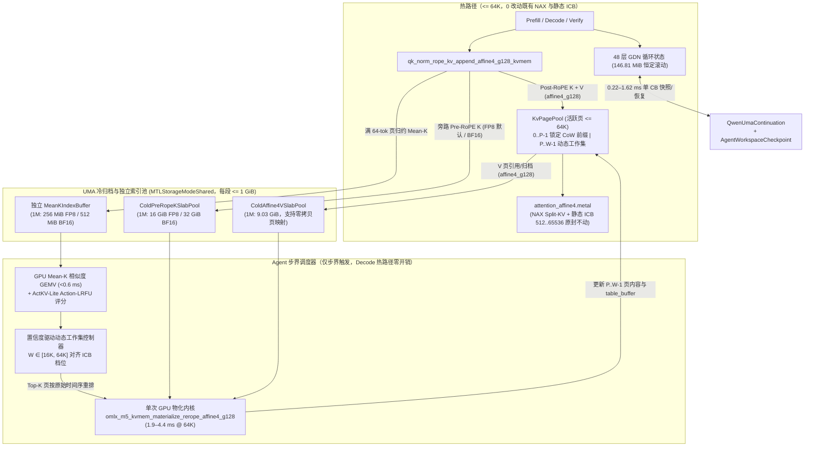

# `ninfer-metal` `v0.02+` 超长上下文与 Agent 内存虚拟化技术规划：`KVMem-UMA + ActKV`

> **文档状态**：工程技术规划（Architecture & Engineering Roadmap）  
> **目标版本**：`ninfer-metal` 下一代核心演进版本（`v0.02+`，衔接首个基线 `miv-v0.01`）  
> **目录约定说明**：核心源码目录正由 `m5rt/` 统一重命名为 `miv/`；下文均采用新目录 `miv/` 标注（括号内注明对应原路径与实测基线 `m5rt.15`/`m5rt.16`），以保证与 `miv-v0.01` 基线及后续 PR 一致。  
> **适用硬件**：Apple Silicon M5 全系 UMA（M5 / M5 Pro / M5 Max / M5 Ultra 64c 96 GiB & 80c 256 GiB）

---

## 1. 执行摘要与架构决策（Executive Summary & Architectural Decision）

### 1.1 核心结论

`KVMem`（[arXiv:2609.04852](https://arxiv.org/abs/2609.04852)）与 `ActKV`（[arXiv:2609.31395](https://arxiv.org/abs/2609.31395)）**高度值得接入 `ninfer-metal`（`miv/`）**，但**绝不能照搬其 CUDA 离散显存实现**。Apple M5 统一内存架构（UMA）改变了整个问题的物理前提：

1. **为什么 Apple M5 UMA 从根本上改写了 KVMem（vs CUDA PCIe）**：
   - **在 CUDA 上（论文基线）**：24 GB 消费级显卡受限于窄 VRAM 与 `25–50 GB/s` PCIe 带宽墙，KVMem 必须构建复杂的 `GPU VRAM ↔ Host RAM ↔ NVMe` 三级搬运与异步双缓冲流水线。
   - **在 Apple M5 UMA 上**：`GPU` 与 `CPU` 共享同一物理 DRAM（`MTLStorageModeShared` 零拷贝，M5 Ultra 带宽 `800–900+ GB/s`，容量 `96–256 GiB`），**VRAM ↔ Host RAM 的 PCIe 搬运墙彻底消失**。对于当前核心目标 `Qwen3.8-27B`（3:1 混合架构），即使采用避免二次量化的高精度 **Pre-RoPE K 归档**（FP8 K + `affine4_g128` V），一整套 **`1M` Token 的完整 Agent 工作空间仅需 `25.03 GiB`**（BF16 K 方案为 `41.03 GiB`），可与 `14.2 GiB` MXFP4 权重完整常驻 96–256 GiB UMA 内存，实现零 SSD 抖动与 **`~2.5–5.5 ms` 步界零拷贝视图切换**。
   - **在 M5 UMA 上 KVMem 依然不可替代的三大价值**：
     1. **突破 `256K` 原生 RoPE 天花板**：将超长 Agent 工作空间虚拟化至 `1M+` Token，避免文本摘要失忆及 `11.4×–53.8×` 文本 RAG 重填延迟；
     2. **封顶活跃注意力带宽并严守 Metal `2 GiB` 单缓冲红线**：若在 `256K–1M` 上执行全量稠密注意力，单步 Decode 仅读取 KV 就需吞吐 `4.52–18.06 GiB`（`affine4_g128`）或 `16–64 GiB`（`bf16`），会将 M5 Ultra Decode 速率从 `~60 tok/s` 拖垮至 `~10–43 tok/s`；通过 KVMem 将活跃工作集锁在 `W ∈ [16K, 64K]`，即可在 `1M` 工作空间下稳住 **`~58–60 tok/s`（AR）/ `110–140 tok/s`（高接受率编码场景 `DFlash2`）**；
     3. **Tier-3 Apple NVMe（`~6–7 GB/s`）**：让 32–64 GiB M5 Pro/Max 也能运行 `1M+` 工作空间，并解锁**跨进程/跨重启的秒级持久化 Agent 工作空间**。

2. **为什么必须分两阶演进——先落地 Tier-1（`KVMem-UMA + ActKV-Lite`），再落地 Tier-2（NVMe + 全量 Token 级 ActKV）**：
   - **在当前主力模型 `Qwen3.8-27B`（3:1 Hybrid）+ 无损 `affine4_g128` 上，直接做破坏性 Token 级 ActKV 剪枝是负 ROI**：
     - `miv-v0.01`（原 `m5rt.15` 80c M5 Ultra 实测）中，无损 `affine4_g128` 已将 `64K` KV 压至仅 **`1.13 GiB`**（占 `15.69 GiB` 净峰值的 `7.2%`），注意力耗时仅 **`2.02 ms/tok`**（占单步 `11.9%`），`2K → 64K` 速度衰减仅 `-4.1%`（`61.42 → 58.92 tok/s`）。
     - 若在 `<= 64K, B=1` 强行裁掉 `74%` KV，仅节省 `0.84 GiB`（总内存 `-5.3%`）与 `~1.5 ms/tok`（`+9%` Decode），却永久丢弃历史 KV 并引入 `~1.5%` Agent 精度折损；且在 **96 GiB / 256 GiB M5 Ultra 上，`Qwen3.8-27B` `128K` `affine4_g128` 的并发上限受运行时 `B <= 8` 硬顶限制而非内存限制，ActKV 带来的并发增益严格为 `1.0×`（0% 增益）**。
   - **Tier-1（`KVMem-UMA + ActKV-Lite`）是最优切入点（2–3 周，低中风险）**：
     - 吸收 ActKV 最精华的 **Action-LRFU 评分 + 置信度驱动自适应工作集预算 `W ∈ [16K, 64K]`**，将其用于 KVMem 的**64-Token 页级冷热调度**而非永久删除历史 Token；
     - 复用现有 `KvPagePool`（`<= 64K`）、静态预编译 Compute ICB（`512..65536`）、`SharedPrefixCache` CoW 与 `QwenUmaContinuation`（`0.22–1.62 ms` GDN 快照），**对热路径 `attention_affine4.metal` NAX 内核与静态 ICB 实现 0 改动**；
     - 在现有 `Qwen3.8-27B` 上立即可交付 `256K → 1M+` 零删档长程 Agent 工作空间。
   - **Tier-2（NVMe 持久化 + 全量 Token 级 ActKV）精准匹配 `v0.02+` 新拓扑与中小内存 SKU（4–6 周，中高风险）**：
     - 当 `v0.02+` 纳入**纯注意力大模型**（如 `Qwen3-32B`、`Llama-3.3-70B`、`Qwen3-30B-A3B`，KV 体积比 3:1 Hybrid 大 `4.5×–5.6×`）并面向 **32–64 GiB M5 Pro/Max** 时，NVMe Tier-3 与基于 LSE 恢复的零反量化 `144 B/tok`（`hd=256`）/ `80 B/tok`（`hd=128`）原地页紧缩将释放真正可观的 **`2.5×–3.8×` 并发增益**与 **`+62%`～`+250%` 长上下文 Decode 收益**。

---

## 2. 已核验论文与社区参考矩阵（Verified Paper & Community Reference Matrix）

> 以下论文编号、作者单位、实验基线与开源生态均已逐项核验。特别澄清：本地 LLM 社区中常被提及的 `kvmen` 经核验为 **`KVMem` 的拼写误植（`n`/`m`）**，不存在独立名为 `kvmen`/`KVMen` 的论文或项目。

| 维度 | **KVMem** | **ActKV** | **本规划融合形态（`KVMem-UMA + ActKV-Lite`）** |
|---|---|---|---|
| **论文标题** | *KVMem: Virtualizing Million-Token Agent Workspaces on a Consumer GPU* | *ActKV: Efficient LLM Agents through Action-Guided KV Cache Management* | — |
| **arXiv 与时间** | [arXiv:2609.04852](https://arxiv.org/abs/2609.04852)（2026-09） | [arXiv:2609.31395](https://arxiv.org/abs/2609.31395) `[cs.OS]`（2026-09） | 面向 `ninfer-metal` `v0.02+` |
| **作者与机构** | Di Chai, Leye Wang, Zeshen Su, Zhiguo Xia, Zhihang Yu（北京大学 PKU、上海财经大学 SUFE、西北工业大学 NWPU、吉林大学 JLU） | Zihan Wang, Cheng Tang, Lei Gong, Chao Wang, Wenqi Lou, Teng Wang, Xuehai Zhou（中国科学技术大学 USTC 及苏州高等研究院） | — |
| **开源仓库现状** | 官方：`kvmem/kvmem`、`kvmem/kvmem-qw3` / `Di-Chai/qw3`（专攻 Qwen3.6/3.8-27B 混合架构）、`kvmem/kvmem-llama.cpp`、`kvmem-vllm` 社区 NInfer 融合：`1314521gjy/ninfer-fusion-kvmem`、`melis2023/ninfer-kvmem-actkv` | 截至 2026-11 尚未确认 USTC 独立官方开源仓库 URL（透明标注）；社区融合参考：`melis2023/kvmem-actkv`、`melis2023/ninfer-kvmem-actkv`（面向 `llama.cpp` / `NInfer` + DFlash） | 原生 C++/ObjC++/Metal 4 实现于 `miv/`，零 MLX/Python 运行时依赖 |
| **论文核心机制** | 将溢出 KV 视为虚拟内存；冷存位置无关 **Pre-RoPE K** + 轻量 **`Mean-K`** 块摘要；在 **Agent 步界** 选出有界工作集并通过 **re-RoPE / delta re-RoPE** 按时间序物化至活跃页池 | 针对 ReAct（`Observation → Reasoning → Action`）循环：① **Action 导向驱逐**（基于 FlashAttention LSE 恢复注意力权重 + Action-LRFU 评分）；② **置信度驱动自适应预算**；③ **页感知三原语**（LSE 恢复 / 条目驱逐 / 原地页紧缩释放物理页） | **Tier-1**：UMA 冷池存高精度 Pre-RoPE K + 独立 `Mean-K` 索引 + Action-LRFU & 置信度工作集 `W∈[16K,64K]` + 单核 `re-RoPE+affine4_pack`（不删历史） **Tier-2**：叠加 NVMe 落盘 + LSE 恢复 + 零反量化原地紧缩 |
| **论文目标模型** | **Qwen3.6/3.8-27B（3:1 Hybrid，NVFP4 + MTP）**——与我方当前主力模型完全同源 | **纯注意力 MoE/Transformer**（`Qwen3-30B`、`Qwen3-235B`、`GPT-OSS-20B`、`GPT-OSS-120B`） | Tier-1 直击 `Qwen3.8-27B`；Tier-2 同步覆盖未来纯注意力 32B/70B 与稀疏 MoE |
| **论文实测基线（CUDA）** | 24 GB RTX 5090 Laptop：`1M` 工作空间（`4×` 原生 256K / `12.5×` 显存寻址）；持续 `~50 tok/s`；较文本 RAG 重填预响应延迟降 **`11.4×–53.8×`**；DeepSWE 成功率 **`43.8% → 48.4%`**（`+4.6 pp`）；评测含 LongMemEval / MemoryAgentBench / AgentLongBench | PagedAttention（ALFWorld / WebShop / HotpotQA）：仅用 **`25.98%`** 峰值 KV 保留 **`98.53%`** FullKV 精度，实现 **`3.97×`** Token 吞吐与 **`3.58×`** 任务吞吐 | M5 Ultra UMA 上彻底消除 PCIe 墙，目标详见第 7 节量化验收矩阵 |

---

## 3. Apple M5 UMA 硬件与内存物理建模（Hardware & Memory Physics）

### 3.1 现有 `miv-v0.01`（`m5rt.15`/`m5rt.16`）实测基线与复用资产

根据 `miv/src/kv_page_pool.cpp`（原 `m5rt/src/kv_page_pool.cpp:43-103`）、`miv/include/omlx_m5/kv_page_pool.h:35-120`、`miv/src/qwen_memory.cpp:120-231`、`miv/src/shared_prefix_cache.h`、`miv/src/qwen_forward.cpp:1030-1147, 8952-9165`、`miv/src/native_backend.cpp:835-895` 与 `miv/kernels/attention_affine4.metal:144-280, 1236-1330, 1992-2070` 的源码审计与 80c M5 Ultra 真机实测：

- **热路径 `64K` 基线已高度极限化**：`Qwen3.8-27B` + `affine4_g128` 在 `2K → 64K` 下 AR 速度由 `61.42 → 58.92 tok/s`（仅下降 `-4.1%`），`64K` Split-KV 注意力耗时仅 `2.02 ms`（有效带宽 `591 GB/s`，占单步 `11.9%`），净内存峰值 `15.69 GiB`；真实编码/长文 `64K` `DFlash2` 达 `139.70 tok/s`（`128/128` `0-ULP`，高接受率 `4.4–5.5 tok/r`；合成 `dim_e` 短对话为 `86.94–97 tok/s`）；冷预填充 `1,542.0 tok/s`。
- **现成底层地基已覆盖约 60% 管道**：
  1. `SharedPhysicalPageAllocator` + `KvPagePool`：已具备 `64-token` 物理页分配、引用计数 CoW 与动态 GPU `table_buffer()`；
  2. `QwenUmaContinuation`：已实现单 GPU CB 零搬运快照/恢复全 48 层 GDN 状态（`146.81 MiB`），解码后保存仅 `0.22 ms`（`m5rt.16`），热恢复 `0.73–1.62 ms`（`m5rt.15`）；
  3. 静态 Compute ICB 包络（`qwen_forward.cpp:1036-1041`：`512, 2048, 8192, 16384, 32768, 65536`）：只要 KVMem 物化工作集满足 `W <= 64K`，即**零 ICB 重编译**；
  4. Split-KV `partial_max` / `partial_sum` 归约已在 `omlx_m5_paged_attention_affine4_g128_split_merge_half_4sg_hd256`（`attention_affine4.metal:2031-2054`）中直接求出 Base-2 对数域全局 `global_m` 与 `global_l`，为 Tier-2 ActKV 的 LSE 输出铺平道路；
  5. Metal `2 GiB` 单 Buffer 安全封顶（`native_backend.cpp:885-888`）已在内存分配层强制执行。

### 3.2 混合架构（Qwen3.8-27B）vs 纯注意力（32B/70B）精确内存账本

由 `kv_page_bytes()`（`miv/src/kv_page_pool.cpp:43-62`）与 `page_byte_stride()`（`miv/kernels/attention_affine4.metal:144-149`）给出严格公式：
- `BF16`：`page_bytes = page_tokens × kv_heads × head_dim × 2`；
- `affine4_g128`：`vec_bytes = head_dim / 2 + sizeof(KvAffine4VecMeta)`（固定 `16 B`），`head_bytes = 64 × vec_bytes + 32 B (KvAffine4PageSummary)`，`page_bytes = kv_heads × head_bytes`。

| 模型拓扑 | 全注意力几何配置 | BF16 KV / tok (`64K / 256K / 1M`) | `affine4_g128` KV / tok (`64K / 256K / 1M`) | 无二次量化 `1M` 冷归档（**FP8 Pre-RoPE K + affine4 V** / **BF16 Pre-RoPE K + affine4 V**） | 非 KV 循环状态 |
|---|---|---|---|---|---|
| **Qwen3.8-27B**（3:1 Hybrid，当前主力） | 16 层 Full-Attn（`4` KVH, `hd=256`, `24` QH）+ 48 层 GDN | `64.0 KiB` (**4.00 / 16.00 / 64.00 GiB**) | `18.0625 KiB` (**1.13 / 4.52 / 18.06 GiB**) | **`25.03 GiB`** (`16.00 + 9.03`) / **`41.03 GiB`** (`32.00 + 9.03`) | **`146.8125 MiB` 恒定** (`48 × (3.00 + 0.0586) MiB`) |
| **Pure-Attn 32B**（如 Qwen3-32B，`v0.02+`） | 64 层 Full-Attn（`8` KVH, `hd=128`） | `256.0 KiB` (**16.00 / 64.00 / 256.00 GiB**) | `80.5 KiB` (**5.03 / 20.13 / 80.50 GiB**) | **`104.25 GiB`** (`64.00 + 40.25`) / **`168.25 GiB`** (`128.00 + 40.25`) | `0 B` |
| **Pure-Attn 70B**（如 Llama-3.3-70B，`v0.02+`） | 80 层 Full-Attn（`8` KVH, `hd=128`） | `320.0 KiB` (**20.00 / 80.00 / 320.00 GiB**) | `100.625 KiB` (**6.29 / 25.16 / 100.63 GiB**) | **`130.31 GiB`** (`80.00 + 50.31`) / **`210.31 GiB`** (`160.00 + 50.31`) | `0 B` |

> **注**：`hd=128` 时 `KvAffine4VecMeta` 仍固定占 `16 B`（`kv_page_pool.h:47-51`），故单向量为 `64 + 16 = 80 B/vec`，单 64-tok 页单头 `5,152 B`，带来上表精确的 `80.5 KiB/tok`（32B）与 `100.625 KiB/tok`（70B）。

### 3.3 `affine4_g128` Per-Token 独立物理布局

检查 `quantize_vec_g128_device`（`miv/kernels/attention_affine4.metal:175-207`）：在每个 `64-token` 物理页的单 KV 头切片内，每个 Token（页内槽位 `within ∈ [0, 63]`）的数据分布于 **3 个跨步子数组**，但量化统计量（`scale[0..1]`、`zero[0..1]`）**完全逐向量独立，不存在跨 Token 组量化耦合**：

- `g0`（`dim 0..127`）：`codes_head + within × 64 B`（`64 B` packed `uint4`）
- `g1`（`dim 128..255`，仅 `hd=256`）：`codes_head + (page_tokens + within) × 64 B`（`64 B` packed `uint4`）
- `meta`：`meta_head + within × 16 B`（`16 B` `KvAffine4VecMeta`）

单向量总计 **`144 B/tok`**（`hd=256`）或 **`80 B/tok`**（`hd=128`）。这一物理特性直接解锁两大工程红利：
1. **Tier-1 KVMem**：V 向量与 RoPE 位置无关，可直接以 `affine4_g128` 归档，并在步界物化时执行**零反量化页表映射或对齐整页拷贝**；
2. **Tier-2 ActKV**：原地页紧缩只需对存活 Token 分别搬运 `g0`、`g1`、`meta` 三个定长片，**完全免除反量化与重量化**，数值 `0` 失真。

### 3.4 关键物理修正一：Pre-RoPE K 归档精度与零二次量化数学

> **严禁二次量化陷阱**：若冷归档将 Pre-RoPE K 或 Post-RoPE K 压缩为 `affine4_g128`（看似仅占 `18.06 GiB`），步界切换时就必须执行 `4-bit 反量化 → (逆 RoPE) → 新位置 RoPE → 再 4-bit 量化`。两次 4-bit 舍入叠加旋转正交变换会显著放大长程注意力点积误差，违背高保真设计原则。

因此，冷归档对 K 与 V 采用**非对称高精度归档策略**（V 恒定存 `affine4_g128`，仅对 K 存高精度 Pre-RoPE 值）：

| 冷归档 K 精度方案 | Qwen3.8-27B `1M` 归档总占用（K + V） | `64K` 视图切换搬运量（读 K + 写 `affine4 K`） | 预计 `64K` 视图切换耗时 @ `900 GB/s`（V 零拷贝映射 / 含 V 拷贝） | 适用建议 |
|---|---|---|---|---|
| **FP8 Pre-RoPE K + `affine4_g128` V** | **`25.03 GiB`**（`16.00 + 9.03 GiB`） | `1.00 GiB` + `0.564 GiB` = `1.564 GiB`（`1.68 GB`） | **`~1.9 ms`** / **`~3.2 ms`** | **Tier-1 默认推荐**：兼顾 `96 GiB` M5 Ultra 充裕余量、零 4-bit 二次量化与极速步界切换 |
| **BF16 Pre-RoPE K + `affine4_g128` V** | **`41.03 GiB`**（`32.00 + 9.03 GiB`） | `2.00 GiB` + `0.564 GiB` = `2.564 GiB`（`2.75 GB`） | **`~2.8–3.1 ms`** / **`~4.4 ms`** | **高保真模式**：适合 128–256 GiB SKU 或对数值保真极度敏感的代码/科研任务，与在线单次量化接近 `<= 1 ULP` |

- 换算至 `W = 32K` 常用活跃窗，上述 `re-RoPE + affine4_pack` 耗时减半至 **`~1.0–2.2 ms`**。
- 对比 96 GiB M5 Ultra 有效工作集上限 `W_ws = 77.76 GiB`：加载 `14.2 GiB` MXFP4 权重 + `25.03 GiB` FP8-K `1M` 归档 + `1.13 GiB` `64K` 活跃 KV + `0.25–0.50 GiB` `Mean-K` 索引 + `~3.2 GiB` 工作区/GDN ≈ **`44 GiB`**（仅占 `W_ws` 的 `56.6%`），即使采用 BF16-K 方案也仅 `~60 GiB < 77.76 GiB`，彻底无需 SSD 换页。

### 3.5 关键物理修正二：独立 `Mean-K` 索引 Buffer（严禁膨胀 `32 B` `KvAffine4PageSummary`）

- 现状核查：`miv/include/omlx_m5/kv_page_pool.h:38-42` 中定义的 `KvAffine4PageSummary` 严格固定为 **`32 B/head/page`**（`8×FP16 min + 8×FP16 max` 子带包围盒，当前未启用），其 `32 B` 偏移硬编码在 `kv_page_pool.cpp:57` 与 `attention_affine4.metal:147` 的 `page_byte_stride()` 中。
- 物理缺口：对 `hd=256` 的 Qwen3.8-27B，完整 `Mean-K` 向量需要 **`512 B/head/page`（BF16）** 或 **`256 B/head/page`（FP8）**，比 `32 B` 大 **`8×–16×`**（在 `1M` Token = `16,384` 页、16 层、4 KVH 下，全量 `Mean-K` 体积为 **`512 MiB`（BF16）** 或 **`256 MiB`（FP8）**）。
- **强制架构决策**：**绝不原地扩大 `KvAffine4PageSummary` 或修改 `page_byte_stride()`**，否则将迫使全部热路径 `attention_affine4.metal` 内核与 `kv_page_pool` 重排重验证。正确做法是将 `Mean-K` 存入**完全独立的连续金属索引缓冲（`MeanKIndexBuffer`）**：
  - 内存排布：`[num_full_attn_layers, max_archive_pages, kv_heads, head_dim]`（`FP8` 或 `BF16`）；
  - 双重收益：① 热路径 `attention_affine4.metal` 字节级零触碰；② 步界评分时 GPU 只需顺序扫读连续 `256–512 MiB` 索引（非跨页随机跳读），在 `900 GB/s` 带宽下扫完整个 `1M` 工作空间仅需 **`~0.30–0.60 ms`**。

### 3.6 关键物理修正三：96G M5 Ultra 并发实算与 Dense 70B Decode 物理封顶

为杜绝脱离硅片带宽与工作集方程的虚高预期，确立两条经 Roofline 核验的硬边界：

1. **96 GiB M5 Ultra 上 `Qwen3.8-27B` `128K` `affine4_g128` 并发增益为 `1.0×`（0% 增益）**：
   - `96 GiB` M5 Ultra 的 `W_ws = 77.76 GiB`，扣除 `~14.2 GiB` MXFP4 权重与 `~3.0 GiB` 共享 workspace 后剩余 `~60.6 GiB`；
   - `Qwen3.8-27B` 在 `128K` `affine4_g128` 下每槽仅占 **`2.40 GiB`**（`2.26 GiB` KV + `146.81 MiB` GDN），物理内存足够放下 `~25` 槽，远超引擎当前 `B <= 8` 并发硬上限（`B=8 × 128K` 总计也仅消耗 `~35 GiB`）；
   - 因此，ActKV 在 96G/256G M5 Ultra 上对 `Qwen3.8-27B` `affine4_g128` 的并发上限提升严格为 **`1.0×`**。ActKV 仅在 **32–48 GiB M5 Pro/Max**（如 36 GiB SKU 可用余量 `~10 GiB`）或 `bf16` KV（已被无损 `affine4_g128` 全面超越）场景下才会对 Qwen3.8-27B 产生并发增益。
2. **纯注意力 Dense `70B-MXFP4` 的 `L=256K, B=1` ActKV Decode 收益物理封顶于 `+62%` / `+118%–140%`**：
   - `70B-MXFP4` 权重体积 `~38 GB`，在 `900 GB/s` UMA 带宽下构成 **`~42 ms/tok` 不可压缩的权重读取下界**；
   - 在 `L=256K, B=1` 下：`affine4_g128` KV 为 `25.16 GiB`（`27.0 GB`，约 `30–45 ms`），ActKV 裁至 `26%` 后单步时间由 `72–87 ms` 降至 `50–54 ms`，提速严格封顶在 **`~+62%`**；`bf16` KV 为 `80.0 GiB`（`85.9 GB`），提速严格封顶在 **`+118%–140%`**；
   - 更高 Decode 提速区间（`+70%–110%` `affine4` / `+180%–250%` `bf16`）仅对活跃权重更小的 **Dense 32B** 或 **稀疏激活 MoE**（如 Qwen3-30B-A3B / 235B-A22B）成立。

---

## 4. Tier-1 详细工程设计：`KVMem-UMA + ActKV-Lite`

### 4.1 总体架构与冷热解耦数据流

### 4.2 Opt-In 配置契约与 `ExecutionIdentityFields` 身份隔离

1. **`LoadOptions` 扩展**（`miv/include/omlx_m5/types.h`）：
   - `std::string kv_policy = "lossless";`
     - `"lossless"`（唯一默认）：严格保持 `miv-v0.01` `0-ULP` 无损全量路径，零额外内存分配、零额外内核分发；
     - `"kvmem"`：开启纯 `Mean-K` 相似度驱动的 UMA 虚拟化工作空间；
     - `"kvmem_actkv"`（Tier-1 推荐 Agent 模式）：开启 `KVMem-UMA + ActKV-Lite`（`Mean-K` + Action-LRFU + 置信度工作集）；
     - 预留 Tier-2 值：`"actkv"`、`"kvmem_actkv_nvme"`。
   - `std::string kvmem_k_dtype = "fp8";`（支持 `"fp8"` 默认、`"bf16"` 高保真；严禁 `"affine4"`）。
   - `std::uint32_t kvmem_min_working_tokens = 16384;` / `std::uint32_t kvmem_max_working_tokens = 65536;`（要求 `<= max_context <= 65536` 且对齐静态 ICB 档位）。
   - `std::uint32_t kvmem_archive_max_tokens = 1048576;`（单会话最大虚拟寻址上限，受 `memory_budget_bytes` 动态钳位）。
   - `std::uint32_t kvmem_recent_tail_tokens = 4096;`（强制保留的最近窗口长度）。
2. **`ExecutionIdentityFields` 强制盖章**（`miv/src/qwen_forward.cpp:1121`、`miv/src/native_backend.cpp:1202`）：
   - 当 `kv_policy != "lossless"` 时，必须将 `kv_policy`、`kvmem_k_dtype`、`kvmem_w_min`、`kvmem_w_max`、`kvmem_archive_max` 写入 `ExecutionIdentityFields` 参与 `shared_contract_identity` 与 `execution_identity` 摘要计算；
   - 确保无损模式的 `QwenUmaContinuation`、`SharedPrefixCache` 与 KVMem 会话在哈希层面**物理隔离**，杜绝跨契约静默命中。

### 4.3 UMA 冷归档 Slab 池与 Pre-RoPE K 捕获设计

1. **分段 Slab 内存布局（严守 Metal `< 2 GiB` 红线）**：
   - 新增 `KvMemArchivePool`（位于 `miv/src/kvmem_archive_pool.{h,cpp}`），底层以 `MTLStorageModeShared` 按段惰性分配，**每个 `MTLBuffer` 严格 `<= 1 GiB`**（例如按 `(layer, chunk_id)` 组织，每块容纳 `1024` 个 `64-token` 页 = `64K` tokens：对于 Qwen3.8-27B 单层 `64K` FP8 Pre-RoPE K 仅 `64 MiB`，BF16 仅 `128 MiB`，`affine4` V 仅 `36.1 MiB`，完全远离 `2 GiB` 上限）；
   - 接入 `oMLX-extend` 统一内存账本（`memory_budget_bytes` 硬限制与 `trim_cache` 软水位回调），空闲冷会话归档池支持 LRU 释放或降级至 Tier-2 NVMe。
2. **Pre-RoPE K 旁路捕获与 `Mean-K` 在线生成**：
   - 新增专用内核 `omlx_m5_attention_qk_norm_rope_kv_append_affine4_g128_kvmem`（复刻自 `attention_affine4.metal:1236-1330`，原无损内核保持零修改）；
   - 在计算完 `QK-Norm`（`first = row[first_index] * inverse_rms * (norm[first_index] + weight_offset)`）、**尚未施加 RoPE 旋转之前**，直接将 Pre-RoPE K 按 `kvmem_k_dtype`（FP8 E4M3 带 per-head/per-page 缩放或 BF16）写入当前逻辑页对应的 `ColdPreRopeKSlabPool` 槽位；
   - **非旋转维度处理**：完整保留 `rotary_dim` 旋转部分与 `[rotary_dim, head_dim)` 非旋转部分的 Pre-RoPE（即 QK-Norm 后）表示，保证 `partial_rotary_factor < 1.0` 模型（如 Qwen3.8 系列）同样精确无误；
   - **满页 `Mean-K` 归约**：每当一个 `64-token` 逻辑页写满（`within == 63` 或 Prefill 整页落盘），启动轻量归约内核（或融合尾步）计算该页 64 个 Pre-RoPE K 向量的均值，写入独立 `MeanKIndexBuffer[layer][archive_page][kvh][0..hd-1]`。

### 4.4 步界（Step-Boundary）调度：Action-LRFU + `Mean-K` + 置信度工作集 `W`

1. **触发边界与零热路径开销保证**：
   - 仅在 **Agent 步界**（新 Observation/User Turn Prefill 完毕后且总逻辑长度 `L_total > W_target` 时）触发一次；Decode 生成期间永不触发换页。
2. **双路混合页重要性评分**：
   - **Query-Conditioned `Mean-K` 相关性分**：取当前步界末尾 `K_q`（默认 `16–64`）个最新查询向量（经 QK-Norm 的 Pre-RoPE Q 均值，消除位置相位漂移），对所有可检索冷页 `p ∈ [P, L_pages - R)` 与独立 `MeanKIndexBuffer` 执行单次跨层并行 GPU GEMV，得到每页各 KV 头的相关性分 `s_sim(l, p)`（`1M` Token = `16,384` 页，耗时 **`< 0.3–0.6 ms`**）；
   - **ActKV-Lite Action-LRFU 历史分**：在主机侧维护每逻辑页的轻量化元数据（仅 `16 B/page`，`1M` Token 共 `256 KiB`）：
     - `last_hit_step`：该页上次在 Action 步（工具调用/关键决策）被选入并获得高相关性分的步号；
     - `action_crf`（Combined Recency and Frequency）：每当页 `p` 在步 `t` 的 Action 评估中进入 Top-K，按 LRFU 递推更新：
       $$\text{CRF}(p, t) = \text{CRF}(p, t_{\text{prev}}) \cdot (1/2)^{\lambda (t - t_{\text{prev}})} + w_{\text{act}} \cdot \tilde{s}_{\text{sim}}(p, t)$$
       其中非 Action 步权重 `w_obs < w_act`（例如 `0.3` vs `1.0`），确保被 Agent 实际操作引用过的代码片段、报错栈与关键事实权重远高于一次性冗长日志（Observation）。
   - **融合打分与跨层一致性**：默认采用跨 16 全注意力层归一化聚合后的共享页集合（`Unified Page View`，使单一 `table_buffer()` 即可直接喂给既有 `KvPagePool` 零改动运行），兼顾最高工程简洁度与最低步界延迟；后续在 `v0.02.x` 可评估 Per-Layer 异构页表收益。
3. **置信度驱动动态工作集 `W ∈ [16K, 64K]`**：
   - 在每个生成回合结束时，无需额外前向，直接由采样器已有 Logits 顺带统计该回合输出 Token 的平均 top-1 概率 $\bar{p}_{\max}$ 与平均归一化熵 $\bar{H}$；
   - 步界决策规则（对齐 `qwen_forward.cpp:1036-1041` 静态 ICB 包络档位 `{16384, 32768, 65536}`）：
     - 高置信度（$\bar{p}_{\max} \ge 0.85$ 且 $\bar{H} \le 0.35$）：`W_target = 16384` 或 `32768`（压低注意力延迟，拉满吐字速度）；
     - 常规状态：`W_target = 32768`；
     - 低置信度 / 探索排错（$\bar{p}_{\max} < 0.65$ 或 $\bar{H} > 0.75$，或检测到工具报错重试）：自动扩容至 `W_target = 65536` 保召回。
4. **保底窗口与因果时间序重排**：
   - 活跃工作集槽位硬分为三段：`[0, P)` **Pinned Prefix** + `[P, W_target - R)` **Top-K 选中冷页** + `[W_target - R, W_target)` **Recency Tail（最新 `4K–8K` Token）**；
   - 选中的 Top-K 逻辑页号强制**按原始时间序严格升序排列**，杜绝因果倒置。

### 4.5 GPU `re-RoPE + affine4_pack` 物化内核与热路径零侵入保证

新增单次步界物化内核 `omlx_m5_kvmem_materialize_rerope_affine4_g128`：
- **输入**：`ColdPreRopeKSlabPool`、`ColdAffine4VSlabPool`、选中冷页映射表 `selected_archive_pages[M]`（`M <= 1024` 页）、目标活跃物理页表 `dst_active_pages[M]`、RoPE 参数（`rotary_dim`、`rope_theta`、`head_dim`）；
- **执行流程（每 SIMDgroup 负责单头单 Token，全 GPU 满载并行）**：
  1. 从冷归档读取该页第 `within` 个 Token 的 `Pre-RoPE K`（FP8 解包至 FP32 或 BF16 升 FP32）；
  2. 计算视图内连续逻辑位置 `pos_view = (P + view_page_idx) * 64 + within`（天然处于 `[0, 65536)` 原生 RoPE 黄金区间，**彻底消灭超 `256K` 位置外推崩塌**）；
  3. 对 `[0, rotary_dim)` 调用与 `attention_affine4.metal:1289-1296` 完全一致的 `precise::pow / precise::cos / precise::sin` 旋转，对 `[rotary_dim, head_dim)` 保持原值直通；
  4. 写入 Threadgroup 暂存向量，直接复用现有内联函数 `quantize_vec_g128_tg`（`attention_affine4.metal:210-242`）完成**唯一一次** 4-bit 量化打包，写入活跃 `KvPagePool` 目标物理页的 `K` 槽位；
  5. **V 页处理（两条路径）**：
     - 优先路径（零拷贝 V 映射）：若冷 V 页与活跃 V 池共享 `SharedPhysicalPageAllocator`（单进程 UMA 模式），直接将冷 V 物理页号写入活跃 `KvPagePool` 的 V 页表并递增引用计数（`0` 字节拷贝，`64K` 物化总耗时仅 **`~1.9 ms` FP8 / `~2.8–3.1 ms` BF16**）；
     - 通用路径（分离冷 V Slab，兼容独立冷池与 Tier-2 NVMe 缓冲）：以对齐 `uint4` 拷贝 `affine4_g128` V 页（`0` 反量化，`64K` 物化总耗时 **`~3.2 ms` FP8 / `~4.4 ms` BF16**）。
- **零侵入热路径保证**：
  - `KvPagePool` 的 `KvAffine4PageSummary` 仍为 `32 B`、`page_byte_stride()` 零修改；
  - `attention_affine4.metal` 中全部 NAX Split-KV Decode/Verify 内核（`a5_nax_2sg_core`、`omlx_m5_paged_attention_affine4_g128_split_merge_half_4sg_hd256`）零修改；
  - 既有静态 ICB 包络（`512..65536`）零重编译，直接按 `L_active <= 65536` 命中对应预编译 ICB。

### 4.6 CoW 前缀锁定（`0..P-1`）、GDN 协同与 `DFlash2`/`MTP` 边界契约

| 子系统 | 集成契约与安全不变量 |
|---|---|
| **`SharedPrefixCache` 与 CoW（`0..P-1`）** | • 利用既有 `SubmitRequest::pin_prefix` 与 `SharedPhysicalPageAllocator::ref_count`，将系统提示词与固定工具定义页 `0..P-1` 永久钉在活跃页表头部，支持多槽位零拷贝 CoW 共享； • KVMem 虚拟化、打分与重排**严格作用于 `page >= P`**，永不写改 `ref_count > 1` 的物理页； • 一旦会话发生步界虚拟化重排，其后续状态不回写至 `SharedPrefixCache` 的精确连续 Token 哈希表（仅保留 `0..P-1` 可复用前缀锚点）。 |
| **GDN 48 层与 `QwenUmaContinuation`** | • `Qwen3.8-27B` 的 48 层 GDN 状态恒定 **`146.81 MiB`**，全程连续滚动更新，**绝不重置、绝不切片**； • 会话切换或检查点保存时，直接调用既有 `QwenForward::checkpoint_uma()` / `restore_uma()`（`0.22–1.62 ms` 单 GPU CB 零搬运），将其 `QwenUmaContinuation` 句柄与 `KvMemArchivePool` 页索引、`ActionLRFU` 状态打包为统一 `AgentWorkspaceCheckpoint`。 |
| **`MTP` 推测解码** | • `MTP` 仅基于主干隐藏态单步前向，无跨步草稿 KV 依赖；步界视图切换**无需任何重置**，步内与 `AR(T=1)` 保持 **`0-ULP` 严格等价**。 |
| **`DFlash2` 推测解码** | • **步内不变量**：视图物化后活跃页表冻结，`AR(T=1)` 与 `DFlash2 Verify(T=2..8)` 在相同 `KvPagePool` 与 512-tok Split-KV 上执行，**维持 `100%` `0-ULP` 比特等价**； • **步界切换处理**：视图切换改变了主干逻辑历史分布，必须清空/复位 `DFlash2` 独立草稿 KV 与 `feature_history` 环（`qwen_memory.cpp:178`，指针复位 `< 0.1 ms`）；该复位在视图切换后的前 **1–2 轮** 会带来轻微接受率回落，随后恢复至稳态（真实编码/长文 `4.4–5.5 tok/r` → `110–140 tok/s`；合成/短对话 `87–97 tok/s`）。 |

---

## 5. Tier-2 详细工程设计：NVMe 持久化工作空间与全量 Token 级 ActKV（`v0.02+`）

Tier-2 精准面向两大下一阶段扩展场景：**（1）32–64 GiB M5 / M5 Pro / M5 Max 内存受限机型及跨重启持久化工作空间**；**（2）`v0.02+` 引入纯注意力大模型（`Qwen3-32B`、`Llama-3.3-70B`、`Qwen3-30B-A3B` 等）后的高并发长轨迹 Agent 服务**。

### 5.1 Tier-3 Apple NVMe 持久化工作空间（`kvmem_nvme`）

1. **三级存储层次**：
   - `Tier-1`：活跃 `KvPagePool`（`<= 64K`，GPU NAX 直接计算）；
   - `Tier-2`：UMA 冷归档池（`MTLStorageModeShared`，按 `memory_budget_bytes` 动态配额，例如 36 GiB 机型仅给 `4–8 GiB` 热冷缓冲）；
   - `Tier-3`：Apple NVMe SSD 持久化冷页仓（`~6–7 GB/s` 顺序读带宽）。
2. **持久化文件格式（`.omlxkv` Workspace Bundle）**：
   - **Header（4 KiB 对齐）**：魔数、格式版本、完整 `ExecutionIdentityFields` 签名校验、`model_artifact_digest`、词表哈希、总逻辑页数 `L_pages`、前缀锁定页数 `P`、归档精度（`fp8`/`bf16`）；
   - **索引区**：`Mean-K` 全量连续索引（启动时直接 `mmap` 或一次性载入 UMA，`1M` Qwen3.8-27B 仅 `256 MiB` FP8）+ `ActionLRFU` 元数据表（`256 KiB`）；
   - **GDN 镜像区**：`146.81 MiB` 完整 `QwenUmaContinuation` 循环状态与 Conv1D 历史镜像；
   - **分页冷数据区**：按 `64-token` 页 4 KiB 对齐落盘（`Pre-RoPE K` + `affine4_g128 V` + 每页 CRC32），支持追加写（Append-Only）与崩溃安全原子提交。
3. **零双缓存 Direct-IO 通道与延迟预算**：
   - 使用 macOS `F_NOCACHE` + `dispatch_io` 异步直写至 `MTLBuffer` 托管页对齐暂存区，**严禁经由内核统一文件页缓存（Page Cache）制造双倍内存膨胀**挤压 GPU `W_ws`；
   - **NVMe 换入延迟测算（@ `6.5 GB/s` Apple SSD）**：
     - `Qwen3.8-27B` 换入 `32K` 冷页（FP8 Pre-RoPE K `0.50 GiB` + `affine4` V `0.28 GiB` = `0.78 GiB`）：仅 **`~120 ms`**（若仅回填 `affine4` 体积 `0.56 GiB` 约 `~85–100 ms`），相较重填 `256K–1M` 文本（`170–700 s`）仍快 **`15×–50×`**；
     - `Pure-Attn 32B/70B` 换入 `32K` 冷页（`2.5–4.1 GiB`）：约 **`~380–650 ms`**，较文本重填快 **`10×–40×`**；
   - **跨重启恢复（Cross-Restart Resume）**：进程重启加载模型权重后，读入 `Mean-K` 索引（`~40 ms`）+ `146.81 MiB` GDN 状态（`~25 ms`）+ 换入并 `re-RoPE` 物化 Top-`32K` 活跃页（`~125 ms`），**`< 1 s` 无缝续接百万 Token 编码 Agent 现场**。

### 5.2 全量 Token 级 ActKV：LSE 注意力恢复与零反量化原地页紧缩

当 `v0.02+` 支持纯注意力 32B/70B 或 MoE 模型，且用户显式启用 `kv_policy="actkv"`（或 `kvmem_actkv` 叠加活跃窗 Token 级紧缩）时，启用 ActKV 完整三原语：

1. **Action-Span 边界注入协议**：
   - 由 `oMLX-extend` / OpenAI Tool-Call 解析器或核心轻量词法状态机（识别 `<tool_call>...</tool_call>`、函数调用 JSON 块等）向单步请求传入 `action_span_mask`；
   - 当会话无明确 Action 边界（普通闲聊）时自动回退至保守保留策略或禁用破坏性驱逐，避免无意义精度损失。
2. **原语一：零额外算力 Base-2 LSE 回传（`+96 B/tok`）**：
   - 核对 `miv/kernels/attention_affine4.metal:2031-2054`（`omlx_m5_paged_attention_affine4_g128_split_merge_half_4sg_hd256`）：内核已在 Phase 1/2 算出以 **2 为底** 的全局最大值 `global_m` 与归一化分母 `global_l`；
   - 仅当 `kv_policy` 启用 Token 级 ActKV 且当前步位于 Action Span 内时，通过派生核（不改默认无损核）由 `tid == 0` 额外写出 `action_lse_log2[action_idx * query_heads + qh] = global_m + log2(global_l)`；
   - 带宽与容量开销微乎其微：`24 QH × 4 B = 96 B/tok`（对纯注意力 64 头的 70B 也仅 `256 B/tok`），对 Decode 吞吐影响 `< 0.1%`。
3. **原语二：Action 注意力分数恢复与 Token 级预算筛选**：
   - 在每个 Action 步结束后，启动 `omlx_m5_actkv_recover_scores` 内核：利用 Action Token 的 Q、活跃页 K 与记录的 `action_lse_log2`，直接在 Base-2 对数域恢复精确注意力权重：
     $$p_{ij} = \exp_2\!\Big(\frac{\mathbf{q}_i \cdot \mathbf{k}_j}{\sqrt{d}} \cdot \log_2 e - \text{lse}_{\log_2}(i)\Big)$$
   - 跨 Query 头聚合后与 Action-LRFU 衰减项累加，结合置信度自适应保留率（典型 `25%–40%` 活跃预算），生成每页存活 Token 位图 `keep_bitmap[active_pages]`（固定全保留 `0..P-1` Pinned Prefix 及最新 Recency Window）。
4. **原语三：零反量化 `144 B/tok`（`80 B/tok` @ `hd=128`）原地页紧缩**：
   - 基于 3.3 节已验证的 `affine4_g128` Per-Token 独立三段跨步布局（`g0[within*64]`、`g1[(64+within)*64]`、`meta[within]`），无需任何反量化/重量化：
     1. 对 `[P, active_pages)` 范围内的非锁定页运行 GPU 前缀和（Exclusive Scan），计算每个存活 Token 紧缩后的目标逻辑索引 `dst_idx`；
     2. 启动 `omlx_m5_actkv_compact_affine4_g128` 内核，双缓冲页级流水或按拓扑依赖顺序将存活 Token 的 K/V 三段字节原封不动以 `uint4` 搬迁至紧缩目标槽位，彻底消除“瑞士奶酪空洞”；
     3. 将尾部释放出的全空物理页立即归还 `SharedPhysicalPageAllocator`（`miv/src/kv_page_pool.cpp:80-103`），立即可被同池中其他并发请求槽位复用；
     4. 刷新活跃 `L_active` 长度以命中更小的既有静态 ICB 包络，执行 `DFlash2` 草稿环复位，并将该会话标记为 `compacted = true`（禁止回写 `SharedPrefixCache` 精确前缀匹配表）。
   - **绝对 CoW 安全守卫**：任何 `SharedPhysicalPageAllocator::ref_count(slot) > 1` 或属于 `0..P-1` 的页在紧缩前由分配器硬断言拦截，**绝不允许就地覆写共享物理页**。

---

## 6. 明确非目标与工程红线禁令（Explicit Non-Goals / Bans）

以下 7 条为 `v0.02+` 开发与 Code Review 的一票否决硬红线：

1. **严禁默认开启近似 KV 策略破坏 `0-ULP` 基线**：`kv_policy` 默认值必须永久锁定为 `"lossless"`。任何 KVMem 或 ActKV 路径均须用户/调用方显式 Opt-In，并在 `ExecutionIdentityFields` 中强制盖章。
2. **严禁移植 CUDA 的 VRAM ↔ Host RAM 双向搬运层**：Apple M5 UMA 没有物理独立的 GPU 显存与主机内存。任何在 `miv/` 中引入 CPU staging buffer 或 Host↔Device 拷贝队列的设计一律驳回。
3. **严禁对 `Qwen3.8-27B` `<= 64K` `affine4_g128` 单会话执行永久 Token 级 ActKV 剪枝**：该工况下无损 `affine4_g128` 仅占 `1.13 GiB` / `2.02 ms`，永久剪枝收益极低且不可逆破坏多轮长程 Agent 召回。
4. **严禁对 4-bit KV 执行二次量化**：严禁“4-bit K → 反量化 → (逆 RoPE) → 新 RoPE → 再 4-bit 量化”。冷归档 Pre-RoPE K 必须使用 `FP8`（默认）或 `BF16`（高保真）。
5. **严禁修改 `KvAffine4PageSummary` 的 `32 B` 步长或侵入热路径 `attention_affine4.metal` NAX 内核**：`Mean-K` 必须使用独立索引 Buffer，确保热路径寄存器占用（`<= 104 VGPR`、`0 alloca`）与 `0-ULP` 回归零风险。
6. **严禁切片、剪枝或近似压缩 Qwen3.8-27B 的 48 层 GDN 状态**：循环状态矩阵恒定 `146.81 MiB`，且数学上不具备位置可拆分性，必须持续滚动并由 `QwenUmaContinuation` 原样快照。
7. **严禁虚标未实现的 `int8_g64` KV 路径**：当前 `miv/src/kv_page_pool.cpp:34-41` 仅支持 `"bf16"` 与 `"affine4_g128"`；在真正交付 `int8_g64` KV 内核并通过 `0-ULP`/Roofline 认证前，所有配置与规划均不对外宣称或映射 `int8_g64`。

---

## 7. 扎实量化目标与下一版本验收门禁（Quantitative Targets & Verification Gates）

### 7.1 CUDA 论文基线 vs Apple M5 UMA 实算收益总表（全部经 Roofline 校正）

| 核心指标 | 论文实测基线（CUDA / HBM） | M5 UMA 目标：**Qwen3.8-27B（3:1 Hybrid, `affine4_g128`）** | M5 UMA 目标：**Pure-Attn 32B / Dense 70B（`v0.02+` 新拓扑）** |
|---|---|---|---|
| **最大有效 Agent 工作空间** | KVMem：`256K → 1M`（`4×` 原生，`12.5×` 24 GB VRAM） | **Tier-1（UMA 零 SSD）**：`64K/256K → 1M+`，96–256G M5 Ultra 仅用 **`25.03 GiB`**（FP8 Pre-RoPE K + `affine4` V）或 **`41.03 GiB`**（BF16 K 方案） **Tier-2（+NVMe）**：36–64G M5 Pro/Max 可达 **`1M–4M+`** | **Tier-1（UMA）**：128–256G SKU 可达 `512K–1M`（`104–130 GiB` FP8-K 归档） **Tier-2（+NVMe）**：48–96G SKU 可达 **`1M+`** |
| **峰值活跃 KV 占用** | ActKV：`25.98%` FullKV（`-74%`） | **`L <= 64K, B=1`**：仅减 `0.84 GiB`（总内存 `-5.3%`，不推荐剪枝） **`B=8 × 128K`**：ActKV `-13.4 GiB`（`affine4`: `18.1 → 4.7 GiB`） | **`L=64K, B=1`**：`-3.7 ～ -4.7 GiB`（`affine4`）/ `-11.8 ～ -14.8 GiB`（`bf16`） **`B=4 × 64K`**：`-14.9 ～ -18.6 GiB`（`affine4`）/ `-47 ～ -59 GiB`（`bf16`） |
| **最大并发槽位 `B`（长轨迹 `64K–128K`）** | ActKV：`3.58×–3.97×` 吞吐（主要来自更大并发 `B`） | **96G / 256G M5 Ultra（`128K`, `affine4`）**：**`1.0×`（0% 增益）**（单槽仅 `2.40 GiB`，物理可容 `~25` 槽，远超 `B<=8` 硬顶） **32–48G M5 Pro/Max（`128K`, `affine4`）**：**`1.5×–2.2×`** | **96G M5 Ultra（`64K–128K`）**：**`2.5×–3.8×`**（如 `B=2 → B=6–8`，真正复现论文 `~3×` 并发红利） |
| **步界视图切换 / 预响应 TTFT（`> 256K`）** | KVMem：较文本 RAG 重填快 **`11.4×–53.8×`** | **Tier-1（UMA）**：`Mean-K`（`<0.6 ms`）+ `64K` `re-RoPE`（`1.9–4.4 ms`）= **`~2.5–5.5 ms`**，较 `256K–1M` 文本重填（`170–700 s` @ `1,542 tok/s`）快 **`20×–80×`** **Tier-2（NVMe 换入 `32K`）**：`~110–130 ms`，仍快 **`15×–50×`** | **Tier-1（UMA）**：**`~5–15 ms`** **Tier-2（NVMe 换入 `32K`）**：`~380–650 ms`，仍快 **`10×–40×`** |
| **Decode 速度（`T=1` AR / `DFlash2`）** | KVMem：`~50 tok/s` @ `1M`（RTX 5090M）；ActKV：高达 `3.97×` 批吞吐 | **`<= 64K`**：`+0% ～ +9%`（基线已达 `58.92 tok/s` AR / `139.70 tok/s` 真实编码 DFlash2） **`256K`**：**`+30%–38%`**（`~43 → ~58 tok/s` AR） **`1M`（虚拟至 `32–64K`）**：**`+150%–170%`** vs 稠密 `1M` `affine4`（`~22 → ~59 tok/s` AR；高接受率编码/长文 DFlash2 `110–140 tok/s`，合成/短对话 `87–97 tok/s`；注意步界切换后前 1–2 轮存在 DFlash2 接受率小幅回落） | **`L=64K, B=1`**：`+18%–25%`（`affine4`）/ `+50%–70%`（`bf16`） **`L=256K, B=1`（32B / 稀疏 MoE）**：`+70%–110%`（`affine4`）/ `+180%–250%`（`bf16`） **`L=256K, B=1`（Dense `70B-MXFP4`）**：受 `~38 GB` 权重 `~42 ms/tok` 下界封顶，严格为 **`~+62%`（`affine4`）/ `+118%–140%`（`bf16`）** **`B=4..8` 聚合吞吐**：**`2.2×–3.5×`** |
| **精度与一致性契约** | KVMem：DeepSWE **`+4.6 pp`**（`43.8% → 48.4%`）；ActKV：**`98.53%`** FullKV | **无损默认路径 `0` 影响**；`> 256K` 超窗下较文本截断/摘要预计 **`+3%–6%`** 任务成功率；`<= 256K` 下 ActKV 约损 `1%–2%` | 同左：无损路径 `0` 影响；ActKV `26%` 预算维持 **`>= 98%`** FullKV Agent 任务精度 |

### 7.2 下一版本强制验收门禁（Verification Gates V1–V6）

| 门禁编号 | 验收维度 | 硬性通过标准（Pass Criteria） | 适用阶段 |
|---|---|---|---|
| **Gate V1** | **无损基线零回归** | `kv_policy=lossless` 下 `Dim A–F` 吞吐波动 `< 1.0%`；`256/256` `0-ULP` `AR == DFlash2` 完全一致；热路径 `attention_affine4.metal` PSO 哈希与 VGPR 占用（`<= 104`、`0 alloca`）无变化；无额外常驻内存开销（`+0 MiB`）。 | Tier-1 & Tier-2 |
| **Gate V2** | **步界延迟与长程 Roofline** | `Qwen3.8-27B` `1M` 虚拟工作空间：`Mean-K` 评分 `< 1.0 ms`（FP8 `< 0.5 ms`）；`64K` `re-RoPE + affine4_pack` 物化 `< 3.5 ms`（FP8 K）/ `< 5.0 ms`（BF16 K）；`1M` 持续 AR Decode `>= 57 tok/s`，真实编码 prompt `DFlash2` 稳态 `>= 110 tok/s`。 | Tier-1 |
| **Gate V3** | **UMA 内存安全与准入控制** | `96 GiB` M5 Ultra（`W_ws = 77.76 GiB`）运行 `Qwen3.8-27B` `1M` 工作空间（FP8 Pre-RoPE K 归档）总峰值 RSS `<= 48 GiB`，`0` macOS Swap、`0` Jetsam；在 `oMLX-extend` 并发共存压测中严格响应 `memory_budget_bytes` 硬上限与 `trim_cache` 回收。 | Tier-1 |
| **Gate V4** | **零二次量化保真与长程召回** | 单步内 `AR(T=1) == DFlash2(T=2..8)` 保持 `128/128` `0-ULP`；`BF16 Pre-RoPE K → re-RoPE → affine4_g128` 与在线单次量化输出偏差 `<= 1 ULP`（FP8 K 源长文 PPL 增量 `< 0.05`）；`256K–1M` Needle-in-a-Haystack / LongMemEval / DeepSWE 子集任务成功率较文本摘要基线提升 `>= +3.0 pp`。 | Tier-1 |
| **Gate V5** | **CoW / GDN / 长稳压测** | 连续 `100` 个 Agent 步界切换 + 多轮对话 Soak Test：`0` 内存泄漏、`0` `SharedPhysicalPageAllocator` 引用计数漂移、`0` `0..P-1` 前缀页污染、`QwenUmaContinuation` 保存/恢复均 `<= 2.0 ms`。 | Tier-1 |
| **Gate V6** | **Tier-2 NVMe 与 Token 级 ActKV 专项** | 36/48 GiB M5 Pro/Max 跑通 `1M` 工作空间且跨重启冷恢复 `< 1.5 s`（`F_NOCACHE` 无页缓存膨胀）；在 `v0.02+` 纯注意力 32B/70B 模型上，ActKV `~26%` 预算达成 `>= 98%` FullKV Agent 精度、`0` 物理页泄漏、96G SKU `64K–128K` 并发 `B` 提升 `>= 2.5×`。 | Tier-2 |

### 7.3 分阶段实施里程碑（Milestones M1–M5）

| 里程碑 | 周期 | 交付内容与涉及模块 | 验收闭环 |
|---|---|---|---|
| **M1（Tier-1 地基）** | Week 1 | `LoadOptions` 新增 `kv_policy` 族参数与 `ExecutionIdentityFields` 盖章（`miv/include/omlx_m5/types.h`、`miv/src/qwen_forward.cpp`、`miv/src/native_backend.cpp`）；实现分段 `<= 1 GiB` 的 `KvMemArchivePool` 与独立 `MeanKIndexBuffer`；实现 Pre-RoPE K 旁路捕获核 `omlx_m5_attention_qk_norm_rope_kv_append_affine4_g128_kvmem`。 | Gate V1 通过 + 单元测试验证 FP8/BF16 Pre-RoPE 捕获与 `Mean-K` 数值精度 |
| **M2（Tier-1 物化与步界引擎）** | Week 2 | 实现单核 `omlx_m5_kvmem_materialize_rerope_affine4_g128`（支持 V 零拷贝映射/对齐拷贝）、GPU `Mean-K` GEMV 评分核、Action-LRFU 主机评分器与置信度动态工作集 `W ∈ [16K, 64K]`；打通 CoW 前缀 `0..P-1` 保护、`QwenUmaContinuation` 联合检查点与 `DFlash2` 步界草稿环复位。 | Gate V2 / V3 / V4（步内 `0-ULP` 与单次量化保真）通过 |
| **M3（Tier-1 端到端压测与 Sidecar 透传）** | Week 3 | 接入 `oMLX-extend` Provider SPI 配置透传与 `trim_cache` 联动；跑通 `Qwen3.8-27B` `256K → 1M` 长程编码 Agent 基准（LongMemEval / DeepSWE 子集）与 100 轮 Soak Test。 | Gate V1–V5 全部收口，发布 `v0.02` Tier-1 |
| **M4（Tier-2 NVMe 持久化工作空间）** | Week 4–5 | 实现 `.omlxkv` 分页持久化格式、`F_NOCACHE` + `dispatch_io` 异步直写换页引擎与跨重启秒级恢复；在 36–64 GiB M5 Pro/Max 完成 `1M` 工作空间压测。 | Gate V6（NVMe 分项）通过 |
| **M5（Tier-2 全量 Token 级 ActKV）** | Week 6–8 | 随 `v0.02+` 纯注意力 32B/70B 拓扑同步落地：实现 `split_merge` Base-2 LSE 条件写出、Action-Span 协议解析、`omlx_m5_actkv_recover_scores` 恢复核与零反量化 `144 B/tok`（`80 B/tok` @ `hd=128`）原地页紧缩及 `SharedPhysicalPageAllocator` 页回收。 | Gate V6 全项通过，发布 `v0.02+` Full |
