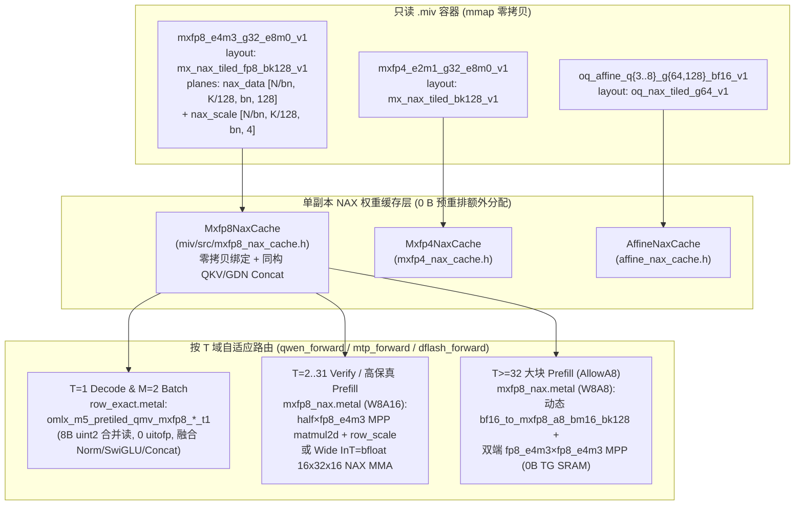

# `ninfer-metal` `v0.02+` 原生 `MXFP8`（`E4M3 × UE8M0`）技术规划：容器契约、Metal 4 NAX 算子栈与层间混合精度架构

> **文档状态**：工程技术规划（Architecture & Engineering Roadmap）  
> **目标版本**：`ninfer-metal` 下一代核心演进版本（`v0.02+`，衔接基线 `miv-v0.01`）  
> **关联规范**：核心认证标准 [`core-certification-standard.md`](../standards/core-certification-standard.md) · 容器转换器 [`miv/tools/m5_artifact.py`](../../miv/tools/m5_artifact.py) · 硅片校准基线 [`apple-m5-ultra-64gpu.json`](../backend/silicon-calibrations/apple-m5-ultra-64gpu.json) / [`apple-m5-ultra-80gpu.json`](../backend/silicon-calibrations/apple-m5-ultra-80gpu.json)  
> **适用硬件**：Apple Silicon M5 全系 UMA（`MTLGPUFamilyApple10+` / `applegpu_g17d`：M5 / M5 Pro / M5 Max / M5 Ultra 64c 96 GiB & 80c 256 GiB）

---

## 1. 执行摘要与架构决策（Executive Summary & Architectural Decision）

### 1.1 核心结论

随着开源大模型生态（Qwen3 / Qwen3.8、DeepSeek-V3/R1、Llama-3.x 及 [`scoltzero/heretic-mlx`](https://github.com/scoltzero/heretic-mlx) 等社区高保真衍生权重）全面向原生 **FP8 / OCP Microscaling MXFP8（`E4M3 × UE8M0, group_size = 32`）** 与 **4-bit + 8-bit 敏感层混合量化** 演进，`ninfer-metal`（`miv/`）将在 `v0.02+` 引入端到端零拷贝 **Native `MXFP8`** 一等公民支持：

1. **硬件级完美契合（Apple10 NAX 原生双通路）**：
   - 经核验 macOS 27 / Xcode 27 SDK `MetalPerformancePrimitives`（`MPPTensorOpsMatMul2dImpl.h:6247-6303, 8409-8575`），Apple M5 GPU 的硬件 Neural Accelerators（NAX）在指令集层面同时原生支持 **`metal::metal_fp8_e4m3_format`** 数据张量与 **`tensor_blockwise<tensor_plane_scales, device metal_fp8_ue8m0_format, 32, 1>`** 32 元素块缩放平面：
     - **W8A16 通路**：支持 `half × metal_fp8_e4m3_format -> float` 硬件协作累加，以及面向宽块 Prefill 的 `InT = bfloat` 零转换解包 `16×32×16` Apple10 NAX MMA；
     - **W8A8 通路**：支持左激活张量与右权重张量**双端同构 `metal_fp8_e4m3_format + ue8m0_scale -> float`** 硬件块缩放乘加（`SK=1` 宽块 Prefill 实现 **`0 B` Threadgroup SRAM** 占用与最高驻留率，同时规避了 `MXFP4` W4A4 动态 4-bit 激活量化的精度折损）。
2. **极致的字节效率与离线单副本驻留（`1.03125 B/param`）**：
   - `MXFP8`（`1 B` `E4M3` + `1/32 B` `UE8M0` 共享指数 = **`1.03125 B/param` / `8.25 bpw`**）较未压缩 `BF16`（`2.0 B/param`）削减 **`48.44%`（`1.939×`）** 的 UMA 存储与 Decode 带宽开销，且比带双 BF16 `scale+bias` 的 `oQ` `affine8_g64`（`1.0625 B/param` / `8.50 bpw`）更紧凑，同时省去 Affine 必需的激活分组求和（`xsum_g64`）与偏置乘加尾步。
   - 通过新增离线 NAX 预重排布局 **`mx_nax_tiled_fp8_bk128_v1`**，Prefill、投机校验（`T=2..8`）、多槽批处理与 `T=1` 自回归解码共享**唯一一份 `mmap` / UMA 常驻权重副本（`1.00×` 体积，严守 `< 2 GiB` Compute ICB 段长上限）**。
3. **细粒度层间/投影间混合精度共存，永久拒绝未压缩 `BF16` 线性层混用**：
   - 单个 `.miv` 容器内支持按层、按投影自由混排 **`MXFP8` + `MXFP4` + `oQ`（`affine3`–`affine8`）**（例如骨干 MLP 采用 `MXFP4`，而对量化敏感的 `lm_head`、`moe_router`、`shared_expert`、前部层 `mlp.down_proj` / `linear_attn.out_proj` / `self_attn.o_proj` 提升至 `MXFP8` 或 `affine8`）。
   - **明确架构红线**：在任何量化模型中**永久拒绝混入未压缩 `BF16`（`direct_bf16_v1`）主干线性投影层**。未压缩 `BF16` 线性层带来 `2.0 B/param` 的 Decode 带宽墙、单张量突破 `2 GiB` Compute ICB 寻址上限（如 Qwen3.8 `lm_head` 达 `2.368 GiB`）、融合算子链断裂与 SLC 缓存污染；源权重中未量化的敏感线性层必须在 `m5_artifact.py convert` 阶段离线无感收敛至 `MXFP8` 或 `affine8`。

---

## 2. `.miv` 容器契约与转换器演进（Container Format Contract & `m5_artifact.py`）

### 2.1 新增格式标识与平面字节契约（`mxfp8_e4m3_g32_e8m0_v1` & `mx_nax_tiled_fp8_bk128_v1`）

在保持 `.miv` 容器主版本（`MAGIC = "OMLXM5A1"`, `VERSION = 1`, `SCHEMA = "omlx-m5-artifact-v1"`, `PAYLOAD_ALIGNMENT = 16384`, `OBJECT_ALIGNMENT = 256`, `PLANE_ALIGNMENT = 256`）完全向后兼容的前提下，注册原生 `MXFP8` 未重排格式与离线 NAX 预重排布局：

1. **`manifest["format_registry"]` 条目**：
   ```json
   "mxfp8_e4m3_g32_e8m0_v1": {
     "code": "E4M3",
     "group_size": 32,
     "scale": "E8M0"
   }
   ```
   对应 `manifest["bindings"]` 中的激活策略字段设为 `"activation_policy": "AllowA8"`（与 `mxfp4_e2m1_g32_e8m0_v1` 的 `"AllowA4"` 及 `oq_affine_*` 的 `"A16Only"` 构成严格三态枚举，见 `miv/tools/m5_artifact.py:713, 1483-1488`）。

2. **几何参数与填充规则**：
   - 设张量逻辑形状为 `shape = [..., N, K]`，展平行数 `rows = prod(shape[:-1])`，逻辑输入维 `logical_k = K`，行尾对齐 `padded_k = align_up(K, 128)`。
   - 对于离线 NAX 预重排（仅对非 `embedding` 的二维矩阵 `len(shape) == 2, N > 0, K >= 512, K % 128 == 0` 生效）：
     - 输出块宽与 `mxfp4_nax_bn(n)`（`miv/src/mxfp4_nax_cache.h:41`）及 `m5_artifact.py:1256, 1790` 完全对齐：
       $$\text{bn} = \begin{cases} 32, & N \ge 65536 \text{（如大词表 \texttt{lm\_head}）} \\ 16, & N < 65536 \end{cases}$$
     - `padded_n = align_up(N, bn)`，K 维分块固定 `bk = 128`，块数 `k_blocks = K // 128`。

3. **精确平面（Planes）规格对照表**：

| 格式 (`format`) | 布局 (`layout`) | 适用秩与条件 | 平面顺序与名称 (`kind`) | 精确字节数 (`bytes`) | 物理排布、张量转置与尾行填充语义 |
|---|---|---|---|---|---|
| `mxfp8_e4m3_g32_e8m0_v1` | `mx_rowsplit_k128_v1`（2D）<br>`mx_expert_rowsplit_k128_v1`（3D MoE `[E,N,K]`） | `rank >= 2`, `padded_k % 128 == 0` | 1. `"data"`<br>2. `"scale"` | `rows * padded_k`<br>`rows * (padded_k // 32)` | • `"data"`：行主序 `[rows, padded_k]` `F8_E4M3`（`uint8`），`[K, padded_k)` 填 `0x00`（`+0.0`），拒绝 `0x7F`/`0xFF`（OCP E4M3 `NaN`）；<br>• `"scale"`：行主序 `[rows, padded_k // 32]` `UE8M0`（`uint8`），每 32 个连续 K 元素共享 1 个无符号 2 的幂指数 $2^{e-127}$（`e=0` 编码 $2^{-127}$；拒绝 `0xFF` `NaN` 缩放码，对齐 `m5_artifact.py:1530`）。 |
| `mxfp8_e4m3_g32_e8m0_v1` | **`mx_nax_tiled_fp8_bk128_v1`** | 2D 非 `embedding`, `N > 0`, `K >= 512`, `K % 128 == 0` | 1. `"nax_data"`<br>2. `"nax_scale"` | `padded_n * K`<br>`padded_n * (K // 32)` | • `"nax_data"`：截取 `data[:, :K]`，尾行 `[N, padded_n)` 填 `0x00`，执行 `reshape(padded_n // bn, bn, K // 128, 128).transpose(0, 2, 1, 3)` → 连续 `[padded_n // bn, k_blocks, bn, 128]`；单 Tile `bn * 128 B`（`bn=16` 为 `2,048 B`，`bn=32` 为 `4,096 B`），每行 `rn` 占 `128 B = 8 × uint4`（天然 16B 对齐）；<br>• `"nax_scale"`：截取 `scale[:, :K // 32]`，尾行 `[N, padded_n)` 填充中性单位缩放码 **`0x7F`**（$2^{127-127}=1.0$，严禁填 `0x00` 虽乘 0 等价但保持与 `m5_artifact.py:1800` 及 `mxfp4_nax.metal:75` `0x7f7f7f7fu` 完全一致），执行 `reshape(padded_n // bn, bn, K // 128, 4).transpose(0, 2, 1, 3)` → 连续 `[padded_n // bn, k_blocks, bn, 4]`；单 Tile `bn * 4 B`（`64 B` / `128 B`），每个 `bk=128` 内的 4 个 `g32` `UE8M0` 缩放因子紧凑打包为 1 个小端 `uint32_t`（`sub32 = 0..3` 对应字节偏移 `0..3`）。 |

### 2.2 修复 `miv/tools/m5_artifact.py` 的硬编码 4-Bit 形状假设

对当前 `miv/tools/m5_artifact.py` 进行源码审计可定位两处阻碍 FP8 / MXFP8 权重导入的硬编码假设：

1. **问题定位一（`_build_mlx_mxfp4_module_recipe` / `build_mlx_mxfp4_recipes` / `build_oq_recipes`，`miv/tools/m5_artifact.py:627-742`）**：
   当某层包含 `.scales` 但**不含 `.biases`**（即非 `oQ` Affine 的对称微缩放格式）时，现有代码在 `_build_mlx_mxfp4_module_recipe()`（`L634-644`）与 `build_oq_recipes()`（`L705`）硬编码：
   ```python
   # miv/tools/m5_artifact.py:634-644（现状：硬编码仅接受 U32 且强制 4-bit 宽度 logical_k // 8）
   if weight.dtype != "U32" or scales.dtype not in ("U8", "F8_E8M0"):
       return None
   ...
   logical_k = scale_groups * 32
   if weight.shape != (*leading_shape, logical_k // 8):
       raise ValueError(f"{module}: MXFP4 weight shape mismatch")
   ```
   这一逻辑在遇到真实 `MXFP8` 或混合 `MXFP4 + MXFP8 + oQ` 权重时会产生双重故障：
   - **MLX `nn.quantize(mode="mxfp8")` 权重**：MLX 将每 4 个 FP8 `E4M3` 字节按小端打包为 1 个 `U32`（`weight.dtype == "U32"`，但 `weight.shape[-1] == logical_k // 4`），直接触发 `ValueError: MXFP4 weight shape mismatch` 中断转换；
   - **HuggingFace / PyTorch / `compressed-tensors` `MXFP8` 权重**：`weight`（或 `.weight_packed`）以 `F8_E4M3`（`float8_e4m3fn`，已在 `DTYPE_BYTES` 第 37 行登记为 1 字节）或 `U8` 存储，`weight.shape[-1] == logical_k`。由于 `weight.dtype != "U32"`，现有 `return None` 分支会**静默跳过量化绑定**，导致该张量跌落至 `build_direct_recipes()`（`L825-850`）变成无绑定的 `direct_f8_e4m3_v1` 和孤儿 `.scales` 对象，加载期直接报错。

2. **问题定位二（`detect_profile`，`miv/tools/m5_artifact.py:436-452`）**：
   当前仅检测 `mode == "affine"`、`mode == "mxfp4"` 与 `format == "mxfp4-pack-quantized"`，未识别顶层或逐模块 `mode == "mxfp8"`、HuggingFace `quant_method in ("mxfp8", "fp8")` 及 `compressed-tensors` `mxfp8` 变体。

3. **精确修复方案（`m5_artifact.py` 与 `miv/src/artifact.cpp` 双向同步）**：
   - **统一微缩放检测器 `_classify_mx_module(weight, scales, spec)`**：
     当模块无 `.biases` 且 `scales.dtype in ("U8", "F8_E8M0")` 时，由 `logical_k = scales.shape[-1] * 32` 与 `(weight.dtype, weight.shape[-1])` 精确反推位宽（并与 `config.json` 中逐层 `quant_spec(config, module)` 交叉校验，不一致立即 Fail-Closed 抛错）：
     - **4-bit `MXFP4`**：`(weight.dtype == "U32" and packed_k == logical_k // 8)` 或 `(weight.dtype in ("U8", "I8") and packed_k == logical_k // 2)` → 产出 `mxfp4_e2m1_g32_e8m0_v1`（`"data"` 源行 `logical_k // 2` B → 目标行 `padded_k // 2` B）；
     - **8-bit `MXFP8`**：
       - MLX 打包态：`weight.dtype == "U32"` 且 `packed_k == logical_k // 4`（小端 `U32` 在内存字节序上与连续 4 个 `E4M3` 字节 `100%` 等价，无需逐字节重排，直接按 `source_row_bytes = logical_k` 流式写出）；
       - HF / OCP 原生态：`weight.dtype in ("F8_E4M3", "U8")` 且 `packed_k == logical_k`（兼容 `.weight` + `.scales` 及 `.weight_packed` + `.weight_scale` 命名）；
       - 统一产出 `mxfp8_e4m3_g32_e8m0_v1`（`"data"` 源行 `logical_k` B → 目标行 `padded_k` B；`"scale"` 源行 `logical_k // 32` B → 目标行 `padded_k // 32` B；写入前扫描拦截 `0x7F`/`0xFF` E4M3 NaN 与 `0xFF` E8M0 NaN）。
   - **标准 HF 块级 FP8（如 DeepSeek-V3 / Qwen3 `128×128` `float8_e4m3fn + F32/BF16 weight_scale_inv`）离线桥接**：
     在 `m5_artifact.py convert` 中提供确定性离线重缩放开关（当检测到 `weight.dtype == "F8_E4M3"` 且 `weight_scale_inv.dtype in ("F32", "BF16")` 时），将每个 `1×32` 子块反量化至 FP32 后提取紧致上界共享指数 $e = \operatorname{clamp}(\lceil \log_2(\max_i |w_i| / 448.0) \rceil, -127, 127)$ 编码为 `UE8M0`，并以 IEEE RNE 舍入重编码 `E4M3` 尾数，统一收敛为 `mxfp8_e4m3_g32_e8m0_v1`，使 C++/Metal 运行时免于维护碎片化的非对称二维块缩放分支。
   - **同步更新校验与解码器**：
     在 `m5_artifact.py` 的 `_expected_plane_bytes()`（`L1194`）、`_validate_object_contract()`（`L1269`）、`read_artifact()`（`L1483` 绑定 `activation_policy == "AllowA8"`）、`decode_artifact_row()`（`L1535` 新增 `_e4m3_to_float()`）与 `pretile_artifact()`（`L1779`）以及 C++ 端 `miv/src/artifact.cpp:validate_format_contract()`（`L373-402`）中同步挂载 `mxfp8_e4m3_g32_e8m0_v1` 与 `mx_nax_tiled_fp8_bk128_v1` 契约校验。

---

## 3. Metal 4 NAX 算子栈与运行时集成（Metal 4 NAX Operator Stack）

### 3.1 总体算子与缓存数据流



### 3.2 `miv/kernels/mxfp8_nax.metal`：W8A16 与 W8A8 协作式 MPP/NAX 内核族

新增着色器单元 `miv/kernels/mxfp8_nax.metal`（编译产物 `omlx_m5_mxfp8_nax.metallib`），严格遵循 macOS 27 `MetalPerformancePrimitives` 硬件张量描述符契约：

```metal
using Mxfp8ScaleTag =
    tensor_blockwise<tensor_plane_scales, device metal_fp8_ue8m0_format, 32, 1>;
using Mxfp8WeightTensor =
    tensor<device metal_fp8_e4m3_format, dextents<int32_t, 2>, tensor_inline, Mxfp8ScaleTag>;
```

> **关键 SDK 硬件约束核验**（`MPPTensorOpsMatMul2dImpl.h:6247-6303, 8409-8575`）：
> 1. 块缩放比例类型强制为 `metal::metal_fp8_ue8m0_format`，块尺寸强制为 `(32, 1)`；左操作数若带缩放平面必须满足 `transpose_left == false`，右操作数若带缩放平面必须满足 `transpose_right == true`；
> 2. 硬件 `matmul2d` 原生支持 `left=half, right=metal_fp8_e4m3_format -> float`（W8A16）与 `left=metal_fp8_e4m3_format, right=metal_fp8_e4m3_format -> float`（W8A8），**不存在直接的 `left=bfloat, right=metal_fp8_e4m3_format` MPP 描述符**（与 `mxfp4_nax.metal` 完全一致）。

据此，`mxfp8_nax.metal` 构建以下四类核心算子：

1. **UMA 回退重排与切片拼接核（Load-Time Only）**：
   - `omlx_m5_repack_mxfp8_bn16_bk128`、`omlx_m5_repack_mxfp8_bn32_bk128`、`omlx_m5_repack_mxfp8_slice_bn16_bk128`：单线程负责 `(blk128, row)`，以 8 次 `uint4`（`128 B`）拷贝代码与 1 次 `uint`（`4 B`）拷贝缩放因子，尾行 `[n, padded_n)` 写 `uint4(0u)` 与 `0x7f7f7f7fu`。
2. **W8A16 通路一（`T = 2..31` 投机 Verify / 多槽 Batch / Split-K MPP 核）**：
   - 算子命名：`omlx_m5_mxfp8_nax_n{16,32}_sk{1,2,4,8}`、`omlx_m5_mxfp8_nax_n16_sk{1..8}_rf{1..4}_nsg{1,2}`、`omlx_m5_mxfp8_nax_bm{16,32}_n{16,32}_sk{1..8}` 及融合门控核 `omlx_m5_mxfp8_nax_swiglu_{f16_,}n16_sk{1..8}`；
   - 执行机制：直接复用 `mxfp4_nax.metal:166` 的无溢出逐行幂次缩放转换核 `omlx_m5_bf16_to_f16_rowscale`（或闭环 `f16` 下的 `omlx_m5_rmsnorm_a16_f16` + `unit_scale = true`），通过 `matmul2d_descriptor(BM, BN, 128, false, true, false, multiply_accumulate)` 对 `a_full(half)` 与 `Mxfp8WeightTensor`（步长 `tile_code_bytes = BN * 128`, `tile_scale_bytes = BN * 4`）执行硬件 NAX 乘加，FP32 寄存器归约后乘回 `row_scale[row]` 写出 `bfloat`。
3. **W8A16 通路二（`T >= 32` 零转换宽块 `SK=1` Prefill 核）**：
   - 算子命名：`omlx_m5_mxfp8_nax_bf16_bm64_bn64_bns{16,32}_sk1`、`omlx_m5_mxfp8_nax_bf16_bm32_bn32_bns{16,32}_sk1` 及对应 `swiglu` 变体；
   - 执行机制：对标 `mxfp4_nax.metal:1730-2047`，`WM×WN = 2×2`（`128` 线程），将 `(BN_TG × 64)` 权Tile 在寄存器中无分支解包为 `bfloat` 写入单级 Threadgroup 缓冲 `Ws[64 * 72]`（`9,216 B <= 32 KiB`，无 bank 冲突 padding `kBKP = 72`），直接与设备侧 `bfloat` 激活 `x` 执行 `16×32×16` Apple10 NAX MMA，实现 **`0` 次 `bf16->f16` 转换派发**、**`<= 104` VGPR**（保住 `3 TGs/core` 满驻留）与 **`0` `alloca`**。
4. **W8A8 动态 FP8 激活通路（`T >= 32` 高吞吐 Prefill，默认对 `AllowA8` 启用）**：
   - **在线激活量化核 `omlx_m5_bf16_to_mxfp8_a8_bm16_bk128`**（支持与前置 `RMSNorm` 融合为 `omlx_m5_rmsnorm_to_mxfp8_a8_bm16_bk128`）：
     - 每个 SIMDgroup（32 线程）协作处理单行 `m` 的 1 个 `g32` 子块（每 lane 读 1 个 `bfloat`）：`amax = simd_max(fabs(val))`；
     - 计算紧致 `UE8M0` 缩放指数：$e = \operatorname{clamp}(\lceil \log_2(\text{amax} / 448.0) \rceil, -127, 127)$（使缩放后动态范围充分利用 `E4M3` 最大有限值 `448.0`，相比 `W4A4` 的 `6.0` 上限与 1-bit 尾数，量化信噪比提升约 `24 dB`），将 `val * exp2(-float(e))` 按 IEEE RNE 编码为 `F8_E4M3`；
     - 直接按 NAX 左操作数预分块格式写出 `a8_codes`（`[mp/16, k/128, 16, 128]`，每 Tile `2,048 B`）与 `a8_scales`（`[mp/16, k/128, 16, 4]`，每 Tile `64 B`，`[rows, mp)` 尾行填 `0x00` 代码与 `0x7F` 缩放）。通过 `Encoder::F16CastKey`（扩展 `quant_kind = A8_MXFP8`）按输入 Buffer 去重，同层 Q/K/V 或 Gate/Up 共享**唯一一次**动态量化！
   - **零共享内存宽块 W8A8 乘加核**（`omlx_m5_mxfp8_w8a8_nax_bm64_bn64_bns{16,32}_sk1`、`bm32_bn32`、`omlx_m5_mxfp8_w8a8_nax_swiglu_bm64_bn64_sk1` 及中小 `T` 的 `n{16,32}_sk{2,4,8}`）：
     - 对标 `mxfp4_w4a4_nax_wide_sk1_linear_impl`（`mxfp4_nax.metal:2690-2831`），`BM_OP = 16, BK = 128`，左张量 `a`（`a8_codes + ai * 2048ul`, `a8_scales + ai * 64ul`, `dextents(128, 16)`）与右张量 `b`（`b_codes + bi * (BN_STORED * 128ul)`, `b_scales + bi * (BN_STORED * 4ul)`, `dextents(128, BN_STORED)`）同为 `Mxfp8WeightTensor`；
     - 硬件 NAX 直接从统一内存/L1/SLC 流式读取双端 FP8 张量并在 FP32 协作寄存器中累加，**Threadgroup SRAM 占用严格为 `0 B`**，消除全部 `threadgroup_barrier` 同步气泡，在 M5 Ultra 80c 上释放翻倍的 K 维吞吐。

### 3.3 `Mxfp8NaxCache`（`miv/src/mxfp8_nax_cache.h`）

对标 `Mxfp4NaxCache`（`miv/src/mxfp4_nax_cache.h:16-351`），新增进程内按 `(owner_key, target_split_k)` 归属复用的 `Mxfp8NaxCache`：

- **权重结构体 `TiledMxfp8Weight`**：包含 `Ref codes`, `Ref scales`, `U32 n`, `U32 k`, `U32 bn`（`16` 或 `32`）, `U32 padded_n`, `U32 split_k`（复用 `mxfp4_nax_split_k` 的 M5 Ultra 标定规则：`N >= 65536` 取 `<= 2`，其余在 64c/80c 上默认 `8`）。
- **零拷贝 `mmap` 直绑**：在 `register_weight(const MaterializedWeightView &w)` 中，若 `w.format == "mxfp8_e4m3_g32_e8m0_v1"` 且 `w.layout == "mx_nax_tiled_fp8_bk128_v1"`，直接提取 `plane(w, "nax_data")` 与 `plane(w, "nax_scale")` 构造 `TiledMxfp8Weight` 存入 `entries_`，**不进入 `pending_`、不分配任何 `NaxSegmentArena` 缓冲、不触发任何加载期 GPU Kernel**。
- **UMA 在线重排回退**：若加载未预重排的 `mx_rowsplit_k128_v1` 制品，则通过 `NaxSegmentArena` 按 `< 2 GiB` 分段上限规划 `padded_n * k`（`codes`）与 `padded_n * (k / 32)`（`scales`）私有缓冲，在单次批处理命令缓冲中调用 `omlx_m5_repack_mxfp8_bn{16,32}_bk128` 完成重排。
- **同构兄弟投影列拼接（`register_concat`）**：当注意力 `[attention_q, attention_k, attention_v]`、GDN `[gdn_qkv, gdn_z]` / `[gdn_a, gdn_b]` 或 MTP `[q_proj, k_proj, v_proj]` 的全部子投影均为 `mxfp8_e4m3_g32_e8m0_v1`、共享相同 `in_features == k`、非末项 `row_count % 16 == 0` 且 `total_n < 65536` 时，生成拼接条目（预重排源走 `omlx_m5_copy_u32_words`，未重排源走 `omlx_m5_repack_mxfp8_slice_bn16_bk128`）；而 MLP `Gate + Up` 直接走双权重指针融合的 `SwiGLU` 核，**零拼接拷贝开销**。

### 3.4 `T=1` 窄向量解码核（`pretiled_qmv_mxfp8_*_t1`）与全图路由分发

1. **零 `uitofp`、8 字节合并访存的 `pretiled_qmv_mxfp8_*_t1`（`miv/kernels/row_exact.metal`）**：
   对标 `pretiled_qmv_mxfp4_kl32_impl`（`row_exact.metal:1035-1499`），每个 Threadgroup 固定 `64` 线程（`2` SIMDgroups，每 SG 负责 `ROWS_SG ∈ {2, 4}` 个输出行）：
   - **合并访存映射（消除 `1 B` `uchar` 标量读）**：对 `bk = 128`，令 `b_sub = lane >> 4u`（`0..1`，单轮循环并行吞吐 `2 × 128 = 256` 个 K 元素），`k_l = lane & 15u`（`0..15`），`sub32 = k_l >> 2u`（`0..3`）。每个 lane 以 **`uint2`（`8 B` = 8 个连续 `E4M3` 权重）** 读取 `d_tile + rn * 128ul + k_l * 8ul`，16 个相邻 lane 恰好构成 **`128 B` 完整缓存行合并事务**；缩放因子按 `uint` 读取 `s_tile[rn * 4ul]` 并用字节移位提取 `sub32`。
   - **无分支、零 `uitofp`、零查表冲突的 IEEE-754 位运算解码（`pretiled_fp8_e4m3_to_h16`）**：
     利用 OCP `E4M3`（1 符号 + 4 指数偏置 7 + 3 尾数）与 IEEE `FP16`（1 符号 + 5 指数偏置 15 + 10 尾数）的位级同构性：
     - 规格化数（`(b & 0x78u) != 0`）：符号位 `(b & 0x80u) << 8u`，尾数与指数右对齐加偏置差 `(15 - 7) << 10 = 0x2000u`，即 `ushort(((b & 0x80u) << 8u) | (((b & 0x7Fu) << 7u) + 0x2000u))` 直接 `as_type<half>`，仅需 **2 条整数移位/加法指令**，零 `uitofp`、零寄存器表查找；
     - 非规格化数/零（`(b & 0x78u) == 0`，数值为 $\pm (b \& 7) \times 2^{-9}$）：通过无分支 `select` 处理（严守 Gate G2.4 禁止在 `-ffast-math` 下做 `0x6400`/`0x1800` 浮点减法折叠的规范），保证 **全 254 个有限 `E4M3` 码字 `0-ULP` 精确还原**。
   - **完整融合算子矩阵**（同步覆盖 `T=1` 与 `M=2` 批处理）：
     - 单投影与跨层 RMSNorm 平方和接力：`omlx_m5_pretiled_qmv_mxfp8_bn{16,32}_r{2,4}{,_norm,_add_sq}_{t1,m2}`；
     - 融合门控 MLP：`omlx_m5_pretiled_qmv_mxfp8_swiglu_bn16_r{2,4}{,_norm}_{t1,m2}`；
     - 免拼接多路单派发投影：`omlx_m5_pretiled_qmv_mxfp8_concat2_{t1,m2}`、`omlx_m5_pretiled_qmv_mxfp8_concat3_bn16_r{2,4}{,_norm}_{t1,m2}`（QKV）、`omlx_m5_pretiled_qmv_mxfp8_concat4_r{2,4}{,_norm}_{t1,m2}`（GDN `qkv/z/a/b` 四合一）。

2. **三大前向图路由接入（`qwen_forward.cpp` / `mtp_forward.cpp` / `dflash_forward.cpp`）**：
   - **`miv/src/qwen_forward.cpp`**：
     - 在构造期（`L738-880`）检测 `has_pretiled_mxfp8` 并初始化 `mxfp8_nax_cache`；**复用既有 `f16_norm`、`f16_scratch`、`f16_row_scale`、`f16_ones_scale`**（与 `mxfp4_nax_cache` 零重复分配），仅在启用 W8A8 时按 `max_mp * max_k` 分配私有 `a8_codes`（`1 B/elem`）与 `a8_scales`（`1/32 B/elem`）；
     - 在 `ExecutionIdentityFields`（`L1139-1165`）与 `plan_key_suffix()`（`L4373-4482`）中写入 `mxfp8` 算子与 W8A8 激活策略指纹，保障前缀缓存与预编译 Compute ICB 严格隔离；
     - 在 `linear()`（`L1478`）、`try_linear_swiglu{,_norm_t1}()`（`L2343, 2413`）、`try_linear_{norm,add_sq}_t1()`（`L2230, 2280`）、注意力 QKV（`L3150-3228`）与 GDN 四路输入（`L3484-3789`）中按 **`T=1 pretiled_qmv_mxfp8` → `T>=32 W8A8 NAX` → `T>=2 W8A16 NAX` → `row_exact_mxfp8` 诊断回退** 的确定性优先级分发；
     - 对 3D MoE 专家库（`moe_nax` / `L3887-4371`），同步扩展 `can_moe_nax_for` 与 `moe9_mxfp8_t1`，支持 `Qwen3.6/3.8-35B-A3B` 的 `MXFP8` 路由/共享专家/稀疏专家库。
   - **`miv/src/mtp_forward.cpp`**：
     - 在 `MtpForward::Impl`（`L1153-1520`）中接入 `head_mxfp8_cache`（通过 `head_owner_key` 与主干 `QwenForward` **零拷贝共享同一份 `MXFP8` `lm_head` 缓存**）与 `mtp_mxfp8_cache`（覆盖 MTP `fc` `[h, 2h]` 及 `layers.0` QKV/O/MLP），在 Priming/Fold（`T >= 2`）走 `mxfp8_nax`，在 Chain 步（`T = 1`）走 `pretiled_qmv_mxfp8_*_t1`。
   - **`miv/src/dflash_forward.cpp`**：
     - 在 `DFlashForward::Impl`（`L390-455, 668-700`）中挂载 `mxfp8_nax_cache` / `mxfp8_nax_head_cache`。当主干模型的 `lm_head` 为 `MXFP8`（如 `MXFP4` 主干 + `MXFP8` 词表头）或未来 DFlash2 草稿层量化为 `MXFP8` 时，单 ICB 融合草稿前向（`T = 8`）直接调用 `linear_mxfp8_nax` 零转换运行。
   - **原生双模 LoRA（`merge` & `bypass`）无缝兼容**：
     - `lora_mode = "merge"` 下，加载期 GPU 融合核支持从 `mxfp8_e4m3_g32_e8m0_v1` 解包基底权重，叠加 $\text{scale} \cdot (BA)$ 后重排入 `AffineNaxCache`（`oq_nax_tiled_g64_v1` `q8`）或 `Mxfp8NaxCache`；`lora_mode = "bypass"` 下低秩旁路 $y \mathrel{+}= \text{scale} \cdot ((x A^\top) B^\top)$ 与基底格式正交，天然无感生效。

---

## 4. 层间/投影间混合精度共存与永久拒绝未压缩 `BF16` 线性层混用

### 4.1 单 `.miv` 容器内的 `MXFP8 + MXFP4 + oQ (affine4/6/8)` 细粒度共存规则

在实际模型量化工程中（参考 `docs/quantization.md` 对 Qwen3.8-27B 敏感张量的实测剖析），不同层与不同投影对位宽的敏感度差异极大：`lm_head`、`moe_router`、GDN `linear_attn.out_proj`、前 40% 层的 `mlp.down_proj` 与 `self_attn.o_proj` 对 4-bit 舍入误差最敏感，而占参数大头的 `mlp.{gate_proj,up_proj}` 与 `in_proj_qkv` 在 4-bit 下几乎无损。`miv` 在对象粒度（`w.object_id`）支持 `MXFP8`、`MXFP4` 与 `oQ`（`affine3..8`）任意组合共存，其精确调度与回退边界如下：

| 混合粒度与场景 | 具体配置示例 | `miv` 编译期（ICB 构建）调度与优雅回退行为 | 额外内存/同步开销 |
|---|---|---|---|
| **跨层异构 / 独立投影异构** | 主干 `MXFP4`，但 `lm_head`、`moe_router`、`o_proj`、`gdn_out`、`mlp_down`（部分层）为 `MXFP8` 或 `affine8` | 每个 `object_id` 独立注册至所属 `Mxfp4NaxCache` / `Mxfp8NaxCache` / `AffineNaxCache`，按各自最优 `pretiled_qmv_*_t1` 或 NAX 核编译进同一静态 Compute ICB。 | **`0 B` 拷贝、`0` 主机同步** |
| **闭环 `f16` 块资格判定（`block_input_nax` & `block_mlp_input_nax`，`qwen_forward.cpp:2605-2652`）** | 情形 1：同层 `{gate, up, down}` 为纯 `MXFP8` 或 `MXFP4 + MXFP8` 混排（如 `gate/up` 为 `MXFP4`、`down` 为 `MXFP8`）<br>情形 2：其中任一投影为 `oQ` Affine（如 `affine8`） | • **情形 1（保持闭环加速）**：因 `MXFP4` W4A16 与 `MXFP8` W8A16 共享完全相同的 `(f16_norm, f16_ones_scale)` 激活契约，`block_mlp_input_nax` 放宽为 `is_mx_f16_nax_eligible(w)`（允许 `MXFP4` 与 `MXFP8` 混排保持 `add_normalize_f16 -> swiglu_f16 -> linear_from_f16` 闭环）！<br>• **情形 2（安全回退）**：`oQ` Affine 依赖 `bfloat` 输入与 `affine_nax_xs`（`xsum_g64`），`block_mlp_input_nax` 返回 `false`，自动回退至标准 `BF16` `norm -> try_linear_swiglu -> linear` 路径。 | 情形 1：**`0` 额外转换**<br>情形 2：仅该层回退标准 BF16 激活链 |
| **同输入兄弟投影异构（QKV、GDN 输入、MLP `Gate+Up`）** | 情形 A：`attention_q` 为 `MXFP8`，`attention_k/v` 为 `MXFP4`<br>情形 B：GDN `in_proj_qkv` 为 `MXFP4`、`in_proj_z` 为 `MXFP8`、`in_proj_a/b` 为 `MXFP8`<br>情形 C：`mlp_gate` 为 `MXFP4`、`mlp_up` 为 `MXFP8` | 1. **Concat 缓存守卫**：各格式专属 `register_concat()` 检测到子项 `format` 不同时立即返回 `false`（绝不错误拼接异构平面）；<br>2. **子组局部融合保留**：如情形 B 中，`[gdn_a, gdn_b]` 同为 `MXFP8`，仍自动命中 `omlx_m5_pretiled_qmv_mxfp8_concat2_t1` / `concat_gdn_ab_id`；情形 A 中 `k, v` 同为 `MXFP4` 仍可走 `concat2`；<br>3. **`Gate+Up` 异构回退**：`try_linear_swiglu()` 在 `gate_w.format != up_w.format`（`qwen_forward.cpp:2485`）时返回 `false`，自动拆分为独立 `linear(gate)` + `linear(up)` + `omlx_m5_swiglu_a16`；<br>4. **激活转换去重**：`T >= 2` 时 `ensure_f16_cast()` 凭 `F16CastKey` 对同一 `norm` 缓冲只发射 **1 次** `bf16_to_f16_rowscale`，供后续异构 `MXFP4` 与 `MXFP8` 兄弟投影共同读取！ | **`0 B` 拼接膨胀、`0` 重复 `f16` 转换** |

### 4.2 永久拒绝未压缩 `BF16` 混合线性层的四大物理与微架构依据

社区部分 HuggingFace 量化权重（如部分 AWQ / GPTQ / MLX 混合导出脚本）习惯将 `lm_head`、`moe.gate`、`shared_expert` 或敏感注意力投影直接保留为未压缩 `BF16`（`2.0 B/param`）。**`ninfer-metal` 在架构层面永久禁止在量化模型主干中保留未压缩 `BF16`（`direct_bf16_v1`）线性投影层**（转换器遇到此类源张量时强制量化为 `mxfp8_e4m3_g32_e8m0_v1` 或 `oq_affine_q8_g64_bf16_v1`），其不可妥协的硅片物理依据如下：

1. **依据一：Apple M5 UMA 解码内存带宽墙（`1.939×` 单参数带宽惩罚）**
   `T=1` 自回归解码严格受限于统一内存带宽 $B_{\text{DRAM}}$（M5 Ultra 64c 实测有效带宽 `604–890 GB/s`，80c 实测 DMA 峰值 `992.1 GB/s`、`lm_head` 实测 `967.9 GB/s`）：
   - 单位参数读取字节对比：`MXFP4` = `0.53125 B`、`MXFP8` = **`1.03125 B`**、`affine8_g64` = `1.06250 B`、**未压缩 `BF16` = `2.00000 B`**（比 `MXFP8` 整整膨胀 **`+93.9%`**）。
   - **实算案例 A（仅保留 `Qwen3.8-27B` 的 `lm_head` `[248320, 5120]` = `1.271 B` 参数为 `BF16`）**：
     `MXFP8` 仅占 `1.311 GB`（80c 上耗时 `~1.35 ms`），而 `BF16` 高达 **`2.543 GB`**（单层耗时 `~2.63–3.20 ms`），仅此一层每步就多烧掉 `+1.232 GB` DRAM 流量，导致整网 27B AR 解码吞吐凭空跌落 **`~8%–11%`**，而 `MXFP8` / `affine8` 词表头相对 `BF16` 的 PPL 差异 `< 0.001`！
   - **实算案例 B（保留 22% 敏感线性投影 = `5.66 B` 参数为 `BF16`，对标 `oQ4e` 敏感子集）**：
     `MXFP4` 基底（`19.96 B` = `10.60 GB`）+ `5.66 B` `MXFP8`（`5.84 GB`）总活跃读取为 **`16.44 GB`**（80c 上稳守 `~53–58 tok/s`）；若该 `5.66 B` 留作 `BF16`（`11.32 GB`），单步读取暴涨至 **`21.92 GB`**（`+5.48 GB/tok`），AR 速度直接重挫 **`-25%`**（跌至 `~41 tok/s`）。
   - **实算案例 C（整网容量准入墙）**：70B 模型在 `BF16` 下仅权重即达 `~140 GB`，**物理上无法装入 96 GiB M5 Ultra（`W_ws = 77.76 GiB`）与 128 GiB M5 Max（`W_ws = 103.68 GiB`）**；而原生 `70B-MXFP8` 仅占 **`~72.2 GB`**，可在 96–128 GiB UMA 上单机零 Swap 原生运行。

2. **依据二：直接击穿 Apple10 Compute ICB 单 Buffer `2 GiB` 硬件寻址红线**
   核查 `miv/src/silicon_tuning.h:35`、`docs/backend/silicon-calibrations/apple-m5-ultra-80gpu.json:27`（`icb_safe_weight_segment_bytes = 2,147,483,648`）与 `miv/src/native_backend.cpp:885-888`：绑定进 `MTLIndirectComputeCommand` 的任何单个权重 Buffer 严禁超过 **`2.0 GiB`**（防止 GPU 间接命令 32-bit 偏移回绕崩溃）。
   - `Qwen3.8-27B` 的未压缩 `BF16` `lm_head` 单平面体积高达 **`2,542,796,800 B`（`2.368 GiB > 2.0 GiB`）**，256 专家 MoE 的 `BF16` 专家矩阵更是远超 `2 GiB`——这会直接破坏 `.miv` 单平面零拷贝 `mmap` 契约，迫使引擎引入丑陋的跨 Buffer 切分派发与尾步拼接；
   - 而在 `MXFP8`（`1.311 GB = 1.221 GiB`）或 `affine8`（`1.351 GB = 1.258 GiB`）下，`lm_head` 天然处于 `< 1.3 GiB` 安全区间内，单平面零拷贝直绑 Compute ICB。

3. **依据三：击碎 `T=1` 跨层融合算子链与丧失 W8A8 2× 张量算力**
   - `miv` 的极致解码效率建立在预重排 `pretiled_qmv_*_t1` 的跨算子融合链之上（`add_sq_t1` 原子累加残差平方和 → 下一层 `norm_t1` / `concat3_norm_t1` / `swiglu_norm_t1` 寄存器级内联归一化，消除独立 `rmsnorm_a16` 与 `forward_add` 派发及全局内存往返）。未压缩 `direct_bf16_v1` 采用行主序 `contiguous_le_v1` 布局，不具备 NAX 预分块几何且无 `rms_sq_buf` 融合核，每混入一层 `BF16` 都会在前后插入额外派发与 `mem_device` 屏障，制造指令流水气泡；
   - 在大块 Prefill 阶段，`BF16` 线性层无法进入 W8A8 NAX 通路，算力上限折半且读取双倍激活/权重带宽。

4. **依据四：严重污染片上 SLC（`C_SLC`）并挤压多模型 UMA 预算**
   在 `B=2..8` 并发批处理与 `oMLX-extend` 多模型共存工况下，每拍流式扫过数 GB 未压缩 `BF16` 线性层会迅速冲刷 Apple M5 的片上 System Level Cache（`C_SLC`），将高复用的 `KvPagePool` 活跃页、`146.81 MiB` GDN 循环状态与 `SharedPrefixCache` 热块挤出缓存，引发连锁延迟劣化。

> **边界澄清（合法保留 `direct_bf16_v1` 的非主干线性场景）**：上述禁令严格针对**主干与 MTP 线性投影矩阵**。以下三类对象合法保持 `BF16`：① 1D 归一化与递推小参数（`rmsnorm`、`q_norm`/`k_norm`、`A_log`、`dt_bias`、`conv1d`，全模型合计仅 `~5 MB`）；② 独立轻量草稿模型 `DFlash2`（5 层共 `3.85 GB`，见 `m5_artifact.py:830` `dflash2_bf16`）；③ `lora_mode = "bypass"` 下的低秩适配器矩阵 $(A, B)$（秩 $r \le 64$，仅占数十 MiB）。

---

## 5. 明确非目标与工程红线禁令（Explicit Non-Goals & Bans）

1. **严禁允许量化 `.miv` 主干混入 `direct_bf16_v1` 2D/3D 线性投影绑定**：`artifact.cpp` 与 `m5_artifact.py` 校验器对绑定列表中出现 `direct_bf16_v1` 线性层直接判定 `REJECT`（`DFlash2` 专属 profile 除外）。
2. **严禁在线双副本常驻**：加载预重排 `mx_nax_tiled_fp8_bk128_v1` 制品时，`Mxfp8NaxCache` 必须 `100%` 零拷贝引用 `mmap` 平面，严禁在初始化时重排生成第二份常驻权重拷贝（硬锁 $M_{\text{resident,weights}} \le 1.05\times M_{\text{artifact}}$）。
3. **严禁放行 `NaN`/`Inf` 编码进入 `.miv` 平面**：转换期与 `decode_artifact_row` 严格拒绝 `E8M0 == 0xFF` 及 `E4M3 in (0x7F, 0xFF)`。
4. **严禁在 `T=1` 解码核引入 `uitofp`/`sitofp` 或 `1 B` `uchar` 离散访存**：`pretiled_qmv_mxfp8_*_t1` 必须采用 `uint2`/`uint4` 合并加载与 IEEE-754 整数位运算解码，通过 `metal-objdump -d` 零溢出审计。
5. **严禁破坏零 MLX / 零 Python Mach-O 纯洁性**：全部 `MXFP8` C++20 缓存、算子路由与测试仅依赖 Apple 系统框架（`Metal`, `MetalPerformancePrimitives`, `Foundation`），`otool -L` 严禁出现任何第三方动态库。

---

## 6. 量化验收门禁与实施里程碑（Acceptance Gates & Milestones）

### 6.1 数值精度门禁（Numerical Acceptance Gates N1–N4）

| 门禁编号 | 验收维度 | 硬性通过标准（Fail-Closed Pass Criteria） | 验证工具与基准集 |
|---|---|---|---|
| **Gate N1** | **容器转换与预重排 `0-ULP` 逐位等价** | MLX `U32` 打包源、HF `F8_E4M3` 源及 `MXFP4 + MXFP8 + affine8` 混合源经 `m5_artifact.py convert --nax-pretile` 后：源 safetensors、未重排 `mx_rowsplit_k128_v1`、离线 `mx_nax_tiled_fp8_bk128_v1` 与 GPU `omlx_m5_repack_mxfp8_bn{16,32}_bk128` 四者反量化 FP32 值 **`100%` `0-ULP` 逐比特一致**；`0xFF` E8M0 NaN 与 `0x7F/0xFF` E4M3 NaN `100%` 拦截。 | `pytest miv/tests/test_p1_miv_tools.py` + `ctest b0_artifact_tests` |
| **Gate N2** | **W8A16 & `T=1` 算子参考一致性与投机 `0-ULP`** | • `T=1` `pretiled_qmv_mxfp8_*_t1` vs FP32 精确参考 `(decode_e4m3 * decode_e8m0) @ x`：最大绝对误差 `<= 1 BF16 ULP`，跨 `[1e-6, 6e4]` 极端输入 `0` NaN/Inf；<br>• `T=2..64` W8A16 `mxfp8_nax` vs `T=1`：余弦相似度 `>= 0.99999`，最大误差 `<= 2 BF16 ULP`；<br>• 贪心与 `position_coupled_v1` 下，`AR(T=1)` 与 `MTP` / `DFlash2` `Verify(T=2..8)` 达成 **`100%`（`256/256` tokens）`0-ULP` 严格一致**（对齐核心认证标准 Gate 3 Dim C/D/E）。 | 新建 `miv/tests/mxfp8_nax_tests.cpp` + Dim C/D 套件 |
| **Gate N3** | **W8A8 动态 FP8 Prefill 保真度** | • 单层算子级（`T=32..4096`）：`mxfp8_w8a8_nax` 相对 W8A16 参考的相对 Frobenius 误差 `<= 0.35%`，余弦相似度 `>= 0.9998`；<br>• 整网首 Token Logits 分布：$\mathrm{KL}(P_{\text{W8A16}} \,\|\, P_{\text{W8A8}}) \le \mathbf{5.0 \times 10^{-4}}$。 | `mxfp8_nax_tests` + Prefill 对拍探针 |
| **Gate N4** | **全模型 PPL / KL 源精度门禁（vs `BF16` 基线）** | 对齐 [`core-certification-standard.md`](../standards/core-certification-standard.md) Gate 4.1（WikiText-2 + C4 + 中英代码集）：<br>• 纯 `MXFP8`（W8A16）：相对上游 `BF16` 基线平均 $\mathrm{KL} \le \mathbf{1.0 \times 10^{-3}}$（`p99 <= 5e-3`），**`ΔPPL <= +0.02`**；<br>• 纯 `MXFP8`（W8A8 Prefill + W8A16 Decode）：平均 $\mathrm{KL} \le \mathbf{1.5 \times 10^{-3}}$，**`ΔPPL <= +0.03`**（相对 W8A16 `ΔPPL <= +0.01`）；<br>• `MXFP4 + MXFP8` 混合模型：PPL 与 KL 严格优于纯 `MXFP4` 基线；连续生成 `4,096` 步 **`0` NaN、`0` Inf**。 | `parity-report.json` 全量质量回归 |

### 6.2 Apple M5 Ultra（64-GPU & 80-GPU）硬件性能门禁（Hardware Performance Gates P1–P4）

以下指标全部归一化至已实测物理基线（`apple-m5-ultra-64gpu`：有效带宽 `604–890 GB/s`，`96 GiB` UMA；`apple-m5-ultra-80gpu`：DMA 带宽 `992.1 GB/s`、`lm_head` 带宽 `967.9 GB/s`、`P_NAX = 118.4 TFLOPS`，`256 GiB` UMA）：

| 门禁编号 | 硬件维度 | **M5 Ultra 64-GPU (`96 GiB`) 硬门限** | **M5 Ultra 80-GPU (`256 GiB`) 硬门限** | 审计方法 |
|---|---|---|---|---|
| **Gate P1** | **`T=1` Decode UMA 带宽利用率** | • 冷 DRAM 单算子探针（`>= 4 × C_SLC`，`[5120, 17408]` & `lm_head` `[248320, 5120]`）：**`>= 90%` $B_{\text{DRAM}}$**（`>= 800 GB/s`）；<br>• Dense `Qwen3.8-27B-MXFP8`（活跃权重 `~28.1 GB`）整网 `TDom=1` AR：**`>= 85%–90%`** 有效带宽（目标 **`~22–25 tok/s`**，较理论 `BF16` 快 `>= 1.85×`）。 | • 冷 DRAM 单算子探针：**`>= 90%` $B_{\text{DRAM}}$**（`>= 880–930 GB/s`）；<br>• Dense `Qwen3.8-27B-MXFP8` 整网 `TDom=1` AR：**`TPOT <= 1.11× TPOT_floor`**（`>= 90%` 有效带宽，目标 **`~30–33 tok/s`**；`MXFP4 + MXFP8` 敏感层混合模型目标 **`>= 52–58 tok/s`**）。 | `hw_counter_probe`（`24 MHz`）+ `--suite dim_b` |
| **Gate P2** | **Prefill NAX 算力扩展（W8A16 & W8A8 TFLOPS）** | • **W8A16**（`bm64_bn64_sk1`）：Linear/MLP 达 **`>= 85%` $P_{\text{NAX,FP16}}$**（`>= 80 TFLOPS`）；<br>• **W8A8**（原生 `fp8_e4m3 × fp8_e4m3`）：冷 DRAM 线性探针较 W8A16 净提速 **`>= 1.35×–1.75×`**（等效 **`>= 110–150 TFLOPS`** FP8 吞吐），`L=1024..8192` 整网 TTFT 缩短 **`>= 22%–35%`**。 | • **W8A16**（`bm64_bn64_sk1`）：Linear/MLP 达 **`>= 85%` $P_{\text{NAX,FP16}}$**（**`>= 100.6 TFLOPS`** / 目标 `106–114 TFLOPS`）；<br>• **W8A8**：冷 DRAM 线性探针较 W8A16 净提速 **`>= 1.35×–1.75×`**（等效 **`>= 145–195+ TFLOPS`** FP8 吞吐，远超 Gate G2.2 `+12%` 准入线），`L=1024..8192` 整网冷预填充突破 **`>= 1,950–2,200+ tok/s`**。 | Stage B `H1` 冷 DRAM 探针 + `--suite dim_a` |
| **Gate P3** | **零主机同步与 Compute ICB 纯度** | **每层 `0` 次 CPU↔GPU 主机同步**；单步 Decode 压平为 `ar_pipe_[2]` 双缓冲异步单 Compute ICB 提交，主机间隙 **`< 2%`**；`omlx_m5_inspect_icb_canary` 连续 `10,000` 步重放 `100%` 逐位一致。 | 同左（每层 **`0` host-sync**，主机间隙 **`< 2%`**，`10,000` 步 ICB 重放 `0` 误差、单 Buffer 严格 `< 2 GiB`）。 | `omlx_m5_inspect_icb_canary` + `24 MHz` 时间戳 |
| **Gate P4** | **单副本内存驻留与零寄存器溢出** | 预重排加载后 $M_{\text{resident,weights}} \le \mathbf{1.05\times} M_{\text{artifact}}$；`metal-objdump -d` 审计确认热路径 **`0` `alloca`**、宽块核 **`<= 104` VGPR**、`T=1` 核 **`0` `uitofp` & `0` `uchar` 1B 加载**。 | 同左；且 `Qwen3.8-27B-MXFP8` + `64K` `affine4_g128` KV + `B=8` 在 256 GiB（及 `B=4` 在 96 GiB）下 `0` Swap、`0` Jetsam。 | `metal-objdump -d` + `otool -L` + `--suite dim_e` |

### 6.3 分阶段实施里程碑（Milestones M1–M4）

| 里程碑 | 周期 | 核心交付物与涉及文件 | 验收门禁 |
|---|---|---|---|
| **M1（容器契约与转换器修复）** | Week 1 | `miv/tools/m5_artifact.py` 与 `miv/src/artifact.cpp` 新增 `mxfp8_e4m3_g32_e8m0_v1` + `mx_nax_tiled_fp8_bk128_v1`；修复无 `.biases` 分支的硬编码 4-bit `logical_k // 8` 假设，打通 MLX `U32`（`logical_k // 4`）与 HF `F8_E4M3`（`logical_k`）及混合精度源转换与 `decode_artifact_row`。 | **Gate N1** 全绿 |
| **M2（冷 DRAM 探针 + W8A16 & `T=1` 算子栈）** | Week 2 | 完成 50 行冷 DRAM 探针标定；交付 `miv/kernels/mxfp8_nax.metal`（重排核 + W8A16 MPP 核 + `InT=bfloat` 宽块核）、`miv/src/mxfp8_nax_cache.h`（零拷贝直绑 + 同构 Concat）与 `row_exact.metal` 的 `pretiled_qmv_mxfp8_*_{t1,m2}` 融合核族。 | **Gate N2、Gate P1、Gate P4** 通过 |
| **M3（W8A8 动态 FP8 Prefill + 三前向图混排路由）** | Week 3 | 实现 `omlx_m5_bf16_to_mxfp8_a8_bm16_bk128` 与零 TG SRAM 的 `mxfp8_w8a8_nax` 宽块/门控核；打通 `qwen_forward.cpp`、`mtp_forward.cpp`、`dflash_forward.cpp`、MoE 专家库与双模 LoRA 的 `MXFP8 + MXFP4 + oQ` 逐投影混排与闭环 `f16` 协同。 | **Gate N3、Gate P2、Gate P3** 通过 |
| **M4（全模型基准认证与 Provider SPI 暴露）** | Week 4 | 在 `provider.json.template` 的 `converter.supported_quant_modes` 注册 `"mxfp8"` / `"fp8"`；在 64-GPU 与 80-GPU M5 Ultra 完成纯 `MXFP8` 与 `MXFP4 + MXFP8` 混合模型的 Dim A–F 全套跑分、PPL/KL 审计与五文件认证证据包归档。 | **Gate N1–N4 & Gate P1–P4** 全部收口 |
